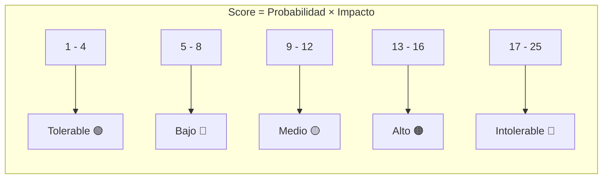
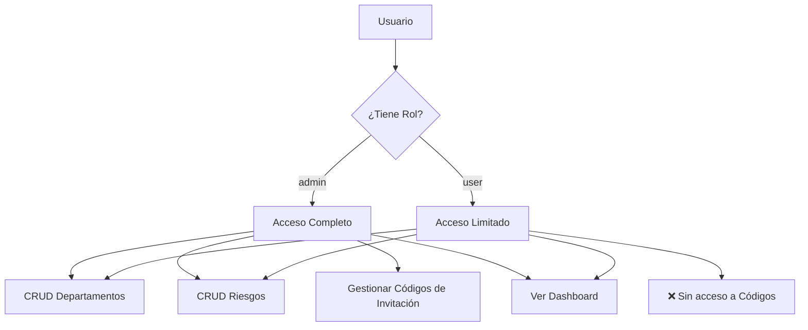

# 📐 Reglas de Negocio

## 1. Gestión de Departamentos

### Reglas

| #   | Regla         | Descripción                                                                                    |
| --- | ------------- | ---------------------------------------------------------------------------------------------- |
| D1  | Creación      | Un departamento requiere un **nombre obligatorio** y una **descripción opcional**              |
| D2  | Propiedad     | Cada departamento registra el `created_by_id` del usuario que lo creó                          |
| D3  | Edición       | Solo el nombre y la descripción son editables                                                  |
| D4  | Contador      | Cada departamento mantiene un `area_count` (inicializado en 0)                                 |
| D5  | Relación      | Un departamento puede tener **muchos riesgos** asociados (relación 1:N)                        |
| D6  | Visualización | En la lista de departamentos se muestra: nombre, descripción, total de riesgos y riesgos altos |

---

## 2. Gestión de Riesgos

### Reglas Generales

| #   | Regla               | Descripción                                                               |
| --- | ------------------- | ------------------------------------------------------------------------- |
| R1  | Campos obligatorios | `department_id`, `threat_type` y `description` son requeridos             |
| R2  | Tipo de amenaza     | Se clasifica como **Interna** o **Externa**                               |
| R3  | Propiedad           | Cada riesgo registra el `created_by_id` del usuario creador               |
| R4  | Edición             | Se puede editar cualquier campo del riesgo                                |
| R5  | Eliminación         | Se pueden eliminar riesgos individualmente o en lote (selección múltiple) |

> **Fase 1 (Perspectivas):** R1 cambia para riesgos nuevos: la **perspectiva** (`perspective_key`) es obligatoria y el `department_id` es opcional (`NULL` si no se elige). Al editar un riesgo existente la perspectiva es opcional (aviso, no bloqueo) y el departamento se conserva tal cual.

### Perspectivas (Fase 1)

| #   | Regla                    | Descripción                                                                                                                                                                                                                                                                                                                 |
| --- | ------------------------ | --------------------------------------------------------------------------------------------------------------------------------------------------------------------------------------------------------------------------------------------------------------------------------------------------------------------------- |
| P1  | Perspectiva de un riesgo | `risks.perspective_key` ∈ {financiera, cliente, competitiva, procesos, equipo} o `NULL` (= "Sin asignar"). Son 5 perspectivas (Finanzas, Clientes, Competitividad, Procesos, Equipo y talento) desde el 20-oct-2026, cuando "Procesos y competitividad" (clave `competitiva`, conservada) se dividió en Competitividad y la clave nueva `procesos`. Los nombres, ayudas y ejemplos salen siempre de `src/config/perspectives.js` (mismos que el Mapa estratégico). En el motor estratégico, `perspectiveFor` (`src/config/strategicCalc.js`) reparte por clave explícita: a `competitiva` van alianzas, clientes_clave, comunidad, socios_estrategicos, proveedores_clave, info_mercado, info_competencia, patentes, ciclo_comercial y `fin:ventas_area_comercial`; a `procesos` van info_interna, software, ia y mejora_continua; el resto conserva el fallback por grupo.                                                                                                           |
| P2  | Banner de migración      | Visible en Dashboard, Perspectivas y Matriz de Riesgos mientras haya ≥ 1 riesgo del usuario sin perspectiva. No se puede descartar; desaparece solo cuando todos tienen perspectiva. El asistente sigue accesible desde el pie de Perspectivas.                                                                               |
| P3  | Sin puntaje              | Riesgo con `inherent_score IS NULL` (probabilidad o impacto vacíos o no reconocidos). Se muestra "Sin puntaje", nunca es crítico, va al final al ordenar por puntaje y cuenta en la tarjeta "Sin puntaje" del Dashboard. Se corrige editando el riesgo.                                                                       |
| P4  | Crítico (Fase 1)         | Puntaje inherente ≥ 13 (Alto o Intolerable). Todo contador nuevo de críticos muestra la aclaración "sin contar lo que ya haces para controlarlo". Los bloques antiguos del Dashboard siguen contando por nivel residual (unificar: Fase 2).                                                                                   |
| P5  | Aviso de planeación      | En `AddRisk`, en vivo, si el puntaje inherente es crítico se informa que el riesgo pasará a la planeación estratégica. Solo informa; en Fase 1 no se escribe nada en Planeación Estratégica.                                                                                                                                 |
| P6  | Asistente — Asignar      | Primero `Department.setPerspective(deptId, key)`, luego `Risk.assignPerspectiveByDepartment(deptId, key)` (solo riesgos del departamento con `perspective_key IS NULL`; nunca pisa una asignación manual). Si falla el segundo paso, la fila sigue pendiente con la sugerencia guardada y se puede reintentar sin efectos dobles. |
| P7  | Asistente — Deshacer     | Primero `Risk.undoPerspectiveByDepartment(deptId, key)` (quita la clave a TODOS los riesgos del departamento que estén en esa perspectiva, incluidos los asignados a mano en la misma), luego `Department.setPerspective(deptId, null)`. El estado "listo" se deriva de la BD, así que sobrevive a recargas.                      |
| P8  | Sugerencia               | `departments.perspective_key` válido, si no la heurística por nombre (`suggestPerspectiveForDepartment`). Sin sugerencia → ningún chip preseleccionado y Asignar deshabilitado ("Administración", "Dirección General", "Gerencia", "Dirección", "Gestión"). Nunca se propone "Procesos" ni "Competitividad" por defecto; "Innovación", "I+D", "Desarrollo de negocios", "Certificaciones" → `competitiva`; "Operaciones", "Producción", "TI", "Calidad", "Compras", "Logística", "Legal" → `procesos`; "Desarrollo" solo es ambiguo → sin sugerencia.           |
| P9  | Riesgos sueltos          | Sin perspectiva y sin departamento (o con un `department_id` que ya no existe para el usuario). Cuentan en el banner, se asignan uno por uno en el asistente (`Risk.setPerspective`), aparecen con el filtro "Sin asignar" y en la fila "Sin asignar" del Dashboard. Donde iría el departamento se muestra "Sin departamento".   |
| P10 | Excel                    | Conserva todas las columnas actuales en su orden y agrega "Perspectiva" (primera; "Sin asignar" si no tiene) y "Puntaje inherente" (número o "Sin puntaje").                                                                                                                                                                 |
| P11 | Privacidad               | Ninguna consulta nueva: todo pasa por `entities.js` sobre tablas con RLS solo-dueño.                                                                                                                                                                                                                                       |

### Evaluación de Riesgo Inherente

El riesgo inherente es la evaluación **sin considerar controles o mitigaciones**. Se calcula multiplicando la probabilidad por el impacto.

#### Escala de Probabilidad (5 niveles)

| Nivel | Etiqueta   | Valor | Rango   |
| ----- | ---------- | ----- | ------- |
| 1     | Remoto     | 1     | 0-20%   |
| 2     | Improbable | 2     | 21-40%  |
| 3     | Ocasional  | 3     | 41-60%  |
| 4     | Probable   | 4     | 61-80%  |
| 5     | Frecuente  | 5     | 81-100% |

#### Escala de Impacto (5 niveles)

| Nivel | Etiqueta       | Valor |
| ----- | -------------- | ----- |
| 1     | Insignificante | 1     |
| 2     | Menor          | 2     |
| 3     | Crítico        | 3     |
| 4     | Mayor          | 4     |
| 5     | Catastrófico   | 5     |

### Cálculo del Nivel de Riesgo

El nivel se calcula como: **Nivel = Probabilidad × Impacto**



| Rango de Score | Nivel           | Color      |
| -------------- | --------------- | ---------- |
| 1 – 4          | **Tolerable**   | 🟢 Verde   |
| 5 – 8          | **Bajo**        | 🔵 Azul    |
| 9 – 12         | **Medio**       | 🟡 Ámbar   |
| 13 – 16        | **Alto**        | 🟠 Naranja |
| 17 – 25        | **Intolerable** | 🔴 Rojo    |

### Matriz de Riesgo (Probabilidad × Impacto)

```
                    IMPACTO
              1    2    3    4    5
         ┌────┬────┬────┬────┬────┐
    5    │  5 │ 10 │ 15 │ 20 │ 25 │  Frecuente
P   4    │  4 │  8 │ 12 │ 16 │ 20 │  Probable
R   3    │  3 │  6 │  9 │ 12 │ 15 │  Ocasional
O   2    │  2 │  4 │  6 │  8 │ 10 │  Improbable
B   1    │  1 │  2 │  3 │  4 │  5 │  Remoto
         └────┴────┴────┴────┴────┘
              Ins  Men  Crí  May  Cat
```

### Estrategias de Manejo

| Estrategia     | Descripción                                                               |
| -------------- | ------------------------------------------------------------------------- |
| **Aceptar**    | Se acepta el riesgo tal cual está. No se implementan acciones adicionales |
| **Reducir**    | Se implementan medidas para disminuir la probabilidad y/o el impacto      |
| **Transferir** | Se transfiere el riesgo a un tercero (seguro, outsourcing, etc.)          |

### Medidas de Mitigación

| #   | Regla            | Descripción                                                                       |
| --- | ---------------- | --------------------------------------------------------------------------------- |
| M1  | Cantidad         | Se pueden registrar hasta **3 medidas de mitigación** por riesgo                  |
| M2  | Estructura       | Cada medida tiene una **descripción** y un **tipo de impacto**                    |
| M3  | Tipos de impacto | `Mitiga la probabilidad`, `Mitiga el impacto`, `Mitiga la probabilidad e impacto` |
| M4  | Opcionalidad     | Las medidas de mitigación son opcionales                                          |

### Evaluación de Riesgo Residual

| #   | Regla      | Descripción                                                                    |
| --- | ---------- | ------------------------------------------------------------------------------ |
| RR1 | Definición | Es la evaluación del riesgo **después** de aplicar las medidas de mitigación   |
| RR2 | Cálculo    | Se utiliza la misma fórmula y escalas que el riesgo inherente                  |
| RR3 | Manual     | El usuario debe seleccionar manualmente la probabilidad y el impacto residual  |
| RR4 | Nivel      | Se calcula automáticamente al seleccionar probabilidad e impacto               |
| RR5 | Prioridad  | El nivel residual tiene prioridad sobre el inherente en el dashboard y filtros |

---

## 3. Dashboard y Reportes

### Estadísticas del Dashboard

| Métrica                   | Cálculo                                                                |
| ------------------------- | ---------------------------------------------------------------------- |
| **Departamentos activos** | Conteo total de departamentos                                          |
| **Riesgos totales**       | Conteo total de riesgos                                                |
| **Riesgos altos**         | Riesgos con `residual_level` = Alto o Intolerable                      |
| **Riesgos bajos**         | Riesgos con nivel = Bajo o Tolerable                                   |
| **Distribución**          | Agrupación por nivel de riesgo (residual → inherente → sin clasificar) |

> **Nota:** Para el conteo de "Riesgos Altos" del dashboard, solo se usa el **nivel residual** (no el inherente). Esto refleja el riesgo real después de las mitigaciones.

### Exportación a Excel

| #   | Regla    | Descripción                                                                                                                                    |
| --- | -------- | ---------------------------------------------------------------------------------------------------------------------------------------------- |
| E1  | Formato  | Se exporta en formato `.xlsx`                                                                                                                  |
| E2  | Nombre   | `matriz_riesgos_YYYY-MM-DD.xlsx`                                                                                                               |
| E3  | Datos    | Incluye todos los riesgos filtrados con todas sus columnas                                                                                     |
| E4  | Columnas | Departamento, Tipo amenaza, Descripción, Prob/Impacto/Nivel inherente, Estrategia, Mitigantes 1-3, Prob/Impacto/Nivel residual, Fecha creación |
| E5  | Fase 1   | Se agregan "Perspectiva" (primera columna; "Sin asignar" si no tiene) y "Puntaje inherente" (número o "Sin puntaje"); el resto de columnas no cambia (ver regla P10)                                      |

---

## 4. Control de Acceso



| Funcionalidad                     | Admin | User |
| --------------------------------- | ----- | ---- |
| Dashboard                         | ✅    | ✅   |
| Ver departamentos                 | ✅    | ✅   |
| Crear/Editar departamentos        | ✅    | ✅   |
| Ver/Crear/Editar/Eliminar riesgos | ✅    | ✅   |
| Exportar a Excel                  | ✅    | ✅   |
| Gestionar códigos de invitación   | ✅    | ❌   |

---

## 5. Códigos de Invitación

| #    | Regla           | Descripción                                                            |
| ---- | --------------- | ---------------------------------------------------------------------- |
| CI1  | Propósito       | Los códigos son necesarios para que nuevos usuarios puedan registrarse |
| CI2  | Formato         | Código alfanumérico de 12 caracteres formateado como `XXXX-XXXX-XXXX`  |
| CI3  | Caracteres      | Se excluyen `O`, `0`, `I`, `1` para evitar confusión visual            |
| CI4  | Unicidad        | Cada código es único en la base de datos                               |
| CI5  | Uso único       | Un código solo puede ser usado una vez                                 |
| CI6  | Expiración      | Un código puede tener fecha de expiración (opcional)                   |
| CI7  | Email vinculado | Un código puede vincularse a un email específico (opcional)            |
| CI8  | Validación      | Se valida: existencia, no usado, no expirado, email coincidente        |
| CI9  | Creación        | Solo administradores pueden crear y gestionar códigos                  |
| CI10 | Notas           | Se pueden agregar notas al código (ej: "Cliente pagó plan mensual")    |

---

## 6. Riesgos críticos en la planeación (Fase 2)

Desde la Fase 2 del proyecto de perspectivas, los riesgos de la matriz con nivel **inherente** Alto o Intolerable entran en vivo a la Planeación Estratégica como objetivos de prioridad alta, con sus controles a la vista, y cada control (o una de tres plantillas por estrategia) se convierte en iniciativa con un clic. Esta tabla es la **única fuente** de esas reglas (replica el §6 de la especificación de la Fase 2); los cálculos viven en `src/config/strategicCalc.js` (funciones puras, probadas con `node scripts/check-strategicCalc.mjs`) y las plantillas en `src/config/strategicCatalog.js`.

| #    | Regla                                                                                                                                                                                                                                                                                                                                                                                                                                                                                                                                            |
| ---- | ------------------------------------------------------------------------------------------------------------------------------------------------------------------------------------------------------------------------------------------------------------------------------------------------------------------------------------------------------------------------------------------------------------------------------------------------------------------------------------------------------------------------------------------------ |
| RC1  | **Crítico** = nivel inherente Alto o Intolerable = `inherent_score >= 13` (`isCriticalKey(levelKeyOf(risk,'inherent'))`). El residual no cuenta para entrar ni para salir del plan. En pantalla siempre se dice "riesgo crítico".                                                                                                                                                                                                                                                                                                                 |
| RC2  | Todo riesgo crítico es objetivo de **prioridad alta por definición**; no se califica. Se lee en vivo (`Risk.listCritical` en cada carga); nunca se copia a `plan_answers`. Aparece en Inicio, FODA, Resumen, Mapas e Iniciativas como objetivo; **en el Score Card aparecen sus iniciativas** (como con las debilidades) y, si no tiene ninguna y no está confirmado como aceptado ("Lo tengo controlado", RC7), un chip "N riesgo(s) crítico(s) sin iniciativa" con enlace a Iniciativas.                                                                                                                      |
| RC3  | Id del objetivo `'risk:<risk.id>'`; `strategy_id` de sus iniciativas igual. Perspectiva = `perspective_key` válida o `null`.                                                                                                                                                                                                                                                                                                                                                                                                                      |
| RC4  | Fecha fin sugerida: Intolerable hoy+30, Alto hoy+60 (`RISK_DEADLINE_DAYS`); inicio = hoy; fechas 'YYYY-MM-DD' en hora local.                                                                                                                                                                                                                                                                                                                                                                                                                      |
| RC5  | Aviso **far**: `end_date − hoy > 60` (Intolerable) / `> 120` (Alto). Sin fecha o vencida: no aplica.                                                                                                                                                                                                                                                                                                                                                                                                                                              |
| RC6  | Aviso **concentration**: con ≥ 3 iniciativas de riesgo con responsable, una persona (owner normalizado) tiene > 50 %. Empates: no hay aviso. (El mínimo de 3 no está en la propuesta; evita avisar con 1 de 1 — desvío documentado abajo.)                                                                                                                                                                                                                                                                                                       |
| RC7  | **Sin plan** = objetivo **no aceptado** con 0 iniciativas con su `strategy_id` (de control, plantilla o manuales). Los controles de la matriz **no cuentan como plan** hasta convertirlos; el aviso lo dice ("tiene N control(es)… pero ninguno está en tu plan"). Los Aceptar no generan "sin plan": generan **aceptado sin confirmar** mientras no exista `('risk-objectives', riskId, 'acknowledged')`, tengan o no iniciativas. Confirmado = sin alertas (sigue en el plan y en el foco con estado "Aceptado"). El Inicio cuenta "sin plan" y "por confirmar" por separado. |
| RC8  | Aviso **no-owner**: iniciativa de riesgo con `owner` vacío; si viene de un control que en la matriz dice "Sí tiene responsable", el aviso pide escribir el nombre. Los avisos **nunca impiden guardar**. Las iniciativas de riesgos que dejaron de ser críticos no generan avisos.                                                                                                                                                                                                                                                             |
| RC9  | **Foco** (Inicio): máximo 5; riesgos primero (Intolerable → Alto → puntaje desc), luego debilidades Alta por puntaje asc. Estados: planificado / aceptado / aceptado sin confirmar / sin plan. "+N más" enlaza al mapa calibrado.                                                                                                                                                                                                                                                                                                                 |
| RC10 | **FODA**: riesgo `threat_type 'Interna'` → Debilidades; `'Externa'` o vacío → Amenazas; etiqueta "Riesgo crítico" + nivel; van antes de los items existentes. La KPI "Debilidades" del Inicio sigue contando solo debilidades calificables; el mini FODA cuenta como la pantalla FODA e indica "incl. N riesgo(s)". **KPI 4 (presupuesto), iniciativas vencidas / por vencer y la nota de calendario cuentan todas las iniciativas, incluidas las de riesgo.**                                                                                 |
| RC11 | **Sin perspectiva**: entran a Inicio, FODA, Resumen, Iniciativas y Score Card (grupo "Sin perspectiva"); en los mapas no ocupan carril: se listan en "Riesgos críticos sin perspectiva" con enlace por riesgo a `AddRisk?id=<id>` y enlace general al asistente `PerspectiveMigration`.                                                                                                                                                                                                                                                         |
| RC12 | Convertir control/plantilla es **idempotente** por `(plan_id, source_key)`; nada se escribe sin clic. `owner` nunca se precarga (desvío documentado abajo). Las plantillas se ofrecen cuando el riesgo no tiene controles y, para los riesgos Aceptar, siempre.                                                                                                                                                                                                                                                                                 |
| RC13 | No existe "ocultar/descartar" un riesgo del plan. La salida honesta es corregir probabilidad e impacto en la matriz (enlace en Resumen e Iniciativas).                                                                                                                                                                                                                                                                                                                                                                                             |
| RC14 | Usuario sin módulo de riesgos: `includeRisks false`, cero consultas a `risks`, módulo idéntico a hoy. Usuario con módulo y sin críticos: idéntico a hoy + un texto discreto en Iniciativas.                                                                                                                                                                                                                                                                                                                                                       |
| RC15 | Los datos de la planeación se cargan una vez por visita a la pantalla; el refoco de la pestaña no recarga ni muestra el esqueleto. Abrir una pantalla **no** guarda nada (sin guardado espurio).                                                                                                                                                                                                                                                                                                                                                 |

### Desvíos respecto a la propuesta aprobada

Decisiones tomadas al implementar la Fase 2 que **el dueño del producto debe confirmar** (o pedir que se cambien):

1. **Responsable no precargado.** La propuesta prometía que la iniciativa creada desde un control naciera "precargada con el responsable del control". No es posible: la matriz guarda solo **si** el control tiene responsable (`control_responsible_N` es Sí/No), no su nombre. La iniciativa nace sin responsable y la app lo pide con una pista ("En la matriz indicaste que este control sí tiene uno: escribe su nombre"); la fila del control muestra "Tiene responsable en la matriz". Seguimiento propuesto: agregar un campo "nombre del responsable" por control en la matriz (fase posterior; requiere columnas nuevas, fuera de esta fase).
2. **Mínimo de 3 iniciativas con responsable para avisar concentración** (RC6). La propuesta no fija un mínimo; sin él, la app avisaría "Ana concentra 1 de 1 iniciativas de riesgo" en cuanto se escribiera el primer responsable.
3. **Riesgo sin tipo de amenaza → Amenazas en el FODA** (RC10). La propuesta solo define Interna → Debilidades y Externa → Amenazas; el caso vacío (riesgos antiguos o importados sin `threat_type`) va a Amenazas.
4. **Score Card: muestra las iniciativas del riesgo, no el riesgo en sí** (RC2), igual que hace con las debilidades. Para que un riesgo sin plan no desaparezca de esa pantalla, se señala con el chip "N riesgo(s) crítico(s) sin iniciativa" con enlace a Iniciativas; los riesgos aceptados ya confirmados no cuentan (confirmado = sin avisos, RC7).
5. **Plantillas para riesgos Aceptar aunque tengan controles** (RC12). La propuesta ofrecía plantillas solo cuando el riesgo no tiene controles; para un riesgo crítico aceptado se ofrecen **siempre**, porque la decisión de aceptarlo exige una señal de alerta y un plan de reacción, que son dos de las tres plantillas de Aceptar.

---

## 7. Análisis Financiero — modelo MP-AFH1

El módulo **Análisis Financiero** (`fin-analysis`) captura los estados financieros anuales de la empresa (y el último periodo parcial) y calcula, sin captura adicional, el Estado de cambios en la situación financiera, el EBITDA, 41 razones financieras con semáforo, el Informe y el tablero del Inicio. Esta sección es la **única fuente** de esas reglas. Los cálculos viven en `src/config/finCalc.js` (`computeIncome`, `computeBalance`, `computeEbitda`, `computeCashflow`, `computeRatios`, `ratioStatus`, `ratioTrend`, `summarizeRatios`, `computeSegments`, `computeExpenseBreakdown`, `computeSeasonality`, `pctChange`, `periodDays`, `DAYS_BASE`, `NA_REASON`; funciones puras probadas con `node scripts/check-finCalc.mjs`, 721 comprobaciones) y los catálogos en `src/config/finConfig.js` (`INCOME_ROWS`, `INCOME_INPUT_KEYS`, `INCOME_MEMO`, `BALANCE_GROUPS`, `BALANCE_RESULT_ROW`, `ALL_BALANCE_KEYS`, `CASHFLOW_INPUTS`, `EXPENSE_CONCEPTS`, `EXPENSE_VIRTUAL`, `SEASON_MONTHS`, `RATIO_GROUPS`, `RATIO_DEFS`, `RATIO_BY_KEY`, `RATIO_STATUS_LABEL`, `formatRatio`). El servidor MCP usa los mismos módulos (ver [MCP.md](./MCP.md)). La fuente del modelo es el Excel del cliente `docs/Modelo MP-AFH1.xlsx` (hojas Edo Res, Balance, Conciliaciones, Razones Financieras, Ventas y Costo de lo vendido, Gasto, Estacionalidad en ventas, Cuadros Informe); los desvíos respecto a él van al final. Sustituye desde el 21-oct-2026 al modelo anterior (`Modelo_Simplificado_con_Tableros_Estrategicos.xlsx`: ventas por línea, costo por concepto, flujo directo y 18 razones).

Notación: `bal(k, y)` saldo de la cuenta `k` del Balance en el periodo `y`; `inc` resultado de `computeIncome` del periodo; `cf(k)` captura complementaria del Estado de cambios; `p` periodo anterior, `c` periodo actual; `AC`, `PC`, `TA`, `TP`, `TC` totales del Balance (activo circulante, pasivo circulante, total activo, total pasivo, total capital contable **incluido** el resultado del periodo); `months` meses del periodo; `dayBase = months × 30`.

### 7.1 Captura, unidades y signos

| #  | Regla |
| -- | ----- |
| F1 | **Unidad y almacenamiento.** Todas las cifras van en **miles** de la moneda del análisis. Se guardan en `fin_values (analysis_id, year_id, section, concept_key, amount)`; una fila por celda. Secciones (constantes en `finConfig.js`): `income` (Estado de Resultados y partidas que no son efectivo), `balance`, `cashflow` (capturas complementarias del Estado de cambios), `sales` y `segcost` (segmentos; `concept_key` = `fin_lines.id`), `expenses` (desglose del gasto), `seasonality` (`m01`…`m12`). Nada calculado se guarda: Estado de cambios, EBITDA, razones, Informe e Inicio se recalculan en cada carga. |
| F2 | **Signos.** En el Estado de Resultados, costos, gastos e impuestos se capturan **en positivo** y la etiqueta entre paréntesis avisa que la app los resta ("(Costo de ventas)", "(ISR)"). De las capturas del Estado de Resultados y del Estado de cambios solo llevan signo las partidas marcadas `signed` en el catálogo: `utilidad_cambiaria` y `otros_productos` del Estado de Resultados y `cambiaria_deuda_cp`, `cambiaria_deuda_lp`, `cambiaria_clientes` del Estado de cambios (utilidad en positivo, pérdida o gasto en negativo). `venta_activo_fijo` (efectivo cobrado) y `ajuste_revaluacion` van en positivo. Las **cuentas del Balance** se capturan con su **signo contable**, tal como vienen en el Balance: casi todas son positivas, pero `reservas` y `resultados_acumulados` (marcadas `signed` en `BALANCE_GROUPS`, con chip "± con signo" y pista en pantalla) van en negativo cuando son un déficit o pérdidas acumuladas; el Excel trae −31, −4 575 y −585 en Resultados acumulados y −500 en Reservas, y solo con ese signo el Balance cuadra (F14). |
| F3 | **Periodos.** `fin_years (year, months)`, ordenados por `year` ascendente; `months < 12` es un periodo parcial y se rotula `yearLabel` ("jun 2026") más "parcial". El "año anterior" de un periodo es el que lo precede en ese orden (`i − 1`), tenga 12 meses o no. El primer periodo no tiene Estado de cambios ni crecimiento. |
| F4 | **Partidas que no son efectivo.** `depreciacion` ("Depreciación y amortización"), `reserva_cxc` ("Reserva de cuentas por cobrar") y `reserva_inventarios` ("Reserva de inventarios") se capturan **una sola vez**, en el bloque memo al pie del Estado de Resultados (`INCOME_MEMO`, sección `income`). Ya están dentro del gasto operativo capturado: **no alteran** los totales del Estado de Resultados. Las leen el Estado de cambios (F16, F19, F21), el EBITDA (F10) y el Desglose del gasto (F76). |
| F5 | **Vacíos y porcentajes.** Una celda vacía o no numérica vale 0 en el motor (`toNumber` → `null` → 0). Todo porcentaje (`pct`) devuelve `null` cuando su base es ≤ 0 (ventas, total activo, total del gasto, total de meses o de segmentos) y la pantalla muestra "—"; el Excel devuelve 0 con `IFERROR`. |
| F6 | **Lo que desaparece y la migración.** Secciones eliminadas: `cost:<lineId>`, `cashflow-annex`, `cashflow-direct`; claves eliminadas: `income.otros_operacion`, `balance.caja`, `balance.inversiones`, `balance.impuesto_diferido_activo`, `balance.provisiones`, `balance.impuesto_diferido_pasivo`, `balance.resultado_periodo`. La migración (`supabase-fin-model-afh1.sql`, idempotente, en una transacción) suma `caja + inversiones → efectivo`, mueve `impuesto_diferido_activo → activos_diferidos` y `provisiones + impuesto_diferido_pasivo → pasivos_diferidos`, inserta `income.ventas` = Σ `sales`, `income.costo` = Σ `cost:*` e `income.gasto_general` = Σ `expenses` (los 20 conceptos) **+ `income.depreciacion`** cuando no existan, pasa cada `cost:<lineId>` a `segcost` con `concept_key = lineId`, y borra lo obsoleto. Solo toca filas cuya clave nueva aún no exista. La depreciación se suma al `gasto_general` migrado porque en el modelo viejo se restaba **aparte** del gasto (`resultadoOp = utilidadBruta − Σ expenses − depreciacion + otrosOp`) y en el nuevo va **dentro** del gasto operativo como partida memo (F4): así el resultado de operación migrado es el mismo y la "Diferencia" del Desglose del gasto (F76) queda en 0; con la suma pura de los 20 conceptos el resultado de operación subiría en la depreciación y el Desglose marcaría diferencia. |

### 7.2 Estado de Resultados

| #  | Regla |
| -- | ----- |
| F7 | **Filas y fórmulas** (`INCOME_ROWS`, en este orden; `input` se captura, `auto` es subtotal calculado, `total` es calculado y resaltado; bajo cada cifra va su % sobre ventas): `ventas` input "Ventas o ingresos netos" · `costo` input "(Costo de ventas)" · `utilidadBruta` total = ventas − costo · `gasto_venta` input "(Gasto de venta)" · `gasto_admin` input "(Gasto de administración)" · `gasto_general` input "(Gastos operativos en general)" · `gastoOperativo` auto "(Gasto operativo)" = gasto_venta + gasto_admin + gasto_general (va **después** de sus tres componentes; en el Excel va antes) · `resultadoOp` total "Resultado de operación" = utilidadBruta − gastoOperativo · `productos_financieros` input · `gastos_financieros` input "(Gastos financieros)" · `utilidad_cambiaria` input con signo "Utilidad (pérdida) cambiaria" (pista "Pérdidas en negativo") · `rif` auto "Resultado integral de financiamiento" = productos_financieros − gastos_financieros + utilidad_cambiaria · `otros_productos` input con signo "Otros productos (gastos)" (pista "Gastos en negativo") · `rai` total "Resultado antes de impuestos" = resultadoOp + rif + otros_productos · `isr` input "(Impuesto sobre la renta)" · `ptu` input "(PTU)" · `utilidadNeta` total "Utilidad neta" = rai − isr − ptu. Las 11 claves de captura son `INCOME_INPUT_KEYS`. |
| F8 | **`computeIncome({ sections, years })`** → `{ [yearId]: { ventas, costo, utilidadBruta, gastoVenta, gastoAdmin, gastoGeneral, gastoOperativo, resultadoOp, prodFin, gastosFin, cambiaria, rif, otrosProd, rai, isr, ptu, utilidadNeta, depreciacion, reservaCxc, reservaInventarios, pct: { [mismaClave]: valor ÷ ventas ó null } } }`, con las cifras **reales** del periodo. Ya no recibe `lines`. Esperados (Excel, 2023 / 2024 / 2025 / jun-2026): utilidadBruta 174 / 9 496 / 29 918 / 18 999; gastoOperativo 196 / 12 066 / 24 734 / 16 116; resultadoOp −22 / −2 570 / 5 184 / 2 883; rif −9 / −2 008 / −1 378 / −2 908; rai −31 / −4 544 / 3 848 / −19; utilidadNeta −31 / −4 544 / 3 490 / −19. |
| F9 | **Sin anualización.** El Estado de Resultados no muestra columna anualizada ni variación anual (el Excel tampoco). Las comparaciones anualizadas viven solo en las razones (crecimiento, ROA, ROE) y en los días (`dayBase = months × 30`). |
| F10 | **EBITDA** ("UAFIRDA / EBITDA"). `computeEbitda({ sections, years })` → `{ [yearId]: ebitda }` para **todos** los periodos: `ebitda = resultadoOp + depreciacion + amortActivosDiferidos + creacionCreditosDiferidos + reservaCxc + reservaInventarios`, donde `amortActivosDiferidos = max(bal(activos_diferidos, p) − bal(activos_diferidos, c), 0)` y `creacionCreditosDiferidos = max(bal(pasivos_diferidos, c) − bal(pasivos_diferidos, p), 0)` (ambos 0 en el primer periodo). Esperados: −22 / −2 570 / 6 394 / 3 528. Es el mismo EBITDA del Estado de cambios y de las razones; en el primer periodo el Excel usa el EBIT en su lugar (desvío 15). |

### 7.3 Balance General

| #  | Regla |
| -- | ----- |
| F11 | **Cuentas y grupos** (`BALANCE_GROUPS`, 27 cuentas capturadas en `ALL_BALANCE_KEYS`, con su total después de cada grupo): activo circulante (8: `efectivo` "Efectivo y equivalentes", `clientes`, `otras_cxc` "Otras cuentas por cobrar", `cxc_relacionadas` "Cuentas por cobrar a compañías relacionadas", `inventarios`, `pagos_anticipados`, `impuestos_recuperar` "Impuestos por recuperar", `otros_circulantes` "Otros activos circulantes"; "Total activo circulante"), activo no circulante (3: `activos_fijos`, `otros_activos`, `activos_diferidos`; "Total activo"), pasivo circulante (9: `anticipos` "Anticipos de clientes", `proveedores`, `cias_relacionadas` "Compañías relacionadas", `gastos_acumulados`, `impuestos_pagar` "Impuestos por pagar", `bancario_cp` "Pasivo bancario a corto plazo", `porcion_circulante_lp` "Porción circulante del pasivo a largo plazo", `acreedores` "Acreedores diversos", `otras_cxp` "Otras cuentas por pagar"; "Total pasivo circulante"), pasivo a largo plazo (2: `bancario_lp` "Pasivo bancario a largo plazo", `pasivos_diferidos`; "Total pasivo"), capital contable (5: `capital_social`, `aportaciones_futuras` "Aportaciones para futuros aumentos de capital", `reservas`, `revaluacion` "Revaluación de activos", `resultados_acumulados`; más la fila automática F12; "Total capital contable" y gran total "Total pasivo + capital"). |
| F12 | **Resultado del periodo automático.** `resultadoPeriodo` ("Resultado neto del periodo", `BALANCE_RESULT_ROW`) **no se captura ni se guarda**: es `utilidadNeta` del Estado de Resultados del mismo periodo y entra en `totalCapital`. Por eso el Balance exige el Estado de Resultados del periodo para cuadrar. |
| F13 | **`computeBalance({ sections, years })`** → `{ [yearId]: { activoCirculante, activoNoCirculante, totalActivo, pasivoCirculante, pasivoLargoPlazo, totalPasivo, resultadoPeriodo, totalCapital, totalPasivoCapital, diferencia, acumuladosSugerido, pct } }`. `diferencia = totalActivo − totalPasivoCapital` debe ser 0 (la pantalla marca "✓ 0" en verde; distinto, la cifra en **rojo** y un aviso rojo arriba de la tabla, "El balance no cuadra en: …": es un descuadre duro, porque sin él tampoco cuadra el Estado de cambios (F22). El ámbar con "revisa la captura" es solo de los análisis opcionales, 7.6). `pct` = cada cuenta y cada total ÷ `totalActivo` (null si TA ≤ 0), como el Excel. `acumuladosSugerido` = `resultados_acumulados` del periodo anterior + su `utilidadNeta` (null en el primero): la pantalla lo muestra como pista "Sugerido: …" bajo `resultados_acumulados`, **sin imponerlo**. |
| F14 | **Esperados** (Excel, 2023 / 2024 / 2025 / jun-2026): AC 1 180 / 18 226 / 22 140 / 50 630; TA 1 973 / 26 183 / 36 466 / 85 644; PC 1 954 / 30 708 / 29 905 / 55 247; TP 1 954 / 30 708 / 29 905 / 73 860; TC 19 / −4 525 / 6 561 / 11 784; diferencia 0 en los cuatro (con `resultados_acumulados` capturados 0, −31, −4 575, −585). |

### 7.4 Estado de cambios en la situación financiera

"(+) fuentes (−) aplicaciones": réplica de la hoja "Conciliaciones" del Excel. `computeCashflow({ sections, years })` devuelve `{ [yearId]: {…} }` **solo** para los periodos con periodo anterior (`i ≥ 1`); las 5 capturas complementarias (`CASHFLOW_INPUTS`, sección `cashflow`, solo en esos periodos) son `venta_activo_fijo`, `cambiaria_deuda_cp`, `cambiaria_deuda_lp`, `cambiaria_clientes` y `ajuste_revaluacion` (signos en F2). Un activo que baja y un pasivo que sube son fuentes; al revés, aplicaciones.

| #  | Bloque | Fórmulas (campo del resultado) |
| -- | ------ | ------------------------------ |
| F15 | EBITDA | `depreciacion = inc.depreciacion`; `amortActivosDiferidos`, `creacionCreditosDiferidos` como en F10; `depAmort = depreciacion + amortActivosDiferidos + creacionCreditosDiferidos`; `reservas = inc.reservaCxc + inc.reservaInventarios`; `ebitda = inc.resultadoOp + depAmort + reservas`. |
| F16 | Capital de trabajo (`workingCapital`) | `clientes = bal(clientes,p) − inc.reservaCxc − bal(clientes,c) + cf(cambiaria_clientes)`; `inventarios = bal(inventarios,p) − inc.reservaInventarios − bal(inventarios,c)`; `proveedores = bal(proveedores,c) − bal(proveedores,p)`; `pagosAnticipados = bal(pagos_anticipados,p) − bal(pagos_anticipados,c)`; `cxcRelacionadas = bal(cxc_relacionadas,p) − bal(cxc_relacionadas,c)`; `cxpRelacionadas = bal(cias_relacionadas,c) − bal(cias_relacionadas,p)`; `anticipos = bal(anticipos,c) − bal(anticipos,p)`; `gastosAcumulados = bal(gastos_acumulados,c) − bal(gastos_acumulados,p)`. `wcTotal` = Σ de las 8 ("Inversión neta en capital de trabajo"); `flujoOperacion = ebitda + wcTotal` ("Flujo de operación"). Las reservas ya redujeron el saldo contable y el efecto cambiario en clientes no es efectivo: por eso se neutralizan. |
| F17 | Impuestos | `impRecuperar = bal(impuestos_recuperar,p) − bal(impuestos_recuperar,c)`; `impPagar = bal(impuestos_pagar,c) − bal(impuestos_pagar,p)`; `isrPtu = −(inc.isr + inc.ptu)`; `impuestos = impRecuperar + impPagar + isrPtu` ("Impuestos causados"); `flujoOperativoNetoImpuestos = flujoOperacion + impuestos`. |
| F18 | Costo integral de financiamiento pagado | `gastoFinNeto = inc.prodFin − inc.gastosFin`; `cambiarioDevengado = inc.cambiaria`; `cif = gastoFinNeto + cambiarioDevengado − cf(cambiaria_clientes) − cf(cambiaria_deuda_cp) − cf(cambiaria_deuda_lp)` (se quitan los efectos cambiarios que no fueron efectivo; se devuelven también `fxClientes`, `fxDeudaCP`, `fxDeudaLP`); `efectivoOperacion = flujoOperacion + impuestos + cif` ("Efectivo generado por la operación"). |
| F19 | Inversión | `capex = bal(activos_fijos,p) − inc.depreciacion − cf(venta_activo_fijo) + cf(ajuste_revaluacion) − bal(activos_fijos,c) + (bal(revaluacion,c) − bal(revaluacion,p))` (detalle en `capexDetalle`); `otrosActivos = bal(otros_activos,p) − bal(otros_activos,c)`; `flujoInversion = capex + otrosActivos`; `flujoNetoInversion = efectivoOperacion + flujoInversion` ("Flujo de efectivo neto de inversión"). La variación de "Revaluación de activos" entra **siempre** en el CAPEX (desvío 2). |
| F20 | Financiamiento externo (`financing`) | `porcionCirculante = −bal(porcion_circulante_lp,p)`; `deudaCP = bal(bancario_cp,c) − bal(bancario_cp,p) + cf(cambiaria_deuda_cp)`; `deudaLP = bal(porcion_circulante_lp,c) + bal(bancario_lp,c) − bal(bancario_lp,p) + cf(cambiaria_deuda_lp)`; `otrosCirculantes = bal(otros_circulantes,p) − bal(otros_circulantes,c)`; `otrasCxc = bal(otras_cxc,p) − bal(otras_cxc,c)`; `otrasCxp = bal(otras_cxp,c) − bal(otras_cxp,p)`; `acreedores = bal(acreedores,c) − bal(acreedores,p)`; `otrosIngresos = inc.otrosProd + cf(venta_activo_fijo)`; `cargosDiferidos = −max(bal(activos_diferidos,c) − bal(activos_diferidos,p), 0)`; `creditosDiferidos = min(bal(pasivos_diferidos,c) − bal(pasivos_diferidos,p), 0)`. `flujoFinExterno` = Σ de las 10. |
| F21 | Accionistas | `aportaciones = (bal(capital_social,c) + bal(aportaciones_futuras,c) − cf(ajuste_revaluacion)) − (bal(capital_social,p) + bal(aportaciones_futuras,p))`; `dividendos = (bal(reservas,c) + bal(resultados_acumulados,c)) − (bal(reservas,p) + bal(resultados_acumulados,p) + inc(p).utilidadNeta)` (negativo = reparto); `accionistas = aportaciones + dividendos` ("Aportaciones (retiros) de los accionistas"); `flujoFinanciamiento = flujoFinExterno + accionistas`. |
| F22 | Flujo del periodo y conciliación | `flujoPeriodo = flujoNetoInversion + flujoFinanciamiento` ("Flujo de efectivo del periodo"); `cajaInicial = bal(efectivo,p)`; `cajaFinal = cajaInicial + flujoPeriodo`; `cajaBalance = bal(efectivo,c)`; `diferencia = cajaFinal − cajaBalance`, que debe ser 0. Propiedad: si el Balance cuadra en ambos periodos (F13) y el resultado del periodo es la utilidad neta (F12), la diferencia es 0 automáticamente, porque cada cuenta entra una vez y depreciación, reservas, venta de activo fijo, ajuste y efectos cambiarios se cancelan. |
| F23 | Salida completa | `{ prevYearId, depreciacion, amortActivosDiferidos, creacionCreditosDiferidos, depAmort, reservaCxc, reservaInventarios, reservas, resultadoOp, ebitda, workingCapital: { clientes, inventarios, proveedores, pagosAnticipados, cxcRelacionadas, cxpRelacionadas, anticipos, gastosAcumulados }, wcTotal, flujoOperacion, impRecuperar, impPagar, isrPtu, impuestos, flujoOperativoNetoImpuestos, gastoFinNeto, cambiarioDevengado, fxClientes, fxDeudaCP, fxDeudaLP, cif, efectivoOperacion, capex, capexDetalle: { activoFijoInicial, depreciacion, ventaActivoFijo, ajusteRevaluacion, variacionRevaluacion, activoFijoFinal }, otrosActivos, flujoInversion, flujoNetoInversion, financing: { porcionCirculante, deudaCP, deudaLP, otrosCirculantes, otrasCxc, otrasCxp, acreedores, otrosIngresos, cargosDiferidos, creditosDiferidos }, flujoFinExterno, aportaciones, dividendos, accionistas, flujoFinanciamiento, flujoPeriodo, cajaInicial, cajaFinal, cajaBalance, diferencia }`. |
| F24 | Esperados (Excel, 2024 / 2025 / jun-2026) | ebitda −2 570 / 6 394 / 3 528; wcTotal 12 499 / −10 214 / 6 523; flujoOperacion 9 929 / −3 820 / 10 051; impuestos 2 139 / −90 / −836; cif −2 008 / −1 378 / −2 908; efectivoOperacion 10 060 / −5 288 / 6 307; capex −6 576 / −6 013 / −21 506; otrosActivos −588 / −1 566 / 173; flujoInversion −7 164 / −7 579 / −21 333; flujoNetoInversion 2 896 / −12 867 / −15 026; flujoFinExterno −2 651 / 5 272 / 11 777; aportaciones 0 / 7 596 / 5 242; dividendos 0 / 0 / 0; flujoFinanciamiento −2 651 / 12 868 / 17 019; flujoPeriodo 245 / 1 / 1 993; cajaInicial 48 / 293 / 294; cajaFinal 293 / 294 / 2 287; diferencia 0 / 0 / 0. |

### 7.5 Razones financieras

| #  | Regla |
| -- | ----- |
| F25 | **Alcance.** 41 indicadores en 6 grupos (`RATIO_GROUPS`, cada uno con una pregunta en lenguaje llano): `eficiencia` "Eficiencia" (¿Qué tan rápido crece y cobra tu empresa?), `flujo` "Flujo de efectivo" (¿Cuánto efectivo genera y a dónde se va?), `liquidez` "Liquidez" (¿Puedes pagar lo que debes a corto plazo?), `cobertura` "Cobertura" (¿Alcanza lo que generas para pagar el costo financiero?), `solvencia` "Solvencia" (¿Cuánto dependes de deuda?), `rentabilidad` "Rentabilidad" (¿Cuánto te queda de cada peso vendido y de lo invertido?). 25 llevan semáforo y 16 son **informativos** (`semaforo: false`): su `status` es siempre `null`, no cuentan en `summarizeRatios` (ni en `na`), la pantalla no les pinta punto ni los lista en "atención"; el bloque "Flujo de efectivo" son cifras en miles. El orden de `RATIO_DEFS` es el de la tabla F34–F74 y manda en pantalla, en el MCP y en `atencion`. Cada def: `{ key, group, label, format: 'ratio' / 'pct' / 'days' / 'miles', better, bands ó statusFrom, semaforo, formula, what, how }`. Las etiquetas son las de la hoja del Excel; para los días el Excel no da literal y se usan las de la tabla. |
| F26 | **Fuente de las cifras.** `computeRatios({ sections, years })` reutiliza `computeIncome`, `computeBalance`, `computeEbitda` y `computeCashflow`; no duplica fórmulas. **Saldos al cierre, sin promedios** (el Excel tampoco promedia). Devuelve por periodo `{ months, values, status, na, aux }` con `aux = { ventas, costo, resultadoOp, rif, gastosFin, prodFin, utilidadNeta, ebitda, activoCirculante, pasivoCirculante, totalActivo, totalPasivo, totalCapital, efectivo, clientes, inventarios, proveedores, anticipos, otras_cxc, cxc_relacionadas, cias_relacionadas, deuda_total }`. `deuda_cp = bancario_cp + porcion_circulante_lp`, `deuda_lp = bancario_lp`, `deuda_total = deuda_cp + deuda_lp`. |
| F27 | **Periodos parciales.** `dayBase = months × 30` (`periodDays(y)`; 360 en un año completo, `DAYS_BASE`); los días dividen el saldo entre `flujo ÷ dayBase`. Se anualizan **solo** el crecimiento en ventas (`ventas × 12 ÷ months`), el ROA y el ROE (`× 12 ÷ months`); todo lo demás usa las cifras reales del periodo (márgenes, coberturas y Pasivo / EBITDA no cambian con el factor en el Excel). |
| F28 | **No calculable (N/A).** Cuando no se puede calcular, `values[key] = null` y `na[key]` lleva el motivo corto (`NA_REASON`: "Sin año anterior", "Sin ventas el año anterior", "Sin ventas", "Sin costo de ventas", "Sin ventas ni costo de ventas", "Sin pasivo circulante", "Sin costo financiero neto", "Sin gastos financieros netos", "Capital contable negativo o cero", "Sin activos", "EBITDA negativo o cero", "Sin deuda con costo"), que la pantalla muestra bajo el "—". El estatus es `null` ("No aplica") salvo los **N/A con semáforo propio**: TC ≤ 0 → **rojo** en `apalancamiento`, `apalancamiento_financiero` y `roe`; EBITDA ≤ 0 → **rojo** en `pasivo_ebitda` y `pasivo_fin_ebitda`; `deuda_total ≤ 0` → **verde** en `pasivo_fin_ebitda` ("Sin deuda con costo"), y esta regla manda sobre la de EBITDA ≤ 0. Inventario 0 con costo > 0 da 0 días, no N/A. Estas excepciones se aplican en `computeRatios`, no en el catálogo. `capital_trabajo`, `ebit`, `ebitda`, `deuda_cp`, `deuda_lp` y `deuda_total` siempre se calculan. |
| F29 | **Semáforo.** `status[key] ∈ {'verde','ambar','rojo',null}`; etiquetas `RATIO_STATUS_LABEL`: Sano / Vigilar / Atender / No aplica. Las bandas viven en el catálogo (porcentajes en fracciones: 0.05, no 5) y `ratioStatus(def, value)` las evalúa: `better:'higher'` → verde si ≥ `greenMin`, ámbar si ≥ `amberMin`, si no rojo; `better:'lower'` → verde si ≤ `greenMax`, ámbar si ≤ `amberMax`, si no rojo; `better:'range'` → verde dentro de `green:[min,max]`, ámbar dentro de `amber:[min,max]`, si no rojo; devuelve `null` sin valor, sin bandas o con `statusFrom`. Son **umbrales de referencia general para PyMEs mexicanas** que el dueño del producto debe confirmar (los nuevos están en la lista de desvíos); se ajustan en un solo lugar (`RATIO_DEFS.bands`). |
| F30 | **Herencia.** `statusFrom: 'liquidez'` en `capital_trabajo`: hereda el semáforo del índice de liquidez porque es la misma información en pesos; no tiene bandas. Se resuelve después de las bandas y de los estatus forzados. |
| F31 | **Tendencia.** `ratioTrend(def, curr, prev)` → `'mejora'`, `'empeora'`, `'igual'` o `null`: `null` si falta alguno de los dos valores, si `better` es `'range'` o si no hay `better` (donde "más" no es mejor ni peor); `igual` si `abs(curr − prev) < 1e-9`; con `'higher'` mejora si sube, con `'lower'` si baja. `better` de los informativos: `higher` en ebit, ebitda, flujo_operacion, efectivo_operacion y efectivo_periodo; `lower` en dias_otras_cxc y dias_cxc_inter; `null` en dias_anticipos, dias_cxp_inter, inversion_capital_trabajo, efectivo_inversion, efectivo_fin_externo, accionistas, deuda_cp, deuda_lp y deuda_total. Se compara el último periodo con el anterior (≥ 2 periodos). |
| F32 | **Resumen.** `summarizeRatios(yearRatios)` → `{ verde, ambar, rojo, na, atencion: [{ key, status, value }] }` cuenta **solo** los indicadores con `semaforo: true` (los N/A con estatus en su color; los N/A sin estatus en `na`) y `atencion` lista primero los rojos y luego los ámbar, en el orden del catálogo. Inicio y Razones muestran hasta 3 de `atencion`. |
| F33 | **Formato.** `formatRatio(def, value)`: `null` o no finito → "—"; `ratio` → 2 decimales + " x" ("2.31 x"); `pct` → `fmtPct` ("36.2%"); `days` → entero redondeado + " días" ("42 días"); `miles` → `fmtMiles` ("29,442"). |

Indicadores (orden del catálogo). Bandas: verde / ámbar / rojo; porcentajes guardados como fracciones. "Inf." = informativo (sin semáforo).

| #  | `key` | Grupo | Fórmula | Formato | N/A (motivo) | Verde | Ámbar | Rojo |
| -- | ----- | ----- | ------- | ------- | ------------ | ----- | ----- | ---- |
| F34 | `crecimiento_ventas` | Eficiencia | (ventas × 12 ÷ months) ÷ ventas del periodo anterior − 1 | pct | sin periodo anterior → "Sin año anterior"; ventas anteriores ≤ 0 → "Sin ventas el año anterior" | ≥ 10 % | 0 – 9.9 % | < 0 |
| F35 | `dias_clientes` | Eficiencia | clientes ÷ (ventas ÷ dayBase) | días | ventas ≤ 0 → "Sin ventas" | ≤ 45 | 46 – 75 | > 75 |
| F36 | `dias_inventario` | Eficiencia | inventarios ÷ (costo ÷ dayBase) | días | costo ≤ 0 → "Sin costo de ventas" | ≤ 60 | 61 – 90 | > 90 |
| F37 | `dias_anticipos` | Eficiencia | anticipos ÷ (costo ÷ dayBase) | días | costo ≤ 0 | Inf. | | |
| F38 | `dias_proveedores` | Eficiencia | proveedores ÷ (costo ÷ dayBase) | días | costo ≤ 0 | 30 – 90 | 15 – 29 ó 91 – 120 | < 15 ó > 120 |
| F39 | `ciclo_economico` | Eficiencia | dias_clientes + dias_inventario − dias_anticipos − dias_proveedores (los N/A cuentan 0) | días | clientes e inventario ambos N/A → "Sin ventas ni costo de ventas" | ≤ 45 | 46 – 90 | > 90 |
| F40 | `dias_otras_cxc` | Eficiencia | otras_cxc ÷ (ventas ÷ dayBase) | días | ventas ≤ 0 | Inf. | | |
| F41 | `ciclo_con_ocxc` | Eficiencia | ciclo_economico + dias_otras_cxc | días | como el ciclo | ≤ 45 | 46 – 90 | > 90 |
| F42 | `dias_cxc_inter` | Eficiencia | cxc_relacionadas ÷ (ventas ÷ dayBase) | días | ventas ≤ 0 | Inf. | | |
| F43 | `dias_cxp_inter` | Eficiencia | cias_relacionadas ÷ (costo ÷ dayBase) | días | costo ≤ 0 | Inf. | | |
| F44 | `ciclo_con_inter` | Eficiencia | ciclo_con_ocxc + dias_cxc_inter − dias_cxp_inter | días | como el ciclo | ≤ 45 | 46 – 90 | > 90 |
| F45 | `ebit` | Flujo | resultadoOp ("UAFIR / EBIT") | miles | — | Inf. | | |
| F46 | `ebitda` | Flujo | `computeEbitda` ("UAFIRDA / EBITDA") | miles | — | Inf. | | |
| F47 | `inversion_capital_trabajo` | Flujo | `wcTotal` ("Inversión neta en capital de trabajo"; desvío 13) | miles | sin periodo anterior | Inf. | | |
| F48 | `flujo_operacion` | Flujo | `flujoOperacion` ("Flujo de operación"; desvío 13) | miles | sin periodo anterior | Inf. | | |
| F49 | `efectivo_operacion` | Flujo | `efectivoOperacion` | miles | sin periodo anterior | Inf. | | |
| F50 | `efectivo_inversion` | Flujo | `flujoInversion` | miles | sin periodo anterior | Inf. | | |
| F51 | `efectivo_fin_externo` | Flujo | `flujoFinExterno` (desvío 14) | miles | sin periodo anterior | Inf. | | |
| F52 | `accionistas` | Flujo | `accionistas` | miles | sin periodo anterior | Inf. | | |
| F53 | `efectivo_periodo` | Flujo | `flujoPeriodo` | miles | sin periodo anterior | Inf. | | |
| F54 | `liquidez` | Liquidez | AC ÷ PC ("Índice de liquidez") | ratio | PC ≤ 0 → "Sin pasivo circulante" | ≥ 1.5 | 1.0 – 1.49 | < 1.0 |
| F55 | `acido` | Liquidez | (AC − inventarios) ÷ PC | ratio | PC ≤ 0 | ≥ 1.0 | 0.7 – 0.99 | < 0.7 |
| F56 | `liquidez_inmediata` | Liquidez | efectivo ÷ PC | ratio | PC ≤ 0 | ≥ 0.3 | 0.1 – 0.29 | < 0.1 |
| F57 | `capital_trabajo` | Liquidez | AC − PC | miles | siempre se calcula | hereda `liquidez` (F30) | | |
| F58 | `cobertura_rif_ebit` | Cobertura | resultadoOp ÷ (−rif) | ratio | rif ≥ 0 → "Sin costo financiero neto" (sin semáforo) | ≥ 3 | 1.5 – 2.99 | < 1.5 |
| F59 | `cobertura_rif_ebitda` | Cobertura | ebitda ÷ (−rif) | ratio | ídem | ≥ 3 | 1.5 – 2.99 | < 1.5 |
| F60 | `cobertura_int_ebit` | Cobertura | resultadoOp ÷ (gastosFin − prodFin) (desvío 12) | ratio | gastosFin − prodFin ≤ 0 → "Sin gastos financieros netos" | ≥ 3 | 1.5 – 2.99 | < 1.5 |
| F61 | `cobertura_int_ebitda` | Cobertura | ebitda ÷ (gastosFin − prodFin) (desvío 12) | ratio | ídem | ≥ 3 | 1.5 – 2.99 | < 1.5 |
| F62 | `apalancamiento` | Solvencia | TP ÷ TC ("Índice de apalancamiento") | ratio | TC ≤ 0 → "Capital contable negativo o cero", **rojo** | ≤ 1.0 | 1.01 – 2.0 | > 2.0 |
| F63 | `apalancamiento_financiero` | Solvencia | deuda_total ÷ TC | ratio | TC ≤ 0 → **rojo** | ≤ 0.5 | 0.51 – 1.0 | > 1.0 |
| F64 | `capital_activo` | Solvencia | TC ÷ TA ("Capital / activo total") | pct | TA ≤ 0 → "Sin activos" | ≥ 50 % | 33 – 49.9 % | < 33 % |
| F65 | `pasivo_ebitda` | Solvencia | TP ÷ ebitda ("Pasivo total / EBITDA") | ratio | ebitda ≤ 0 → "EBITDA negativo o cero", **rojo** | ≤ 3 | 3.01 – 5 | > 5 |
| F66 | `pasivo_fin_ebitda` | Solvencia | deuda_total ÷ ebitda ("Pasivo financiero / EBITDA") | ratio | deuda_total ≤ 0 → "Sin deuda con costo", **verde** (manda); si no, ebitda ≤ 0 → **rojo** | ≤ 2 | 2.01 – 3.5 | > 3.5 |
| F67 | `deuda_cp` | Solvencia | bancario_cp + porcion_circulante_lp | miles | — | Inf. | | |
| F68 | `deuda_lp` | Solvencia | bancario_lp | miles | — | Inf. | | |
| F69 | `deuda_total` | Solvencia | deuda_cp + deuda_lp ("Total pasivos con costo") | miles | — | Inf. | | |
| F70 | `margen_bruto` | Rentabilidad | utilidadBruta ÷ ventas | pct | ventas ≤ 0 → "Sin ventas" | ≥ 30 % | 15 – 29.9 % | < 15 % |
| F71 | `margen_operativo` | Rentabilidad | resultadoOp ÷ ventas | pct | ídem | ≥ 10 % | 5 – 9.9 % | < 5 % |
| F72 | `margen_neto` | Rentabilidad | utilidadNeta ÷ ventas | pct | ídem | ≥ 5 % | 0 – 4.9 % | < 0 |
| F73 | `roa` | Rentabilidad | (utilidadNeta ÷ TA) × 12 ÷ months | pct | TA ≤ 0 → "Sin activos" | ≥ 5 % | 0 – 4.9 % | < 0 |
| F74 | `roe` | Rentabilidad | (utilidadNeta ÷ TC) × 12 ÷ months | pct | TC ≤ 0 → **rojo** | ≥ 15 % | 0 – 14.9 % | < 0 |

Esperados de control (Excel, hoja "Razones Financieras"; nuestras reglas N/A donde el Excel da un número sin sentido): 2025 → crecimiento 24.6 %, dias_clientes 34.58, dias_inventario 23.64, dias_proveedores 115.15, ciclo −57.12, liquidez 0.740, acido 0.600, cobertura_rif_ebit 3.76, cobertura_rif_ebitda 4.64, apalancamiento 4.56, apalancamiento_financiero 0.745, pasivo_ebitda 4.68, pasivo_fin_ebitda 0.764, margen_bruto 31.9 %, roa 9.6 %, roe 53.2 %; 2024 → apalancamiento, apalancamiento_financiero, roe y pasivo_ebitda N/A en **rojo** (TC −4 525, EBITDA −2 570); 2023 → pasivo_fin_ebitda N/A en **verde** (sin deuda); jun-2026 (6 meses) → crecimiento 33.4 % anualizado, dias_inventario 60.89 con `dayBase 180`, roa −0.04 % y roe −0.32 % anualizados. La lista completa está en `scripts/check-finCalc.mjs`.

### 7.6 Análisis opcionales

Los tres se comparan contra el Estado de Resultados y muestran "Total según Estado de Resultados" y "Diferencia" (✓ 0 en verde; distinto, en ámbar con "revisa la captura"). No alimentan las razones ni el Estado de cambios.

| #  | Regla |
| -- | ----- |
| F75 | **Segmentos** (hoja "Ventas y Costo de lo vendido"). Los segmentos son `fin_lines` (agregar, renombrar, eliminar; `FinLine.remove` borra sus filas de `sales` y `segcost`). `computeSegments({ sections, years, lines })` → por periodo `{ bySegment: { [lineId]: { ventas, costo, bruto, margen (bruto ÷ ventas ó null), pctVentas, pctCosto } }, totalVentas, totalCosto, totalBruto, margenTotal, ventasResultados (= inc.ventas), costoResultados (= inc.costo), difVentas (= ventasResultados − totalVentas), difCosto (= costoResultados − totalCosto) }`. Tres tablas como el Excel: composición de las ventas, costo por segmento y resultado bruto por segmento con % de margen. |
| F76 | **Desglose del gasto** (hoja "Gasto"). 20 conceptos capturables (`EXPENSE_CONCEPTS`: sueldos, prestaciones, bonos, honorarios, tecnologia, suministros, viajes, mantenimiento, marketing, capacitacion, seguros, representacion, servicios_basicos, renta "Renta / alquiler", comunicaciones, outsourcing, innovacion "I+D e innovación", logistica, legales, menores) más el bloque "Partidas virtuales": depreciación y las dos reservas en **solo lectura** desde el memo del Estado de Resultados (F4) y `amortizaciones` y `otras_virtuales` (`EXPENSE_VIRTUAL`) capturables en `expenses`. `computeExpenseBreakdown({ sections, years })` → por periodo `{ concepts, gastosOperacion (Σ 20), depreciacion, amortizaciones, reservaCxc, reservaInventarios, otrasVirtuales, total, pct: { [clave ó campo]: valor ÷ total }, gastoEnResultados (= inc.gastoOperativo), diferencia (= total − gastoEnResultados) }`. |
| F77 | **Estacionalidad** (hoja "Estacionalidad en ventas"). Claves `m01`…`m12` (`SEASON_MONTHS`, con `label`, `short`, `month`) en `seasonality`. `computeSeasonality({ sections, years })` → por periodo `{ months: [12 números], pct: [12 ó null], total, ventasResultados, diferencia (= ventasResultados − total) }`. En un periodo parcial solo se capturan los meses incluidos (`months`); los demás se muestran deshabilitados. Gráfica de barras de los meses del último periodo. |
| F78 | **Informe e Inicio.** El Informe (`FinAnalysisReport`) replica los 10 cuadros de la hoja "Cuadros Informe" y el Inicio es un tablero; ambos leen exclusivamente de `computeIncome`, `computeBalance`, `computeCashflow` y `computeRatios` (gasto operativo % = `gastoOperativo ÷ ventas`). Qué muestra cada uno y la completitud de los pasos están en [05 - Lógica del Frontend](./05-LOGICA-FRONTEND.md). |

### Desvíos respecto al Excel

Decisiones tomadas al pasar el Excel MP-AFH1 a la app, que **el dueño del producto debe confirmar** (las cuatro primeras ya se acordaron el 21-oct-2026):

1. **Signos (F2).** El Excel captura costos, gastos e impuestos en negativo y suma; la app los captura en positivo, con la etiqueta entre paréntesis, y resta. Los tres efectos cambiarios del Estado de cambios se capturan con el signo del Estado de Resultados (utilidad +) y el motor aplica el signo; en el Excel se capturan "en negativo de la utilidad". Resultado idéntico. El Balance no cambia: sus cuentas se capturan con el signo contable que traen (Reservas y Resultados acumulados en negativo con déficit o pérdidas), igual que en el Excel.
2. **Lo que se elimina (F6).** Flujo de efectivo directo, costo de ventas por concepto y el anexo de movimientos no existen en el modelo nuevo y se borran con sus datos.
3. **Partidas que no son efectivo una sola vez (F4).** El Excel las pide dos veces (hoja Gasto y Conciliaciones); aquí se capturan solo al pie del Estado de Resultados.
4. **Datos existentes (F6).** Se migra lo que coincide, se reconstruyen los datos demo y se deja fuera lo que ya no existe.
5. **Revaluación en el CAPEX (F19).** La variación de "Revaluación de activos" entra siempre en el CAPEX; el Excel solo la incluye en la segunda columna (con 0 no cambia nada).
6. **N/A en vez de números sin sentido (F28).** El Excel divide entre cero o entre capital negativo y muestra apalancamientos negativos, días infinitos o coberturas con signo invertido; la app devuelve N/A con motivo y, donde la situación es mala por definición, un estatus forzado (TC ≤ 0 rojo, EBITDA ≤ 0 rojo, sin deuda verde).
7. **Umbrales del semáforo (F29).** El Excel no tiene semáforo. Los nuevos, propuestos como referencia general: crecimiento ≥ 10 % / 0 – 10 %; liquidez inmediata ≥ 0.3 / 0.1 – 0.3; apalancamiento financiero ≤ 0.5 / 0.5 – 1; pasivo total / EBITDA ≤ 3 / 3 – 5; pasivo financiero / EBITDA ≤ 2 / 2 – 3.5; las cuatro coberturas ≥ 3 / 1.5 – 3; los tres ciclos ≤ 45 / 45 – 90. Los demás conservan las bandas del modelo anterior.
8. **Porcentajes sin base (F5).** `pct` devuelve `null` ("—") cuando la base es ≤ 0; el Excel devuelve 0 con `IFERROR`.
9. **Orden del gasto operativo (F7).** "(Gasto operativo)" va después de sus tres componentes; en el Excel va antes.
10. **Etiquetas de los días (F25).** El Excel no da un literal uniforme; se usan "Días clientes", "Días inventario", "Días anticipos de clientes", "Días proveedores", "Días otras cuentas por cobrar", "Ciclo económico + otras cuentas por cobrar", "Días cuentas por cobrar intercompañías", "Días cuentas por pagar intercompañías", "Ciclo económico con intercompañías", "Índice de apalancamiento financiero" y "Deuda con costo de largo plazo".
11. **`DAYS_BASE` (F27).** Se conserva como constante 360 (año comercial) y se agrega `periodDays(y) = months × 30`; `computeRatios` usa `months × 30` por dentro y expone `months` por periodo.
12. **Cobertura de intereses (F60, F61).** En el Excel la fila "Cobertura de intereses con EBIT" (Razones D40) divide entre `'Edo Res'!D19 + −D20` = productos financieros **+** |gastos financieros|, y la fila "con EBITDA" (D41) entre `−(D19 + D20)` = |gastos financieros| **−** productos financieros. La app usa en ambas el mismo denominador, los intereses netos `gastosFin − prodFin`. Coinciden en el ejemplo solo porque los productos financieros son 0.
13. **"Desinversión (Inversión) Capital de Trabajo" (F47, F48, cuadro 5 del Informe).** Esa fila del Excel (Razones B24 y Cuadros Informe B23) apunta a Conciliaciones!D28 = "Flujo de Operación" (9 929 en 2024), no a D27 "Inversion neta en capital de trabajo" (12 499). La app muestra `inversion_capital_trabajo` = D27 (`wcTotal`, "Inversión neta en capital de trabajo") y, solo en Razones, añade `flujo_operacion` = D28 como fila propia; el cuadro 5 del Informe muestra únicamente la inversión neta. "Efectivo generado en el periodo" no cambia (el Excel lo suma de las filas 25–28, sin la 24). Quien compare con el Excel verá 12 499 donde este dice 9 929 bajo un rótulo casi igual.
14. **Financiamiento externo de 2024 en el Informe (F51, cuadro 5).** En Cuadros Informe la celda G26 (2024) de "Efectivo generado por Financ. Externo" apunta a Conciliaciones!D71 (flujo de financiamiento total, con accionistas), mientras J26 y M26 apuntan a D64 (financiamiento externo), igual que las tres columnas de la hoja Razones. La app usa siempre D64 (`flujoFinExterno`). Coinciden en el ejemplo porque las aportaciones de 2024 son 0.
15. **EBITDA del primer periodo (F10, F46, F59, F61, F65, F66).** En la primera columna el Excel no calcula EBITDA (la fila está vacía) y, donde lo necesita, usa el EBIT (`'Edo Res'!D18`: Razones D39, D41, D47 y D48). La app calcula `computeEbitda` en todos los periodos (en el primero, resultadoOp + depreciación + reservas) y lo usa en todas las razones. Coinciden en el ejemplo porque la depreciación de 2023 es 0; con depreciación en el primer periodo, las coberturas con EBITDA y los Pasivo / EBITDA de ese periodo difieren del Excel.

---

**Navegación:**
← [01 - Resumen General](./01-RESUMEN-GENERAL.md) | [03 - Base de Datos](./03-BASE-DE-DATOS.md) →
