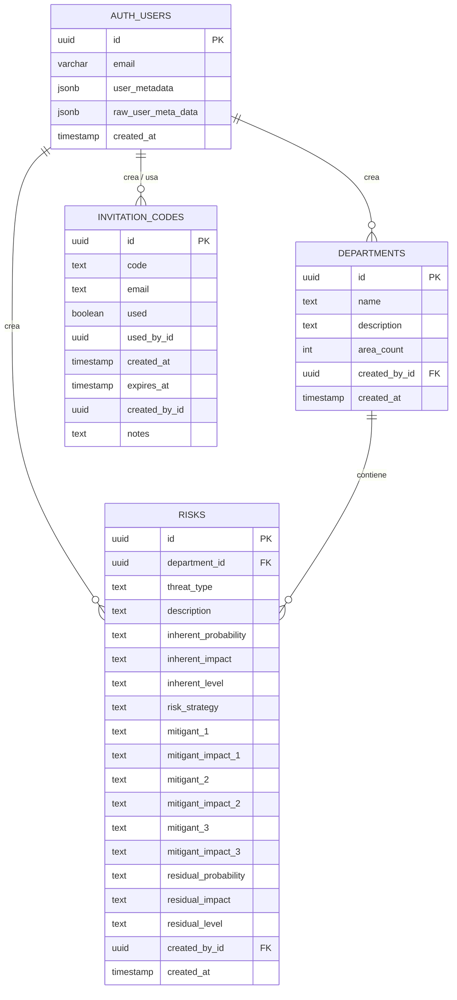
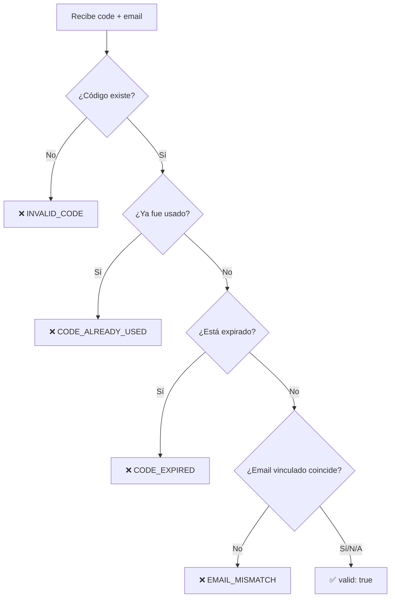

# 🗃️ Base de Datos

## Proveedor

La aplicación utiliza **Supabase** como Backend-as-a-Service (BaaS), que provee una base de datos **PostgreSQL** gestionada con las siguientes características:

- **Row Level Security (RLS)** para control de acceso a nivel de fila
- **Funciones RPC** (Remote Procedure Calls) para lógica del lado del servidor
- **Supabase Auth** integrado para autenticación de usuarios

---

## Diagrama Entidad-Relación



---

## Tablas

### 1. `departments`

Almacena los departamentos de la organización.

| Columna         | Tipo          | Restricciones     | Descripción              |
| --------------- | ------------- | ----------------- | ------------------------ |
| `id`            | `UUID`        | PK, auto-generado | Identificador único      |
| `name`          | `TEXT`        | NOT NULL          | Nombre del departamento  |
| `description`   | `TEXT`        | nullable          | Descripción de funciones |
| `area_count`    | `INTEGER`     | DEFAULT 0         | Contador de áreas        |
| `created_by_id` | `UUID`        | FK → auth.users   | ID del creador           |
| `created_at`    | `TIMESTAMPTZ` | DEFAULT NOW()     | Fecha de creación        |

### 2. `risks`

Almacena los riesgos evaluados por departamento.

| Columna                | Tipo          | Restricciones     | Descripción                                            |
| ---------------------- | ------------- | ----------------- | ------------------------------------------------------ |
| `id`                   | `UUID`        | PK, auto-generado | Identificador único                                    |
| `department_id`        | `UUID`        | FK → departments  | Departamento asociado                                  |
| `threat_type`          | `TEXT`        | —                 | `"Interna"` o `"Externa"`                              |
| `description`          | `TEXT`        | —                 | Descripción del riesgo                                 |
| `inherent_probability` | `TEXT`        | —                 | Probabilidad inherente (escala de 5 niveles)           |
| `inherent_impact`      | `TEXT`        | —                 | Impacto inherente (escala de 5 niveles)                |
| `inherent_level`       | `TEXT`        | —                 | Nivel calculado: Tolerable/Bajo/Medio/Alto/Intolerable |
| `risk_strategy`        | `TEXT`        | —                 | Estrategia: Aceptar/Reducir/Transferir                 |
| `mitigant_1`           | `TEXT`        | —                 | Descripción mitigante 1                                |
| `mitigant_impact_1`    | `TEXT`        | —                 | Tipo de mitigación 1                                   |
| `mitigant_2`           | `TEXT`        | —                 | Descripción mitigante 2                                |
| `mitigant_impact_2`    | `TEXT`        | —                 | Tipo de mitigación 2                                   |
| `mitigant_3`           | `TEXT`        | —                 | Descripción mitigante 3                                |
| `mitigant_impact_3`    | `TEXT`        | —                 | Tipo de mitigación 3                                   |
| `residual_probability` | `TEXT`        | —                 | Probabilidad residual                                  |
| `residual_impact`      | `TEXT`        | —                 | Impacto residual                                       |
| `residual_level`       | `TEXT`        | —                 | Nivel residual calculado                               |
| `created_by_id`        | `UUID`        | —                 | ID del usuario creador                                 |
| `created_at`           | `TIMESTAMPTZ` | DEFAULT NOW()     | Fecha de creación                                      |

### 3. `invitation_codes`

Almacena los códigos de invitación para registro de usuarios.

| Columna         | Tipo          | Restricciones           | Descripción                                |
| --------------- | ------------- | ----------------------- | ------------------------------------------ |
| `id`            | `UUID`        | PK, `gen_random_uuid()` | Identificador único                        |
| `code`          | `TEXT`        | NOT NULL, UNIQUE        | Código alfanumérico (ej: `ABCD-EFGH-JKLM`) |
| `email`         | `TEXT`        | nullable                | Email vinculado (opcional)                 |
| `used`          | `BOOLEAN`     | DEFAULT FALSE           | Si el código fue utilizado                 |
| `used_by_id`    | `UUID`        | nullable                | ID del usuario que usó el código           |
| `created_at`    | `TIMESTAMPTZ` | DEFAULT NOW()           | Fecha de creación                          |
| `expires_at`    | `TIMESTAMPTZ` | nullable                | Fecha de expiración (opcional)             |
| `created_by_id` | `UUID`        | nullable                | ID del admin que creó el código            |
| `notes`         | `TEXT`        | nullable                | Notas sobre el cliente/pago                |

> **Nota:** Los campos `used_by_id` y `created_by_id` en `invitation_codes` **no** tienen foreign key constraints hacia `auth.users` para evitar problemas de timing durante el registro.

#### Índices

```sql
CREATE INDEX idx_invitation_codes_code ON invitation_codes(code);
CREATE INDEX idx_invitation_codes_used ON invitation_codes(used);
CREATE INDEX idx_invitation_codes_email ON invitation_codes(email);
CREATE INDEX idx_invitation_codes_used_by_id ON invitation_codes(used_by_id);
```

---

## Funciones RPC (Stored Procedures)

### `validate_and_use_invitation_code`

Valida un código de invitación antes del registro.

```sql
validate_and_use_invitation_code(
    code_to_validate TEXT,
    user_email TEXT DEFAULT NULL
) RETURNS JSONB
```

**Flujo de validación:**



**Respuestas posibles:**

| Caso              | `valid` | `error`             | `message`                                      |
| ----------------- | ------- | ------------------- | ---------------------------------------------- |
| No existe         | `false` | `INVALID_CODE`      | "El código de invitación no existe"            |
| Ya usado          | `false` | `CODE_ALREADY_USED` | "Este código ya fue utilizado"                 |
| Expirado          | `false` | `CODE_EXPIRED`      | "Este código ha expirado"                      |
| Email no coincide | `false` | `EMAIL_MISMATCH`    | "Este código está reservado para otro usuario" |
| Válido            | `true`  | —                   | "Código válido"                                |

### `mark_invitation_code_used`

Marca un código como usado después del registro exitoso.

```sql
mark_invitation_code_used(
    code_to_mark TEXT,
    user_id UUID
) RETURNS BOOLEAN
```

Actualiza `used = true` y `used_by_id = user_id` donde el código coincida y no haya sido usado.

### `generate_random_code`

Genera un código aleatorio para invitaciones.

```sql
generate_random_code(length INT DEFAULT 12) RETURNS TEXT
```

- **Caracteres válidos:** `ABCDEFGHJKLMNPQRSTUVWXYZ23456789` (sin O, 0, I, 1)
- **Formato de salida:** `XXXX-XXXX-XXXX` (para longitud 12)

---

## Row Level Security (RLS)

### Tabla `invitation_codes`

La tabla tiene RLS habilitado con las siguientes políticas:

| Política                       | Operación | Rol             | Condición                                 |
| ------------------------------ | --------- | --------------- | ----------------------------------------- |
| Solo admins leen códigos       | `SELECT`  | `authenticated` | `user_metadata.role = 'admin'`            |
| Solo admins crean códigos      | `INSERT`  | `authenticated` | `user_metadata.role = 'admin'`            |
| Solo admins actualizan códigos | `UPDATE`  | `authenticated` | `user_metadata.role = 'admin'`            |
| Solo admins eliminan códigos   | `DELETE`  | `authenticated` | `user_metadata.role = 'admin'`            |
| Validación para registro       | `SELECT`  | `anon`          | `true` (permite validar durante registro) |

> **Importante:** La verificación del rol admin se hace en dos campos: `auth.jwt() -> 'user_metadata' ->> 'role'` **OR** `auth.jwt() -> 'raw_user_meta_data' ->> 'role'`

### Tablas `departments` y `risks`

Estas tablas usan las políticas por defecto de Supabase para usuarios autenticados (acceso completo para lectura, escritura, actualización y eliminación).

---

## Asistente de IA (`supabase-ia.sql`)

Dos tablas de apoyo para la Edge Function `ia` del asistente de IA ([IA.md](./IA.md)). Las escribe **solo la función** con `service_role`; desde la app únicamente se leen. Requiere `public.is_admin()` (`supabase-fix-role-security.sql`). El script es idempotente (`IF NOT EXISTS`, `DROP POLICY IF EXISTS`, `CREATE OR REPLACE`).

### `ia_usage` — bitácora de llamadas

Una fila por cada llamada a Claude (correcta, o fallida). Alimenta los topes de gasto y el panel «Uso de IA».

| Columna | Tipo | Restricciones | Descripción |
| --- | --- | --- | --- |
| `id` | `UUID` | PK, `gen_random_uuid()` | Identificador |
| `user_id` | `UUID` | NOT NULL | Usuario que llamó (`auth.users.id`, sin FK) |
| `action` | `TEXT` | NOT NULL | `interpretar_informe`, `extraer_estados`, `sugerir_riesgo`, `sugerir_iniciativa`, `resumen_ejecutivo` |
| `model` | `TEXT` | nullable | Modelo que respondió (p. ej. `claude-opus-5-5`) |
| `input_tokens`, `output_tokens` | `INT` | NOT NULL, DEFAULT 0 | Tokens de entrada y salida (la salida incluye el razonamiento del modelo) |
| `cache_read_tokens`, `cache_write_tokens` | `INT` | NOT NULL, DEFAULT 0 | Tokens leídos / escritos en el caché de prompts |
| `cost_usd` | `NUMERIC(10,6)` | NOT NULL, DEFAULT 0 | Costo calculado con la tabla de precios de `claude.ts` |
| `duration_ms` | `INT` | nullable | Duración de la acción |
| `ok` | `BOOLEAN` | NOT NULL, DEFAULT true | `false` si la llamada falló |
| `error_code` | `TEXT` | nullable | Código de `IaError` cuando `ok = false` |
| `created_at` | `TIMESTAMPTZ` | NOT NULL, DEFAULT now() | Fecha |

Índices: `idx_ia_usage_user_created (user_id, created_at DESC)` e `idx_ia_usage_created (created_at DESC)`.

### `ia_resultados` — resultados guardados

Uno por usuario y tipo (`UNIQUE (user_id, kind)`): la interpretación del Informe financiero y el Resumen ejecutivo, con la huella de los datos con que se generaron. Si la huella no cambia, la función devuelve el guardado sin volver a gastar.

| Columna | Tipo | Restricciones | Descripción |
| --- | --- | --- | --- |
| `id` | `UUID` | PK, `gen_random_uuid()` | Identificador |
| `user_id` | `UUID` | NOT NULL | Dueño |
| `kind` | `TEXT` | NOT NULL | `'informe'` o `'resumen_ejecutivo'` |
| `input_hash` | `TEXT` | NOT NULL | SHA-256 (hex) del JSON canónico de los datos de entrada |
| `model` | `TEXT` | nullable | Modelo que lo generó |
| `result` | `JSONB` | NOT NULL | El `result` tal como lo recibe la app |
| `cost_usd` | `NUMERIC(10,6)` | NOT NULL, DEFAULT 0 | Costo de esa generación |
| `created_at` | `TIMESTAMPTZ` | NOT NULL, DEFAULT now() | Lo fija la función en cada `upsert`; la app lo muestra como `generated_at` |

### Funciones RPC del asistente

| Función | Quién la llama | Devuelve |
| --- | --- | --- |
| `ia_usage_window(p_user UUID)` | Solo `service_role` (la Edge Function, antes de cada petición); `REVOKE` para `PUBLIC` y `authenticated` | `(user_24h_usd NUMERIC, user_24h_calls BIGINT, global_30d_usd NUMERIC)`: gasto y llamadas del usuario en las últimas 24 h y gasto global en los últimos 30 días |
| `ia_reserve(p_user UUID, p_action TEXT, p_est NUMERIC, p_daily_usd NUMERIC, p_daily_calls INT, p_monthly_usd NUMERIC)` | Solo `service_role` (la Edge Function, antes de cada llamada a Claude) | `(id UUID, motivo TEXT)`: bajo un candado por usuario compara el uso con los topes sumando el costo estimado y, si cabe, inserta la fila `en_curso` en `ia_usage` y devuelve su `id`; si no, `motivo` = `limite_diario` / `limite_global` |
| `ia_usage_by_user()` | `authenticated` (panel «Uso de IA») | Una fila por usuario con `email` y `full_name` (de `auth.users`, que la app no puede leer directamente), `calls`, `calls_30d`, `cost_usd`, `cost_30d_usd`, `last_call`, ordenadas por gasto. Su `WHERE public.is_admin()` devuelve vacío a quien no es administrador |

Ambas son `LANGUAGE sql STABLE SECURITY DEFINER` con `SET search_path = public`.

### RLS de las tablas de IA

| Tabla | Política | Operación | Rol | Condición |
| --- | --- | --- | --- | --- |
| `ia_usage` | `read own ia usage` | `SELECT` | `authenticated` | `user_id = auth.uid()` |
| `ia_usage` | `admin read all ia usage` | `SELECT` | `authenticated` | `(SELECT public.is_admin())` |
| `ia_resultados` | `read own ia results` | `SELECT` | `authenticated` | `user_id = auth.uid()` |

No hay políticas de `INSERT` / `UPDATE` / `DELETE` para `authenticated`: solo escribe `service_role` (la Edge Function). Los administradores leen toda la bitácora pero **no** los resultados guardados de otros usuarios.

---

## Scripts SQL del Proyecto

| Archivo                             | Propósito                                                                       |
| ----------------------------------- | ------------------------------------------------------------------------------- |
| `supabase-invitation-codes.sql`     | Crear tabla `invitation_codes`, índices, políticas RLS iniciales, funciones RPC |
| `supabase-admin-rls-policies.sql`   | Actualizar políticas RLS para restringir acceso solo a admins                   |
| `supabase-fix-invitation-codes.sql` | Eliminar foreign key constraints problemáticos                                  |
| `supabase-ia.sql`                   | Tablas `ia_usage` e `ia_resultados`, RPC `ia_reserve` / `ia_usage_window` / `ia_usage_by_user` y RLS del asistente de IA (ver [IA.md](./IA.md)) |

---

**Navegación:**
← [02 - Reglas de Negocio](./02-REGLAS-DE-NEGOCIO.md) | [04 - Autenticación y Seguridad](./04-AUTENTICACION-Y-SEGURIDAD.md) →
