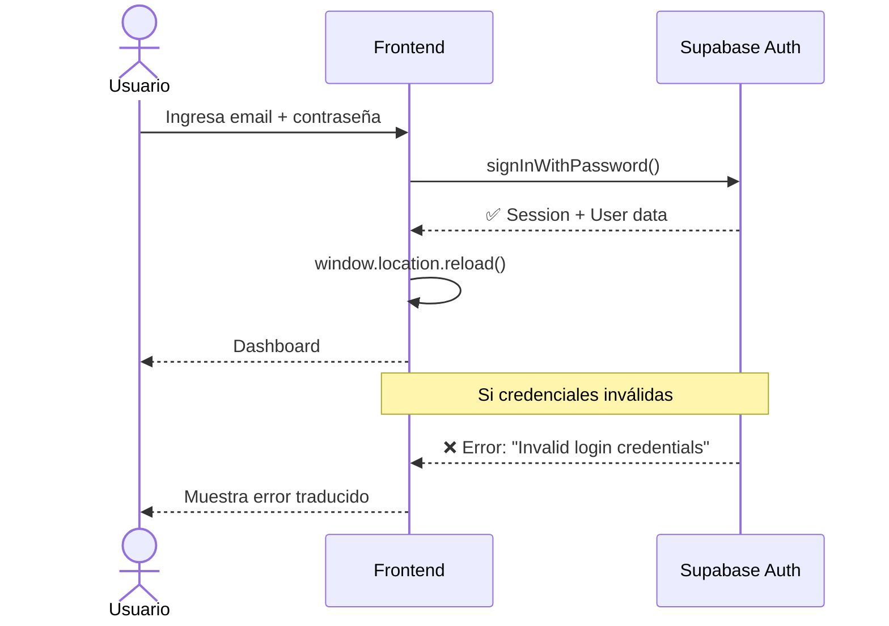
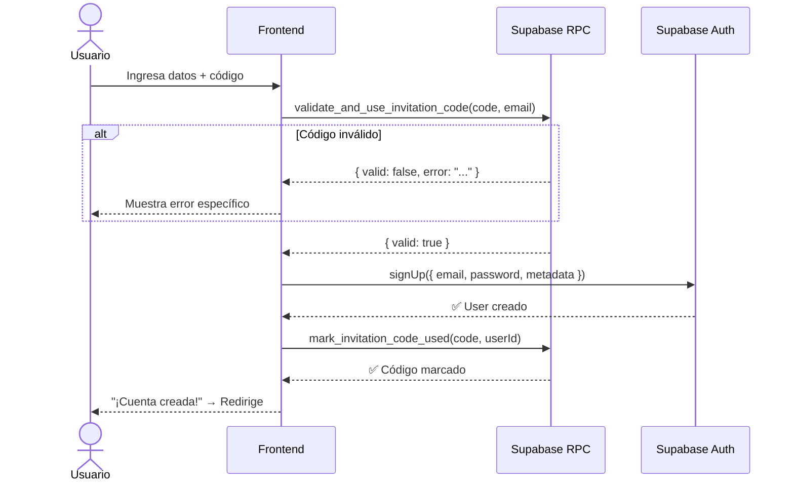
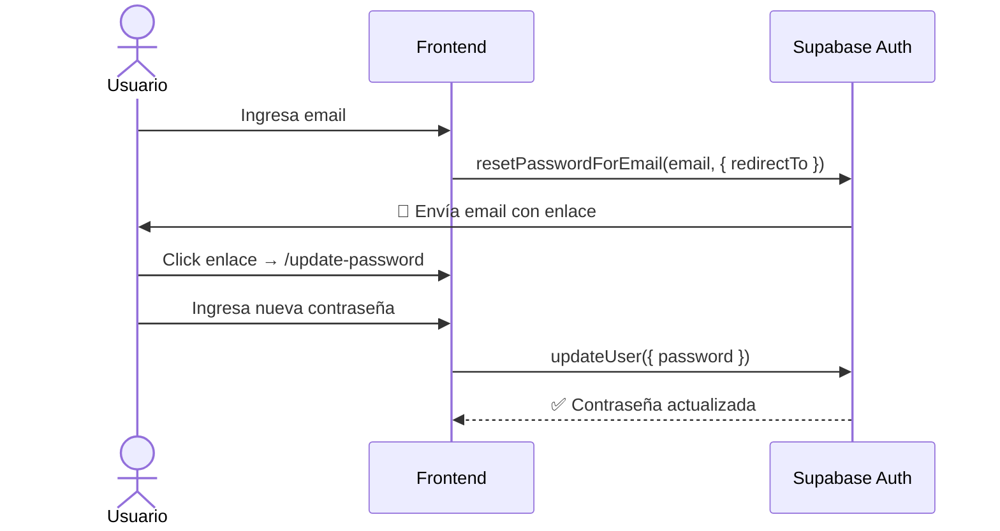
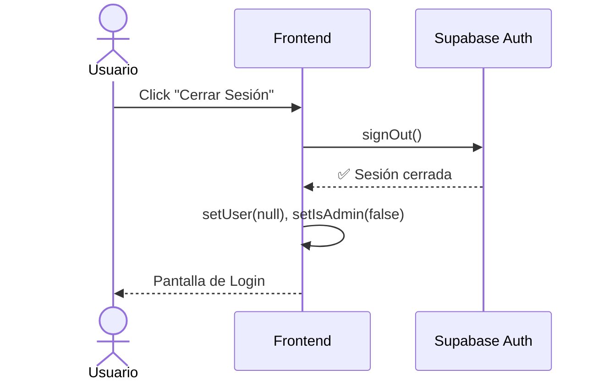
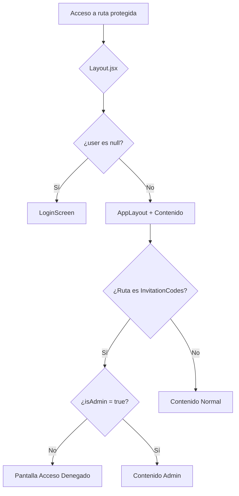

# 🔐 Autenticación y Seguridad

## Proveedor de Autenticación

La autenticación se gestiona a través de **Supabase Auth**, que proporciona:

- Autenticación por **email + contraseña**
- Gestión de sesiones con **JWT tokens**
- Recuperación de contraseña por email
- Metadata de usuario (`user_metadata`, `raw_user_meta_data`)

---

## Flujos de Autenticación

### 1. Login



### 2. Registro con Código de Invitación



**Metadata del usuario al registrarse:**

```javascript
options: {
    data: {
        full_name: fullName,
        role: 'user'  // Rol por defecto
    }
}
```

### 3. Recuperación de Contraseña



**URL de redirección:** `window.location.origin + '/update-password'`

### 4. Logout



---

## Sistema de Roles

### Roles Disponibles

| Rol     | Descripción                                                  |
| ------- | ------------------------------------------------------------ |
| `admin` | Acceso completo, incluyendo gestión de códigos de invitación |
| `user`  | Acceso estándar a departamentos, riesgos y dashboard         |

### ¿Dónde se almacena el rol?

El rol se almacena en la **metadata del usuario** de Supabase Auth:

```javascript
// Verificación del rol (orden de prioridad)
const role =
  currentUser?.user_metadata?.role ||
  currentUser?.raw_user_meta_data?.role ||
  "user"; // fallback

setIsAdmin(role === "admin");
```

> **Nota:** Se verifica tanto `user_metadata` como `raw_user_meta_data` porque Supabase puede almacenar esta información en diferentes ubicaciones según el flujo de autenticación.

### ¿Cómo cambiar un usuario a Admin?

Se debe actualizar directamente en la base de datos de Supabase. En el SQL Editor:

```sql
UPDATE auth.users
SET raw_user_meta_data = raw_user_meta_data || '{"role": "admin"}'::jsonb
WHERE email = 'admin@ejemplo.com';
```

---

## Protección de Rutas

### Rutas Públicas (sin autenticación)

| Ruta               | Componente       | Descripción                 |
| ------------------ | ---------------- | --------------------------- |
| `/register`        | `Register`       | Formulario de registro      |
| `/forgot-password` | `ForgotPassword` | Recuperación de contraseña  |
| `/update-password` | `UpdatePassword` | Actualización de contraseña |

### Rutas Protegidas (requieren autenticación)

| Ruta                 | Componente          | Admin requerido |
| -------------------- | ------------------- | --------------- |
| `/`                  | `Dashboard`         | No              |
| `/Dashboard`         | `Dashboard`         | No              |
| `/Departments`       | `Departments`       | No              |
| `/AddDepartment`     | `AddDepartment`     | No              |
| `/AddRisk`           | `AddRisk`           | No              |
| `/DepartmentRisks`   | `DepartmentRisks`   | No              |
| `/AllRisks`          | `AllRisks`          | No              |
| `/InvitationCodes`   | `InvitationCodes`   | **Sí**          |
| `/AddInvitationCode` | `AddInvitationCode` | **Sí**          |
| `/ExecutiveSummary`  | `ExecutiveSummary`  | No (resumen ejecutivo con IA; ver [IA.md](./IA.md)) |
| `/IaUsage`           | `IaUsageAdmin`      | **Sí** (panel «Uso de IA») |

### Mecanismo de Protección

La protección se implementa en `Layout.jsx`:

1. **Sin usuario autenticado** → Se muestra `LoginScreen` en lugar del contenido
2. **Con usuario autenticado** → Se muestra `AppLayout` con sidebar y contenido
3. **Verificación admin** → `InvitationCodes` verifica internamente si el usuario es admin y muestra "Acceso Denegado" si no lo es



---

## Listener de Estado de Autenticación

El `Layout.jsx` mantiene un listener activo que detecta cambios en el estado de la sesión:

```javascript
const { data: authListener } = supabase.auth.onAuthStateChange(
  (event, session) => {
    if (event === "SIGNED_OUT" || (event === "TOKEN_REFRESHED" && !session)) {
      setUser(null); // Sesión expirada o cerrada
      setIsAdmin(false);
    } else if (event === "SIGNED_IN" && session) {
      loadUser(); // Nueva sesión
    } else if (!session) {
      setUser(null); // Sin sesión
      setIsAdmin(false);
    }
  },
);
```

Esto asegura que la aplicación reaccione automáticamente cuando:

- La sesión expira
- El usuario cierra sesión en otra pestaña
- El token se refresca exitosamente o falla

---

## Seguridad a Nivel de Base de Datos

Además de la protección en el frontend, la base de datos tiene **Row Level Security (RLS)** en la tabla `invitation_codes`, lo que garantiza que:

- Solo usuarios con rol `admin` pueden leer, crear, actualizar o eliminar códigos
- Usuarios anónimos pueden validar códigos durante el registro (a través de la función RPC `validate_and_use_invitation_code` con `SECURITY DEFINER`)

> Ver detalles completos de RLS en [03 - Base de Datos](./03-BASE-DE-DATOS.md)

## Edge Function `ia` (asistente de IA): JWT, RLS y secretos

El asistente de IA ([IA.md](./IA.md)) añade una pieza del lado del servidor que también debe respetar "cada quien ve solo lo suyo". Cómo lo consigue:

```mermaid
sequenceDiagram
    participant App as Frontend (supabase-js)
    participant F as Edge Function ia
    participant SA as Supabase Auth
    participant DB as PostgreSQL (RLS)
    participant C as API de Claude

    App->>F: POST /functions/v1/ia { action, … }<br/>Authorization: Bearer JWT del usuario
    F->>SA: auth.getUser(token)
    SA-->>F: user (role = authenticated) — si no, 401 sin_sesion
    F->>DB: is_admin(), user_module_access (con el token del usuario)
    F->>DB: ia_reserve(user, acción, estimado) con service_role → reserva o 429
    F->>DB: contexto: fin_*, risks, strategic_* (con el token del usuario → RLS "solo el dueño")
    F->>C: prompt + JSON Schema (ANTHROPIC_API_KEY, solo en el servidor)
    C-->>F: JSON
    F->>DB: INSERT ia_usage; upsert ia_resultados (service_role)
    F-->>App: { ok, result, usage, cached, generated_at }
```

1. **Verificación del token.** `supabase.functions.invoke` manda el `access_token` de la sesión como bearer. La función lo verifica **contra el servidor de Auth** (`auth.getUser(token)`) y exige `role = 'authenticated'`; sin token válido responde `401 sin_sesion`. Por eso `supabase/config.toml` declara `[functions.ia] verify_jwt = false`: igual que el servidor MCP, la función verifica por sí misma (el gateway rechazaría los tokens HS256 del proyecto; ver la nota técnica en [MCP.md](./MCP.md)) y además debe poder responder el preflight CORS, que llega sin token.
2. **RLS del usuario.** Con ese mismo token crea el cliente de datos: toda lectura de contexto (análisis financiero, riesgos, plan estratégico) pasa por las políticas "solo el dueño" de cada tabla. Un administrador tampoco ve datos de otros a través de la IA.
3. **Acceso por módulo.** Antes de ejecutar, comprueba `is_admin()` y `user_module_access` con el cliente del usuario y el módulo que exige la acción (`sin_acceso`, 403). Una cuenta sin módulos solo puede llamar a la acción `estado`.
4. **`service_role` acotado.** El cliente con `SUPABASE_SERVICE_ROLE_KEY` se usa solo para las RPC `ia_reserve` / `ia_usage_window` (topes), para completar o borrar la fila reservada en `ia_usage` y la lectura / `upsert` en `ia_resultados` **del usuario que llama**; nunca para leer datos de negocio. Desde la app esas dos tablas solo se leen (RLS: lo propio; el administrador, toda la bitácora).
5. **La llave como secreto.** `ANTHROPIC_API_KEY` (y los opcionales `IA_MODEL`, `IA_DAILY_USD`, `IA_DAILY_CALLS`, `IA_MONTHLY_USD`) viven en Supabase → Edge Functions → Secrets (`npx supabase secrets set …`). El navegador nunca los recibe ni habla con la API de Claude; si la llave falta o es inválida, la función responde `no_configurado` (503) y la app lo muestra como aviso informativo.
6. **Topes.** 2 USD y 40 llamadas por usuario en 24 h, 150 USD globales en 30 días (`limite_diario` / `limite_global`, 429), para que una sola cuenta no pueda disparar el gasto. La reserva es atómica (candado por usuario en la RPC), así que varias peticiones en paralelo tampoco rebasan el tope; la lectura de PDF además rechaza entradas de más de 60 000 tokens.

Rutas nuevas: `/ExecutiveSummary` (protegida; cualquier usuario con al menos un módulo; se muestra sin menú de módulo) y `/IaUsage` (página del módulo de administración: solo los admins la ven en el menú y `ia_usage_by_user` devuelve vacío a los demás).

---

---

**Navegación:**
← [03 - Base de Datos](./03-BASE-DE-DATOS.md) | [05 - Lógica del Frontend](./05-LOGICA-FRONTEND.md) →
