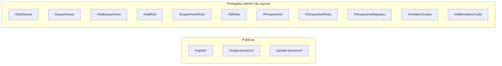
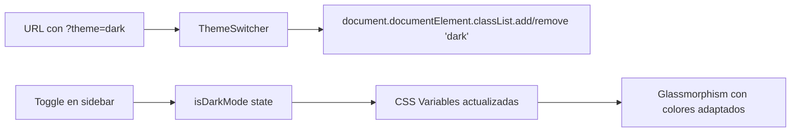

# ⚛️ Lógica del Frontend

## Estructura de Páginas

La aplicación sigue un patrón SPA (Single Page Application) con React Router para la navegación.



---

## Componentes Principales

### `Layout.jsx` — Layout Principal

**Responsabilidades:**

- Gestión del estado de autenticación (login/logout)
- Renderizado condicional: `LoginScreen` vs `AppLayout`
- Sidebar con navegación, perfil de usuario, tema y lenguaje
- Responsive: sidebar colapsable en móvil
- CSS Variables dinámicas para temas (light/dark)

**Estado interno:**

| Estado          | Tipo        | Propósito                          |
| --------------- | ----------- | ---------------------------------- |
| `user`          | Object/null | Datos del usuario autenticado      |
| `isAdmin`       | Boolean     | Si el usuario tiene rol admin      |
| `loading`       | Boolean     | Estado de carga de autenticación   |
| `loginEmail`    | String      | Email del formulario de login      |
| `loginPassword` | String      | Contraseña del formulario de login |
| `loginError`    | String      | Mensaje de error de login          |
| `sidebarOpen`   | Boolean     | Estado del sidebar en móvil        |
| `isDarkMode`    | Boolean     | Tema oscuro activo                 |

**CSS Variables de Tema:**

```css
/* Modo Claro */
--glass-bg: rgba(255, 255, 255, 0.85) --glass-border: rgba(200, 200, 220, 0.4)
  --text-primary: #1e293b --text-muted: #64748b --accent: #7c3aed
  /* Modo Oscuro */ --glass-bg: rgba(30, 30, 60, 0.6)
  --glass-border: rgba(120, 120, 200, 0.15) --text-primary: #e2e8f0
  --text-muted: #94a3b8 --accent: #a78bfa;
```

### `Dashboard.jsx` — Panel Principal

**Datos que muestra:**

| Tarjeta                | Cálculo                                                         |
| ---------------------- | --------------------------------------------------------------- |
| Departamentos activos  | `departments.length`                                            |
| Riesgos totales        | `risks.length`                                                  |
| Riesgos altos          | Filtra por `isHighRisk(r.residual_level \|\| r.inherent_level)` |
| Riesgos bajos          | Filtra por `isLowRisk(r.residual_level \|\| r.inherent_level)`  |
| Distribución por nivel | Agrupa riesgos en 5 categorías + "Sin clasificar"               |

**Flujo de datos:**

```mermaid
sequenceDiagram
    Dashboard->>User.me(): Obtener usuario
    Dashboard->>Department.list(): Obtener departamentos
    Dashboard->>Risk.list(): Obtener riesgos
    Dashboard->>Dashboard: Calcular estadísticas
    Dashboard->>Dashboard: Renderizar tarjetas + tabla
```

### `AddRisk.jsx` — Formulario de Riesgo

**Campos del formulario:**

| Sección          | Campo                       | Tipo                                | Requerido |
| ---------------- | --------------------------- | ----------------------------------- | --------- |
| General          | Departamento                | Select                              | ✅        |
| General          | Tipo de amenaza             | Select (Interna/Externa)            | ✅        |
| General          | Descripción                 | Textarea                            | ✅        |
| Riesgo Inherente | Probabilidad                | Select (5 niveles)                  | ❌        |
| Riesgo Inherente | Impacto                     | Select (5 niveles)                  | ❌        |
| Riesgo Inherente | Nivel                       | Calculado automático                | —         |
| Manejo           | Estrategia                  | Select (Aceptar/Reducir/Transferir) | ❌        |
| Mitigantes       | Mitigante 1-3 (descripción) | Input                               | ❌        |
| Mitigantes       | Impacto Mitigante 1-3       | Select                              | ❌        |
| Riesgo Residual  | Probabilidad                | Select (5 niveles)                  | ❌        |
| Riesgo Residual  | Impacto                     | Select (5 niveles)                  | ❌        |
| Riesgo Residual  | Nivel                       | Calculado automático                | —         |

**Lógica de cálculo de nivel:**

```javascript
const calculateRiskLevel = (probability, impact) => {
  const scores = {
    "Remoto (0-20%)": 1,
    "Improbable (21-40%)": 2,
    "Ocasional (41-60%)": 3,
    "Probable (61-80%)": 4,
    "Frecuente (81-100%)": 5,
  };
  const impactScores = {
    Insignificante: 1,
    Menor: 2,
    Crítico: 3,
    Mayor: 4,
    Catastrófico: 5,
  };

  const score = scores[probability] * impactScores[impact];

  if (score >= 17) return "Intolerable";
  if (score >= 13) return "Alto";
  if (score >= 9) return "Medio";
  if (score >= 5) return "Bajo";
  return "Tolerable";
};
```

### `AllRisks.jsx` — Matriz Completa

**Funcionalidades:**

| Funcionalidad              | Implementación                                      |
| -------------------------- | --------------------------------------------------- |
| Filtro por departamento    | `Select` con todos los departamentos                |
| Filtro por nivel de riesgo | `Select` con 5 niveles                              |
| Búsqueda por texto         | `Input` filtra por `description` (case-insensitive) |
| Selección múltiple         | `Checkbox` por fila + seleccionar todos             |
| Edición                    | Botón "Editar" cuando hay 1 seleccionado            |
| Eliminación en lote        | Botón "Eliminar" cuando hay ≥1 seleccionado         |
| Exportación Excel          | Botón que genera `.xlsx` con `xlsx + file-saver`    |

**Columnas de la tabla:**

```
Departamento | Tipo Amenaza | Descripción |
Prob. Inherente | Imp. Inherente | Nivel Inherente |
Estrategia |
Mitigante 1 | Impacto 1 | Mitigante 2 | Impacto 2 | Mitigante 3 | Impacto 3 |
Prob. Residual | Imp. Residual | Nivel Residual
```

### `Departments.jsx` — Lista de Departamentos

**Información mostrada por departamento:**

| Dato             | Fuente                                                  |
| ---------------- | ------------------------------------------------------- |
| Nombre           | `department.name`                                       |
| Descripción      | `department.description`                                |
| Total de riesgos | `risks.filter(r => r.department_id === dept.id).length` |
| Riesgos altos    | `isHighRisk(r.residual_level \|\| r.inherent_level)`    |

### `DepartmentRisks.jsx` — Riesgos por Departamento

Similar a `AllRisks.jsx` pero filtrado por un departamento específico. Recibe el ID del departamento via query parameter (`?id=...`).

### Perspectivas (Fase 1): `Perspectives.jsx`, `PerspectiveRisks.jsx`, `PerspectiveMigration.jsx`

Desde la Fase 1 los riesgos se organizan en las perspectivas de `src/config/perspectives.js`; desde el 20-oct-2026 son 5 (`financiera` Finanzas, `cliente` Clientes, `competitiva` Competitividad, `procesos` Procesos, `equipo` Equipo y talento; antes `competitiva` era "Procesos y competitividad"), con el campo `risks.perspective_key` (`NULL` = "Sin asignar"). "Perspectivas" sustituye a "Departamentos" en el menú del módulo de riesgos (`src/config/modules.js`); las páginas de departamentos siguen accesibles por URL y desde el enlace "Departamentos (anterior)".

| Página | Ruta | Qué hace |
| --- | --- | --- |
| `Perspectives.jsx` | `/Perspectives` | Una tarjeta por perspectiva con total, críticos (puntaje inherente ≥ 13) y "Sin puntaje"; ayuda y 3 ejemplos del catálogo que prellenan `AddRisk?perspective=&example=`. Pie con enlace permanente al asistente y a Departamentos. |
| `PerspectiveRisks.jsx` | `/PerspectiveRisks?key=<clave>` | Lista filtrable de los riesgos de una perspectiva (búsqueda, nivel vigente, tipo, orden por puntaje o fecha); tarjetas en móvil. Clave inválida → redirige a `/Perspectives`. |
| `PerspectiveMigration.jsx` | `/PerspectiveMigration` | Asistente para convertir departamentos en perspectivas: sugerencia por heurística o por `departments.perspective_key`, Asignar (`Department.setPerspective` → `Risk.assignPerspectiveByDepartment`) y Deshacer (`Risk.undoPerspectiveByDepartment` → `Department.setPerspective(null)`); los riesgos sin departamento (o huérfanos) se asignan uno por uno con `Risk.setPerspective`. |

Piezas compartidas: helpers puros en `src/lib/perspectiveView.js` (probados con `node scripts/check-perspectiveView.mjs`) y componentes en `src/components/perspectives/` (`PerspectiveBadge`, `PerspectivePicker`, `MigrationBanner`). El banner de migración aparece en Dashboard, Perspectivas y Matriz de Riesgos mientras haya al menos un riesgo sin perspectiva. En `AddRisk` la perspectiva es obligatoria para riesgos nuevos (opcional al editar) y el departamento pasó a ser opcional; `AllRisks` suma filtro y columna de perspectiva, columna "Puntaje" y dos columnas nuevas en el Excel ("Perspectiva" y "Puntaje inherente"). Las claves i18n van en la sección `// Perspectivas (Fase 1)` de `LanguageContext.jsx`; los nombres del catálogo se muestran en español también en inglés, igual que el Mapa estratégico.

### Riesgos críticos en la planeación (Fase 2): `useStrategyInputs`, `src/components/strategy/`

Desde la Fase 2 los riesgos con nivel **inherente** Alto o Intolerable (`inherent_score >= 13`) entran en vivo al módulo estratégico como objetivos de prioridad alta (`id = 'risk:<risk.id>'`). Las seis pantallas del módulo dejan de armar sus propias consultas y cargan todo con el hook `useStrategyInputs`; después derivan los objetivos de riesgo con `riskObjectivesFrom(inputs.risks, inputs.decisions)` de `src/config/strategicCalc.js` (reglas RC1–RC15 en [02 - Reglas de Negocio](./02-REGLAS-DE-NEGOCIO.md)). Todo el módulo estratégico sigue solo en español: no se agregaron claves a `LanguageContext.jsx`.

| Pantalla | Qué agrega la Fase 2 |
| --- | --- |
| `StrategicPlanning.jsx` (Inicio) | KPI "Tu foco" cuenta riesgos críticos + debilidades Alta, con subtítulo "N sin plan · M por confirmar"; las alertas de riesgo (`summarizeRiskWarnings`) van primero y enlazan a `StrategicInitiatives#risk-<id>` / `#initiative-<id>`; "Tu foco ahora" lista hasta 5 (`focusItems`: riesgos primero, con chip de nivel y estado planificado / aceptado / aceptado sin confirmar / sin plan); el mini FODA usa `mergeFodaWithRisks` y muestra "incl. N riesgo(s)"; el botón "Continuar" dice "Planear riesgos" cuando hay riesgos sin plan y el usuario ya empezó el análisis. KPIs 1, 2 y 4, recorrido y nota de calendario no cambian de código. |
| `FodaAnalysis.jsx` | `mergeFodaWithRisks(buildFoda(...), riskObjectives)`: riesgos Interna al principio de Debilidades, Externa (o sin tipo) al principio de Amenazas, con chips "Riesgo crítico" + nivel (`RiskLevelChip`); subtítulos y tarjeta "Se llena solo" con una frase extra cuando hay riesgos. |
| `StrategicSummary.jsx` | Chip "N riesgos críticos" y sección "RIESGOS CRÍTICOS DE TU MATRIZ (N)" con una tarjeta por riesgo (`id="risk-<id>"`, `RiskObjectiveBadges`, chip propio "Prioridad alta · por su gravedad", estrategia, controles en solo lectura, enlaces "Planear sus controles →" y "Ver en la matriz →"). Las calificaciones de debilidades siguen igual, con hidratación única para no guardar al abrir. |
| `StrategicMap.jsx` (`StrategicMapBase`, sirve también a `StrategicMapCalibrated.jsx`) | Los riesgos entran como burbujas con escudo (`ShieldAlert`) y punto rojo (Intolerable) o naranja (Alto) en el carril de su perspectiva; tercer párrafo en "cómo leerlo"; debajo de los carriles `UnassignedRisksNote` lista los críticos sin perspectiva con enlace a `AddRisk?id=` y al asistente. |
| `StrategicInitiatives.jsx` | Tarjetas de riesgo antes de las debilidades (`id="risk-<id>"`): badges, controles de la matriz con botón "Convertir en iniciativa" → `Initiative.createFromSource` (idempotente; "Ya en tu plan ↓" si ya existe), plantillas por estrategia cuando no hay controles (siempre para Aceptar), aviso "Lo tengo controlado" / "Quitar confirmación" para los Aceptar (`PlanAnswer` sección `risk-objectives`), `RiskWarningsCard` agrupado tras la intro, avisos inline por iniciativa (`far`, `no-owner`), grupo "Otras iniciativas" para riesgos que dejaron de ser críticos (`strategy_label`) y Excel con "Riesgo crítico: …" / "Sin perspectiva". Texto discreto si el usuario tiene el módulo de riesgos y ninguno es crítico. |
| `ScoreCard.jsx` | Las iniciativas de riesgo se agrupan por la perspectiva del objetivo completo (`objectivesById`), con chip "Riesgo"; grupo extra "Sin perspectiva" al final (riesgos sin perspectiva y huérfanos); chip "N riesgo(s) crítico(s) sin iniciativa" + "Planear →" junto a los Totales (`print:hidden`; excluye los aceptados confirmados, RC7). |

**Hook `useStrategyInputs({ extraSections })`** (`src/hooks/useStrategyInputs.js`) devuelve `{ inputs, loading, error, reload, risksEnabled }`. `risksEnabled = canAccessModule(módulo risk, { isAdmin, grantedModules })` del `ModuleAccessContext`; `inputs` es el resultado de `loadStrategyInputs({ includeRisks: risksEnabled, extraSections })` (`plan, sections, ratings, competitors, initiatives, risks, decisions`). Reglas: (1) **carga única por visita**: espera a que el contexto de módulos termine de cargar solo la **primera** vez; después ignora sus recargas (supabase-js emite `SIGNED_IN` cada vez que la pestaña vuelve a ser visible), así que al refocar no reaparece el esqueleto ni se repiten consultas; (2) `loading = !inputs && !error && (accessLoading || fetching)`, nunca vuelve a `true` cuando ya hay datos ni cuando la primera carga falló (el refoco no sustituye el bloque de error por el esqueleto); (3) solo si `risksEnabled` cambia de valor se vuelve a consultar **en silencio**, y nunca sin sesión (`user` null tras `SIGNED_OUT`); (4) `error` es `''` o `LOAD_ERROR_TEXT` cuando la primera carga falla. Las páginas con estado editable (Resumen, Iniciativas) copian `inputs` a su estado **una sola vez** con una bandera `hydrated` y pasan `enabled: hydrated && !!planId` a `useAutosave`, para que la línea base del autosave sean los datos ya cargados y abrir la pantalla no dispare ningún guardado; además muestran el esqueleto mientras `!hydrated && !error`, para que el primer render visible ya sea el hidratado (sin parpadeo de avisos ni estados vacíos).

**Componentes compartidos `src/components/strategy/`** (con `PropTypes`, estilo `glass`, solo español): `RiskLevelChip` (chip del nivel con `getRiskLevelColorClasses`), `RiskObjectiveBadges` (fila "Riesgo crítico" + nivel + `PerspectiveBadge` + "Aceptado" + "Controlado"), `RiskWarningsCard` (tarjeta ámbar con una línea por tipo de aviso vía `summarizeRiskWarnings`, "Ver detalle" para la lista completa y pie "Son avisos, no bloqueos: puedes guardar igual.") y `UnassignedRisksNote` (riesgos críticos sin perspectiva con enlaces a `AddRisk?id=` y a `PerspectiveMigration`).

**Script `scripts/check-strategicCalc.mjs`**: `node scripts/check-strategicCalc.mjs` prueba las funciones nuevas de `strategicCalc.js` (identificadores, fechas, `riskControls`, `riskObjectivesFrom`, `riskInitiativeWarnings`, `summarizeRiskWarnings`, `focusItems`, `mergeFodaWithRisks`, plantillas) y la regresión de las existentes; imprime `TODO OK` o sale con código 1. `eslint.config.js` no cubre `.mjs`, así que el criterio del script es ejecutarlo, no pasarlo por eslint.

### Análisis Financiero (modelo MP-AFH1): pantallas, flujo de datos y tablero

El módulo `fin-analysis` sigue desde el 21-oct-2026 el modelo **MP-AFH1** del cliente (`docs/Modelo MP-AFH1.xlsx`): se capturan los estados financieros anuales y el último periodo parcial (Estado de Resultados, Balance General y las capturas complementarias del Estado de cambios) y todo lo demás se calcula: Estado de cambios, EBITDA, 41 razones con semáforo, el Informe y el Inicio como tablero; tres análisis opcionales (segmentos, desglose del gasto, estacionalidad) se comparan contra el Estado de Resultados. Las reglas de negocio (fórmulas, signos, N/A, semáforo, valores esperados) están en [02 - Reglas de Negocio §7](./02-REGLAS-DE-NEGOCIO.md); aquí solo el flujo de datos, las pantallas y el registro. Cifras en **miles**; todo el módulo está solo en español (los únicos textos i18n son los del menú).

**Patrón visual común** (todas las pantallas): header con `ArrowLeft` → Inicio e icono en `bg-cyan-500/15 text-cyan-500`; card de introducción con `Sparkles`; tablas `overflow-x-auto min-w-[640px]` con filas `border-b border-card-border/50` y totales `bg-accent/5`; inputs `w-full min-w-[90px] p-2 rounded-lg glass text-foreground placeholder:text-muted/60 outline-none focus:border-accent text-right`; `useAutosave` + `SaveStatusBar` en las pantallas con captura; loading `glass animate-pulse`; bloque de error rojo; navegación inferior con `Button variant="outline" className="glass hover:border-accent font-subtitle"`. `src/components/fin/Semaforo.jsx` (`SemaforoDot`, `SemaforoBadge`, `STATUS_STYLES`, `statusKey`) no cambia: `STATUS_STYLES = { verde: { dot: 'bg-green-500', text: 'text-green-600 dark:text-green-500', label: 'Sano' }, ambar: { dot: 'bg-amber-400', text: 'text-amber-600 dark:text-amber-400', label: 'Vigilar' }, rojo: { dot: 'bg-red-500', text: 'text-red-500', label: 'Atender' }, na: { dot: 'bg-muted-foreground/40', text: 'text-muted', label: 'No aplica' } }`, siempre con pares claro/oscuro. Captura **en positivo** con la etiqueta entre paréntesis cuando la app resta; solo las filas `signed` del catálogo llevan signo y lo dicen en su pista ("Pérdidas en negativo", "Gastos en negativo"). Las cuentas del Balance se capturan con su signo contable, tal como vienen en el Balance: `reservas` y `resultados_acumulados` van marcadas `signed` (chip "± con signo" y pista "en negativo si … déficit / pérdidas acumuladas").

**Flujo de datos.** Cada pantalla carga en `useEffect`: `FinAnalysis.getOrCreate()` (crea la fila de `fin_analyses` la primera vez que el usuario entra al módulo) → `FinYear.list(a.id)` y `FinLine.list(a.id)` → **una sola** `FinValue.getSections(a.id, [...])` con las secciones que necesita (constantes de `src/config/finConfig.js`: `INCOME_SECTION`, `BALANCE_SECTION`, `CASHFLOW_SECTION`, `SALES_SECTION`, `SEGCOST_SECTION`, `EXPENSES_SECTION`, `SEASONALITY_SECTION`; ya no existen secciones por línea, así que la lista es fija). El resultado `{ [section]: { [conceptKey]: { [yearId]: amount } } }` se pasa tal cual a los motores puros de `src/config/finCalc.js` dentro de `useMemo`: `computeIncome`, `computeBalance`, `computeEbitda`, `computeCashflow`, `computeRatios({ sections, years })`, `summarizeRatios`, `computeSegments({ sections, years, lines })`, `computeExpenseBreakdown`, `computeSeasonality`. Las pantallas de captura guardan con `useAutosave` → `FinValue.saveRows(a.id, [{ year_id, section, concept_key, amount }])`; las calculadas no escriben nada fuera de esa alta inicial. La columna de un periodo parcial se rotula `yearLabel` ("jun 2026") + "parcial".

| Pantalla | Ruta | Grupo del menú | Qué hace |
| --- | --- | --- | --- |
| `FinAnalysisHome.jsx` (Inicio) | `/FinAnalysisHome` | — | Tablero: header (empresa, chip "Último periodo"), 4 KPI, tarjeta "Semáforo financiero", dos gráficas y el recorrido (detalle abajo). |
| `FinAnalysisData.jsx` | `/FinAnalysisData` | Captura | Datos generales de la empresa (nombre, país, actividad, moneda) y los periodos (`fin_years`: año y meses). Texto: "Captura los estados financieros anuales y el último periodo parcial que haya emitido tu contador". |
| `FinAnalysisIncome.jsx` | `/FinAnalysisIncome` | Captura | Estado de Resultados: las 17 filas de `INCOME_ROWS` (11 `input`, subtotales `auto` y totales `total` resaltados; las tres de gasto con `indent`), % sobre ventas bajo cada cifra, y al pie el bloque memo `INCOME_MEMO` ("Partidas que no son efectivo incluidas en el gasto operativo": depreciación y amortización, reserva de cuentas por cobrar, reserva de inventarios) con su ayuda (`INCOME_MEMO_HINT`). Sin columna anualizada ni variación anual. Lectura rápida del último periodo: los 4 márgenes y el EBITDA. |
| `FinAnalysisBalance.jsx` | `/FinAnalysisBalance` | Captura | Balance General: los 5 grupos de `BALANCE_GROUPS` con su total después de cada uno; en capital la fila automática "Resultado neto del periodo" (= utilidad neta del Estado de Resultados, no se captura), "Total capital contable" y "Total pasivo + capital"; % sobre total activo bajo cada cifra; fila "Diferencia" (activo − pasivo − capital: "✓ 0" en verde; distinto, la cifra en **rojo** y un aviso rojo arriba de la tabla "El balance no cuadra en: …"; si falta el Estado de Resultados de un periodo capturado, aviso ámbar para capturarlo); pista "Sugerido: {acumuladosSugerido}" bajo `resultados_acumulados` cuando hay periodo anterior (no se impone); `reservas` y `resultados_acumulados` llevan chip "± con signo" y pista porque van en negativo con déficit o pérdidas acumuladas (la intro aclara que los saldos se capturan tal como vienen en el Balance, no "siempre en positivo"). |
| `FinAnalysisCashflow.jsx` | `/FinAnalysisCashflow` | Captura | Estado de cambios "(+) fuentes (−) aplicaciones", solo para periodos con periodo anterior: las 5 capturas complementarias (`CASHFLOW_INPUTS`, con pista de signo) y los bloques calculados de `computeCashflow` (EBITDA, capital de trabajo, flujo de operación, impuestos, CIF, efectivo de operación, inversión, financiamiento externo, accionistas, flujo del periodo, caja inicial / final / Balance / diferencia). Con un solo periodo pide capturar otro. |
| `FinAnalysisRatios.jsx` | `/FinAnalysisRatios` | Resultados | "Lectura rápida · {yearLabel}" del último periodo con `summarizeRatios` (3 contadores + hasta 3 de `atencion`); una Card `glass` por grupo de `RATIO_GROUPS` (título + pregunta) con tabla Concepto + una columna por periodo + Tendencia; los informativos (`semaforo: false`) se muestran como cifra, **sin punto** y sin entrar en el resumen; el bloque "Flujo de efectivo" son cifras en miles. Cada fila se despliega con "¿Qué mide?" (`what`), "¿Cómo leerlo?" (`how`) y "Fórmula" (`formula`). |
| `FinAnalysisReport.jsx` | `/FinAnalysisReport` | Resultados | **Informe**: los 10 cuadros de la hoja "Cuadros Informe", cada uno una Card `glass` con título, gráfica recharts pequeña (`h-48`) y tabla compacta por periodo (`formatRatio`): 1 Crecimiento y cobranza (barras de `crecimiento_ventas`, línea de `dias_clientes`); 2 Márgenes (`margen_bruto`, gasto operativo % = gastoOperativo ÷ ventas, `margen_operativo`; líneas); 3 Cobertura del costo financiero (`cobertura_rif_ebit`, `cobertura_rif_ebitda`; barras); 4 Deuda con costo y apalancamiento financiero (`deuda_total` barras, `apalancamiento_financiero` tabla); 5 Flujo de efectivo (EBITDA, inversión en capital de trabajo, efectivo de operación, inversión, financiamiento externo, accionistas, efectivo del periodo, efectivo final; barras por actividad); 6 Ciclo financiero (días clientes, inventario, proveedores, anticipos, ciclo, otras CxC, ciclo + OCxC, intercompañías; barras del ciclo); 7 Liquidez (liquidez, ácido, capital de trabajo); 8 Cobertura de intereses (con EBIT y con EBITDA); 9 Solvencia (apalancamiento, apalancamiento financiero, capital / activo); 10 Rentabilidad (margen neto, ROA, ROE). Botón "Imprimir" (`window.print()`) con una regla `@media print` mínima que oculta la navegación inferior. Series: `#06b6d4`, `#DDBF5A`, `#a78bfa`, `#22c55e`, `#ef4444`; ejes `tick={{ fill: 'var(--foreground-muted)', fontSize: 11 }}`, `CartesianGrid stroke="var(--card-border)"`, tooltip `glass` con valores en `text-foreground` y cuadrito del color. |
| `FinAnalysisSegments.jsx` | `/FinAnalysisSegments` | Análisis opcionales | **Segmentos** dinámicos (`fin_lines`: agregar, renombrar, eliminar; `FinLine.remove` borra `sales` y `segcost`), captura de ventas (`sales`) y costo (`segcost`) por segmento y periodo, y tres tablas como el Excel (composición de las ventas, costo por segmento, resultado bruto por segmento con % de margen) con las filas "Total según Estado de Resultados" y "Diferencia" (✓ 0 en verde; distinto en ámbar "revisa la captura"), de `computeSegments`. |
| `FinAnalysisExpenses.jsx` | `/FinAnalysisExpenses` | Análisis opcionales | **Desglose del gasto**: 20 inputs (`EXPENSE_CONCEPTS`) + bloque "Partidas virtuales" (depreciación y reservas en solo lectura con enlace al Estado de Resultados; `amortizaciones` y `otras_virtuales` editables), total, "Gasto de operación en resultados" y "Diferencia", de `computeExpenseBreakdown`. |
| `FinAnalysisSeasonality.jsx` | `/FinAnalysisSeasonality` | Análisis opcionales | **Estacionalidad**: tabla 12 meses × periodos (`SEASON_MONTHS`, claves `m01`…`m12`) con % y totales, filas "Ventas según Estado de Resultados" y "Diferencia", y gráfica de barras (recharts) de los meses del último periodo; en periodos parciales solo se capturan los meses incluidos (`months`) y los demás se muestran deshabilitados. De `computeSeasonality`. |

**Inicio como tablero** (`FinAnalysisHome.jsx`). Header con `company_name` y chip "Último periodo: {yearLabel}" (+ "parcial"). KPI del último periodo: Ventas (con `crecimiento_ventas` anualizado), Margen operativo, Índice de liquidez con `SemaforoBadge`, Pasivo financiero / EBITDA con `SemaforoBadge`. Tarjeta "Semáforo financiero" (contadores de `summarizeRatios`, hasta 3 de `atencion`, enlace "Ver las razones →"). Dos gráficas recharts: ventas y resultado de operación por periodo, y ciclo financiero en días por periodo (eje X solo con `yearLabel`; el parcial se aclara en la nota y en el tooltip `glass`). Igual que antes, si el **último periodo** no tiene Balance, los KPI de razones muestran "—" / "Sin Balance General" y la tarjeta pide capturarlo ("Captura el Balance General de {yearLabel} para ver el semáforo"): es el caso cotidiano de un periodo nuevo con Estado de Resultados y Balance aún vacío, donde el motor devolvería N/A con semáforo por saldos en cero.

**Completitud de pasos en el Inicio** ("algún valor" = al menos una celda `!= null` tras `toNumber`):

| Paso | `done` cuando |
| --- | --- |
| Datos generales | `years.length > 0` |
| Estado de Resultados | algún valor en `income` |
| Balance General | algún valor en `balance` |
| Estado de cambios | hay ≥ 2 periodos con `income` y `balance` |
| Razones financieras | `income` y `balance` en el último periodo |
| Informe | `income` y `balance` en el último periodo |
| Segmentos (opcional) | algún valor en `sales` |
| Desglose del gasto (opcional) | algún valor en `expenses` |
| Estacionalidad (opcional) | algún valor en `seasonality` |

Los opcionales van debajo, bajo "Análisis opcionales", con chip "opcional" y no cuentan para `continueTarget`, que es el primer paso obligatorio no hecho ("Empezar" si ninguno está hecho, "Continuar" si ya hay avance); con todos hechos → `FinAnalysisReport` con "Ver informe".

**Estados vacíos de Razones e Informe.** Sin periodos → card "Primero define los años a analizar en Datos generales" con botón a `FinAnalysisData`. Con periodos pero sin Estado de Resultados ni Balance en ninguno (`aux.totalActivo === 0 && aux.ventas === 0` en todos) → card que pide capturarlos con botones a `FinAnalysisIncome` y `FinAnalysisBalance`.

**Orden del recorrido y de la navegación inferior:** Datos generales → Estado de Resultados → Balance General → Estado de cambios → Razones financieras → Informe → (opcionales: Segmentos → Desglose del gasto → Estacionalidad → Volver al Inicio).

**Motor** (`src/config/finCalc.js`, puro, compartido con el MCP; sin React ni APIs del navegador). Exports: `DAYS_BASE` (360), `periodDays`, `NA_REASON`, `pctChange`, `computeIncome`, `computeBalance`, `computeEbitda`, `computeCashflow`, `computeRatios` → `{ [yearId]: { months, values, status, na, aux } }`, `ratioStatus`, `ratioTrend`, `summarizeRatios`, `computeSegments`, `computeExpenseBreakdown`, `computeSeasonality`. Catálogos (`src/config/finConfig.js`): `INCOME_ROWS` (17 filas `{ type: 'input'|'auto'|'total', key, calc, label, hint?, signed?, indent? }`), `INCOME_INPUT_KEYS` (11), `INCOME_MEMO` (3), `INCOME_MEMO_TITLE`, `INCOME_MEMO_HINT`, `BALANCE_GROUPS` (5 grupos `{ key, title, items, total, totalKey }`; el de capital además `auto: [BALANCE_RESULT_ROW]` y `grandTotal`), `BALANCE_RESULT_ROW`, `ALL_BALANCE_KEYS` (27), `CASHFLOW_INPUTS` (5 `{ key, label, hint, signed, group }`), `ALL_CASHFLOW_KEYS`, `EXPENSE_CONCEPTS` (20), `EXPENSE_VIRTUAL` (2), `ALL_EXPENSE_KEYS` (22), `SEASON_MONTHS` (12 `{ key, label, short, month }`), `RATIO_GROUPS` (6), `RATIO_DEFS` (41), `RATIO_BY_KEY`, `RATIO_STATUS_LABEL`, `formatRatio`, y los helpers `yearLabel`, `annualizeFactor`, `fmtMiles`, `fmtPct`, `toNumber`, `sumValues`. Desaparecieron `COST_CONCEPTS`, `costSection`, `INCOME_INPUTS`, `CASHFLOW_ANNEX_SECTION`, `ANNEX_GROUPS`, `ALL_ANNEX_KEYS`, `CASHFLOW_DIRECT_SECTION`, `DIRECT_GROUPS`, `DIRECT_INITIAL_KEY`, `ALL_DIRECT_KEYS`, `scaleIncome`, `WORKING_CAPITAL` y `computeDirectCashflow`. Probado con `node scripts/check-finCalc.mjs` (fixture de las 4 columnas del Excel MP-AFH1, 721 comprobaciones; imprime `TODO OK`). `scripts/check-riskCalc.mjs` valida que los `finConcepts` de `src/config/perspectives.js` existan en el catálogo nuevo (`SALES_SECTION`, `ALL_EXPENSE_KEYS`, `INCOME_INPUT_KEYS`, `INCOME_MEMO`, `ALL_BALANCE_KEYS`; `caja` pasó a `efectivo` y los conceptos de costo a `costo`).

**Registro y navegación.** `src/config/modules.js` (módulo `fin-analysis`) define `groups: [{ key: 'captura', nameKey: 'navGroupFinCapture' }, { key: 'resultados', nameKey: 'navGroupFinResults' }, { key: 'opcionales', nameKey: 'navGroupFinOptional' }]` y las páginas `FinAnalysisHome` (sin grupo, `Calculator`), `FinAnalysisData` (captura, `Building2`), `FinAnalysisIncome` (captura, `FileText`), `FinAnalysisBalance` (captura, `Scale`), `FinAnalysisCashflow` (captura, `Waves`), `FinAnalysisRatios` (resultados, `Gauge`), `FinAnalysisReport` (resultados, `BarChart3`), `FinAnalysisSegments` (opcionales, `PieChart`), `FinAnalysisExpenses` (opcionales, `Receipt`), `FinAnalysisSeasonality` (opcionales, `CalendarRange`); el grupo de la página activa se abre solo (mismo mecanismo que el módulo `strategic`). `src/pages/index.jsx` importa las 10 páginas, las registra en `PAGES` y en `<Route path="/X">`. `LanguageContext.jsx` (es / en): `navGroupFinCapture` "Captura" / "Data entry", `navGroupFinResults` "Resultados" / "Results", `navGroupFinOptional` "Análisis opcionales" / "Optional analyses", `navFinAnalysisSegments` "Segmentos" / "Segments", `navFinAnalysisReport` "Informe" / "Report", `navFinAnalysisSeasonality` "Estacionalidad" / "Seasonality", `navFinAnalysisExpenses` "Desglose del gasto" / "Expense breakdown"; se eliminaron `navFinAnalysisSales`, `navFinAnalysisCosts` y `navFinAnalysisCashflowDirect` junto con las páginas `FinAnalysisSales.jsx`, `FinAnalysisCosts.jsx` y `FinAnalysisCashflowDirect.jsx` (imports, `PAGES` y rutas). El servidor MCP expone los mismos cálculos (`estado_resultados`, `balance_general`, `flujo_efectivo`, `razones_financieras`, `analisis_opcionales` y el bloque `analisis_financiero` de `resumen_general`); ver [MCP.md](./MCP.md).

---

## Utilidades (`src/lib/utils.js`)

### Normalización de Niveles de Riesgo

La aplicación soporta nombres de niveles en **español e inglés**, normalizándolos a constantes internas:

| Español        | Inglés       | Constante      |
| -------------- | ------------ | -------------- |
| Intolerable    | Intolerable  | `INTOLERABLE`  |
| Alto           | High         | `HIGH`         |
| Medio          | Medium       | `MEDIUM`       |
| Bajo           | Low          | `LOW`          |
| Tolerable      | Tolerable    | `TOLERABLE`    |
| Sin clasificar | Unclassified | `UNCLASSIFIED` |

**Funciones exportadas:**

| Función                      | Retorno   | Descripción                     |
| ---------------------------- | --------- | ------------------------------- |
| `normalizeRiskLevel(level)`  | `string`  | Convierte a constante interna   |
| `isHighRisk(level)`          | `boolean` | `true` si es HIGH o INTOLERABLE |
| `isLowRisk(level)`           | `boolean` | `true` si es LOW o TOLERABLE    |
| `getRiskLevelColorClasses()` | `object`  | Mapa de constantes → clases CSS |

### Navegación (`src/utils/index.ts`)

```typescript
export function createPageUrl(pageName: string) {
  return "/" + pageName.toLowerCase().replace(/ /g, "-");
}
```

Convierte nombres de página a URLs: `"AddRisk"` → `"/addrisk"`, `"AllRisks"` → `"/allrisks"`

---

## Hook Personalizado: `useAuth`

```javascript
const { user, loading, isAdmin } = useAuth();
```

| Propiedad | Tipo        | Descripción                                 |
| --------- | ----------- | ------------------------------------------- |
| `user`    | Object/null | Objeto del usuario autenticado              |
| `loading` | Boolean     | Si la verificación de auth está en progreso |
| `isAdmin` | Boolean     | Si el usuario tiene rol admin               |

**Implementación:** Escucha `onAuthStateChange` de Supabase y verifica `user_metadata.role`.

---

## Sistema de Temas

El tema se gestiona a través de un `ThemeSwitcher` en el router y un toggle en el sidebar:



**Clases de estilo "glass":**

| Clase           | Propósito                        |
| --------------- | -------------------------------- |
| `glass`         | Fondo semi-transparente con blur |
| `input-glass`   | Inputs con efecto glassmorphism  |
| `table-glass`   | Tablas con efecto glassmorphism  |
| `glass-sidebar` | Sidebar con efecto glassmorphism |

---

**Navegación:**
← [04 - Autenticación y Seguridad](./04-AUTENTICACION-Y-SEGURIDAD.md) | [06 - Internacionalización](./06-INTERNACIONALIZACION.md) →
