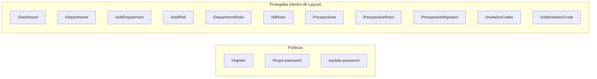
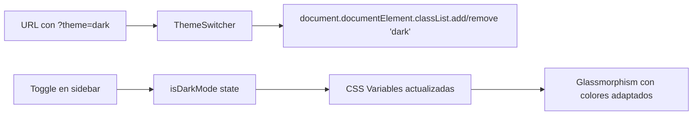

# ⚛️ Lógica del Frontend

## Estructura de Páginas

La aplicación sigue un patrón SPA (Single Page Application) con React Router para la navegación.



---

## Componentes Principales

### `Layout.jsx` — Layout Principal

**Responsabilidades:**

- Gestión del estado de autenticación (login/logout)
- Renderizado condicional: `LoginScreen` vs `AppLayout`
- Sidebar con navegación, perfil de usuario, tema y lenguaje
- Responsive: sidebar colapsable en móvil
- CSS Variables dinámicas para temas (light/dark)

**Estado interno:**

| Estado          | Tipo        | Propósito                          |
| --------------- | ----------- | ---------------------------------- |
| `user`          | Object/null | Datos del usuario autenticado      |
| `isAdmin`       | Boolean     | Si el usuario tiene rol admin      |
| `loading`       | Boolean     | Estado de carga de autenticación   |
| `loginEmail`    | String      | Email del formulario de login      |
| `loginPassword` | String      | Contraseña del formulario de login |
| `loginError`    | String      | Mensaje de error de login          |
| `sidebarOpen`   | Boolean     | Estado del sidebar en móvil        |
| `isDarkMode`    | Boolean     | Tema oscuro activo                 |

**CSS Variables de Tema:**

```css
/* Modo Claro */
--glass-bg: rgba(255, 255, 255, 0.85) --glass-border: rgba(200, 200, 220, 0.4)
  --text-primary: #1e293b --text-muted: #64748b --accent: #7c3aed
  /* Modo Oscuro */ --glass-bg: rgba(30, 30, 60, 0.6)
  --glass-border: rgba(120, 120, 200, 0.15) --text-primary: #e2e8f0
  --text-muted: #94a3b8 --accent: #a78bfa;
```

### `Dashboard.jsx` — Panel Principal

**Datos que muestra:**

| Tarjeta                | Cálculo                                                         |
| ---------------------- | --------------------------------------------------------------- |
| Departamentos activos  | `departments.length`                                            |
| Riesgos totales        | `risks.length`                                                  |
| Riesgos altos          | Filtra por `isHighRisk(r.residual_level \|\| r.inherent_level)` |
| Riesgos bajos          | Filtra por `isLowRisk(r.residual_level \|\| r.inherent_level)`  |
| Distribución por nivel | Agrupa riesgos en 5 categorías + "Sin clasificar"               |

**Flujo de datos:**

```mermaid
sequenceDiagram
    Dashboard->>User.me(): Obtener usuario
    Dashboard->>Department.list(): Obtener departamentos
    Dashboard->>Risk.list(): Obtener riesgos
    Dashboard->>Dashboard: Calcular estadísticas
    Dashboard->>Dashboard: Renderizar tarjetas + tabla
```

### `AddRisk.jsx` — Formulario de Riesgo

**Campos del formulario:**

| Sección          | Campo                       | Tipo                                | Requerido |
| ---------------- | --------------------------- | ----------------------------------- | --------- |
| General          | Departamento                | Select                              | ✅        |
| General          | Tipo de amenaza             | Select (Interna/Externa)            | ✅        |
| General          | Descripción                 | Textarea                            | ✅        |
| Riesgo Inherente | Probabilidad                | Select (5 niveles)                  | ❌        |
| Riesgo Inherente | Impacto                     | Select (5 niveles)                  | ❌        |
| Riesgo Inherente | Nivel                       | Calculado automático                | —         |
| Manejo           | Estrategia                  | Select (Aceptar/Reducir/Transferir) | ❌        |
| Mitigantes       | Mitigante 1-3 (descripción) | Input                               | ❌        |
| Mitigantes       | Impacto Mitigante 1-3       | Select                              | ❌        |
| Riesgo Residual  | Probabilidad                | Select (5 niveles)                  | ❌        |
| Riesgo Residual  | Impacto                     | Select (5 niveles)                  | ❌        |
| Riesgo Residual  | Nivel                       | Calculado automático                | —         |

**Lógica de cálculo de nivel:**

```javascript
const calculateRiskLevel = (probability, impact) => {
  const scores = {
    "Remoto (0-20%)": 1,
    "Improbable (21-40%)": 2,
    "Ocasional (41-60%)": 3,
    "Probable (61-80%)": 4,
    "Frecuente (81-100%)": 5,
  };
  const impactScores = {
    Insignificante: 1,
    Menor: 2,
    Crítico: 3,
    Mayor: 4,
    Catastrófico: 5,
  };

  const score = scores[probability] * impactScores[impact];

  if (score >= 17) return "Intolerable";
  if (score >= 13) return "Alto";
  if (score >= 9) return "Medio";
  if (score >= 5) return "Bajo";
  return "Tolerable";
};
```

### `AllRisks.jsx` — Matriz Completa

**Funcionalidades:**

| Funcionalidad              | Implementación                                      |
| -------------------------- | --------------------------------------------------- |
| Filtro por departamento    | `Select` con todos los departamentos                |
| Filtro por nivel de riesgo | `Select` con 5 niveles                              |
| Búsqueda por texto         | `Input` filtra por `description` (case-insensitive) |
| Selección múltiple         | `Checkbox` por fila + seleccionar todos             |
| Edición                    | Botón "Editar" cuando hay 1 seleccionado            |
| Eliminación en lote        | Botón "Eliminar" cuando hay ≥1 seleccionado         |
| Exportación Excel          | Botón que genera `.xlsx` con `xlsx + file-saver`    |

**Columnas de la tabla:**

```
Departamento | Tipo Amenaza | Descripción |
Prob. Inherente | Imp. Inherente | Nivel Inherente |
Estrategia |
Mitigante 1 | Impacto 1 | Mitigante 2 | Impacto 2 | Mitigante 3 | Impacto 3 |
Prob. Residual | Imp. Residual | Nivel Residual
```

### `Departments.jsx` — Lista de Departamentos

**Información mostrada por departamento:**

| Dato             | Fuente                                                  |
| ---------------- | ------------------------------------------------------- |
| Nombre           | `department.name`                                       |
| Descripción      | `department.description`                                |
| Total de riesgos | `risks.filter(r => r.department_id === dept.id).length` |
| Riesgos altos    | `isHighRisk(r.residual_level \|\| r.inherent_level)`    |

### `DepartmentRisks.jsx` — Riesgos por Departamento

Similar a `AllRisks.jsx` pero filtrado por un departamento específico. Recibe el ID del departamento via query parameter (`?id=...`).

### Perspectivas (Fase 1): `Perspectives.jsx`, `PerspectiveRisks.jsx`, `PerspectiveMigration.jsx`

Desde la Fase 1 los riesgos se organizan en las perspectivas de `src/config/perspectives.js`; desde el 20-oct-2026 son 5 (`financiera` Finanzas, `cliente` Clientes, `competitiva` Competitividad, `procesos` Procesos, `equipo` Equipo y talento; antes `competitiva` era "Procesos y competitividad"), con el campo `risks.perspective_key` (`NULL` = "Sin asignar"). "Perspectivas" sustituye a "Departamentos" en el menú del módulo de riesgos (`src/config/modules.js`); las páginas de departamentos siguen accesibles por URL y desde el enlace "Departamentos (anterior)".

| Página | Ruta | Qué hace |
| --- | --- | --- |
| `Perspectives.jsx` | `/Perspectives` | Una tarjeta por perspectiva con total, críticos (puntaje inherente ≥ 13) y "Sin puntaje"; ayuda y 3 ejemplos del catálogo que prellenan `AddRisk?perspective=&example=`. Pie con enlace permanente al asistente y a Departamentos. |
| `PerspectiveRisks.jsx` | `/PerspectiveRisks?key=<clave>` | Lista filtrable de los riesgos de una perspectiva (búsqueda, nivel vigente, tipo, orden por puntaje o fecha); tarjetas en móvil. Clave inválida → redirige a `/Perspectives`. |
| `PerspectiveMigration.jsx` | `/PerspectiveMigration` | Asistente para convertir departamentos en perspectivas: sugerencia por heurística o por `departments.perspective_key`, Asignar (`Department.setPerspective` → `Risk.assignPerspectiveByDepartment`) y Deshacer (`Risk.undoPerspectiveByDepartment` → `Department.setPerspective(null)`); los riesgos sin departamento (o huérfanos) se asignan uno por uno con `Risk.setPerspective`. |

Piezas compartidas: helpers puros en `src/lib/perspectiveView.js` (probados con `node scripts/check-perspectiveView.mjs`) y componentes en `src/components/perspectives/` (`PerspectiveBadge`, `PerspectivePicker`, `MigrationBanner`). El banner de migración aparece en Dashboard, Perspectivas y Matriz de Riesgos mientras haya al menos un riesgo sin perspectiva. En `AddRisk` la perspectiva es obligatoria para riesgos nuevos (opcional al editar) y el departamento pasó a ser opcional; `AllRisks` suma filtro y columna de perspectiva, columna "Puntaje" y dos columnas nuevas en el Excel ("Perspectiva" y "Puntaje inherente"). Las claves i18n van en la sección `// Perspectivas (Fase 1)` de `LanguageContext.jsx`; los nombres del catálogo se muestran en español también en inglés, igual que el Mapa estratégico.

### Riesgos críticos en la planeación (Fase 2): `useStrategyInputs`, `src/components/strategy/`

Desde la Fase 2 los riesgos con nivel **inherente** Alto o Intolerable (`inherent_score >= 13`) entran en vivo al módulo estratégico como objetivos de prioridad alta (`id = 'risk:<risk.id>'`). Las seis pantallas del módulo dejan de armar sus propias consultas y cargan todo con el hook `useStrategyInputs`; después derivan los objetivos de riesgo con `riskObjectivesFrom(inputs.risks, inputs.decisions)` de `src/config/strategicCalc.js` (reglas RC1–RC15 en [02 - Reglas de Negocio](./02-REGLAS-DE-NEGOCIO.md)). Todo el módulo estratégico sigue solo en español: no se agregaron claves a `LanguageContext.jsx`.

| Pantalla | Qué agrega la Fase 2 |
| --- | --- |
| `StrategicPlanning.jsx` (Inicio) | KPI "Tu foco" cuenta riesgos críticos + debilidades Alta, con subtítulo "N sin plan · M por confirmar"; las alertas de riesgo (`summarizeRiskWarnings`) van primero y enlazan a `StrategicInitiatives#risk-<id>` / `#initiative-<id>`; "Tu foco ahora" lista hasta 5 (`focusItems`: riesgos primero, con chip de nivel y estado planificado / aceptado / aceptado sin confirmar / sin plan); el mini FODA usa `mergeFodaWithRisks` y muestra "incl. N riesgo(s)"; el botón "Continuar" dice "Planear riesgos" cuando hay riesgos sin plan y el usuario ya empezó el análisis. KPIs 1, 2 y 4, recorrido y nota de calendario no cambian de código. |
| `FodaAnalysis.jsx` | `mergeFodaWithRisks(buildFoda(...), riskObjectives)`: riesgos Interna al principio de Debilidades, Externa (o sin tipo) al principio de Amenazas, con chips "Riesgo crítico" + nivel (`RiskLevelChip`); subtítulos y tarjeta "Se llena solo" con una frase extra cuando hay riesgos. |
| `StrategicSummary.jsx` | Chip "N riesgos críticos" y sección "RIESGOS CRÍTICOS DE TU MATRIZ (N)" con una tarjeta por riesgo (`id="risk-<id>"`, `RiskObjectiveBadges`, chip propio "Prioridad alta · por su gravedad", estrategia, controles en solo lectura, enlaces "Planear sus controles →" y "Ver en la matriz →"). Las calificaciones de debilidades siguen igual, con hidratación única para no guardar al abrir. |
| `StrategicMap.jsx` (`StrategicMapBase`, sirve también a `StrategicMapCalibrated.jsx`) | Los riesgos entran como burbujas con escudo (`ShieldAlert`) y punto rojo (Intolerable) o naranja (Alto) en el carril de su perspectiva; tercer párrafo en "cómo leerlo"; debajo de los carriles `UnassignedRisksNote` lista los críticos sin perspectiva con enlace a `AddRisk?id=` y al asistente. |
| `StrategicInitiatives.jsx` | Tarjetas de riesgo antes de las debilidades (`id="risk-<id>"`): badges, controles de la matriz con botón "Convertir en iniciativa" → `Initiative.createFromSource` (idempotente; "Ya en tu plan ↓" si ya existe), plantillas por estrategia cuando no hay controles (siempre para Aceptar), aviso "Lo tengo controlado" / "Quitar confirmación" para los Aceptar (`PlanAnswer` sección `risk-objectives`), `RiskWarningsCard` agrupado tras la intro, avisos inline por iniciativa (`far`, `no-owner`), grupo "Otras iniciativas" para riesgos que dejaron de ser críticos (`strategy_label`) y Excel con "Riesgo crítico: …" / "Sin perspectiva". Texto discreto si el usuario tiene el módulo de riesgos y ninguno es crítico. |
| `ScoreCard.jsx` | Las iniciativas de riesgo se agrupan por la perspectiva del objetivo completo (`objectivesById`), con chip "Riesgo"; grupo extra "Sin perspectiva" al final (riesgos sin perspectiva y huérfanos); chip "N riesgo(s) crítico(s) sin iniciativa" + "Planear →" junto a los Totales (`print:hidden`; excluye los aceptados confirmados, RC7). |

**Hook `useStrategyInputs({ extraSections })`** (`src/hooks/useStrategyInputs.js`) devuelve `{ inputs, loading, error, reload, risksEnabled }`. `risksEnabled = canAccessModule(módulo risk, { isAdmin, grantedModules })` del `ModuleAccessContext`; `inputs` es el resultado de `loadStrategyInputs({ includeRisks: risksEnabled, extraSections })` (`plan, sections, ratings, competitors, initiatives, risks, decisions`). Reglas: (1) **carga única por visita**: espera a que el contexto de módulos termine de cargar solo la **primera** vez; después ignora sus recargas (supabase-js emite `SIGNED_IN` cada vez que la pestaña vuelve a ser visible), así que al refocar no reaparece el esqueleto ni se repiten consultas; (2) `loading = !inputs && !error && (accessLoading || fetching)`, nunca vuelve a `true` cuando ya hay datos ni cuando la primera carga falló (el refoco no sustituye el bloque de error por el esqueleto); (3) solo si `risksEnabled` cambia de valor se vuelve a consultar **en silencio**, y nunca sin sesión (`user` null tras `SIGNED_OUT`); (4) `error` es `''` o `LOAD_ERROR_TEXT` cuando la primera carga falla. Las páginas con estado editable (Resumen, Iniciativas) copian `inputs` a su estado **una sola vez** con una bandera `hydrated` y pasan `enabled: hydrated && !!planId` a `useAutosave`, para que la línea base del autosave sean los datos ya cargados y abrir la pantalla no dispare ningún guardado; además muestran el esqueleto mientras `!hydrated && !error`, para que el primer render visible ya sea el hidratado (sin parpadeo de avisos ni estados vacíos).

**Componentes compartidos `src/components/strategy/`** (con `PropTypes`, estilo `glass`, solo español): `RiskLevelChip` (chip del nivel con `getRiskLevelColorClasses`), `RiskObjectiveBadges` (fila "Riesgo crítico" + nivel + `PerspectiveBadge` + "Aceptado" + "Controlado"), `RiskWarningsCard` (tarjeta ámbar con una línea por tipo de aviso vía `summarizeRiskWarnings`, "Ver detalle" para la lista completa y pie "Son avisos, no bloqueos: puedes guardar igual.") y `UnassignedRisksNote` (riesgos críticos sin perspectiva con enlaces a `AddRisk?id=` y a `PerspectiveMigration`).

**Script `scripts/check-strategicCalc.mjs`**: `node scripts/check-strategicCalc.mjs` prueba las funciones nuevas de `strategicCalc.js` (identificadores, fechas, `riskControls`, `riskObjectivesFrom`, `riskInitiativeWarnings`, `summarizeRiskWarnings`, `focusItems`, `mergeFodaWithRisks`, plantillas) y la regresión de las existentes; imprime `TODO OK` o sale con código 1. `eslint.config.js` no cubre `.mjs`, así que el criterio del script es ejecutarlo, no pasarlo por eslint.

### Análisis Financiero: Inicio como tablero y Razones financieras

El módulo `fin-analysis` cierra con dos pantallas 100 % calculadas (sin inputs, sin `useAutosave` ni `SaveStatusBar`): el **Inicio** (`FinAnalysisHome.jsx`) convertido en tablero y la nueva **Razones financieras** (`FinAnalysisRatios.jsx`). Las reglas de negocio (fórmulas, N/A, semáforo) están en [02 - Reglas de Negocio §7](./02-REGLAS-DE-NEGOCIO.md); aquí solo el flujo de datos y los componentes.

**Flujo de datos.** Ambas pantallas cargan en `useEffect` (Razones envuelve la carga en `useCallback`; el Inicio usa una función asíncrona dentro del efecto): `FinAnalysis.getOrCreate()` (crea la fila de `fin_analyses` la primera vez que el usuario entra al módulo) → `FinYear.list(a.id)` y `FinLine.list(a.id)` en paralelo → **una sola** `FinValue.getSections(a.id, [...])` con las secciones que necesitan, incluidas las `cost:<lineId>` de las líneas recién leídas (por eso va después de las líneas, no en paralelo): `SALES_SECTION`, `EXPENSES_SECTION`, `INCOME_SECTION`, `BALANCE_SECTION`, `...lines.map(costSection)`; el Inicio agrega `CASHFLOW_ANNEX_SECTION` y `CASHFLOW_DIRECT_SECTION`. El resultado `{ [section]: { [conceptKey]: { [yearId]: amount } } }` se pasa tal cual a los motores puros de `src/config/finCalc.js` dentro de `useMemo`: `computeIncome` / `scaleIncome` (flujos, anualizados si `months < 12`), `computeBalance`, `computeRatios({ sections, years, lines })` y `summarizeRatios`. Fuera de esa alta inicial del análisis, estas pantallas no escriben nada en la BD. Loading: dos bloques `glass animate-pulse`; error: el bloque rojo de las demás pantallas del módulo (`console.error` en el catch).

| Pantalla | Ruta | Qué muestra |
| --- | --- | --- |
| `FinAnalysisHome.jsx` (Inicio) | `/FinAnalysisHome` | Header con `company_name` y chip "Último periodo: {yearLabel}" (+ "parcial, anualizado en los indicadores"); botón Continuar. Con datos: fila de 4 KPI del último periodo (Ventas con variación `pctChange` sobre anualizado, Utilidad neta con margen neto, Liquidez y Deuda / EBITDA con `SemaforoBadge`; si el último periodo no tiene Balance muestran "—" y "Sin Balance General", sin badge), tarjeta "Semáforo financiero · {yearLabel}" (contadores Sanos / Por vigilar / Por atender y hasta 3 de `atencion`, enlace "Ver las 18 razones →"; si el **último periodo** no tiene Balance: "Captura el Balance General de {yearLabel} para ver el semáforo"), gráfica recharts "Ventas y utilidad neta por año" (valores reales del periodo; el eje X lleva solo `yearLabel` para que quepan todos los años en móvil, y el periodo parcial se aclara en la nota bajo el título y en el tooltip `glass`, que muestra los valores en `text-foreground` con un cuadrito del color de la serie) y el recorrido de 9 pasos. Sin datos (solo años o nada): header, card "¿Qué es esto?" y recorrido. |
| `FinAnalysisRatios.jsx` | `/FinAnalysisRatios` | Header (ArrowLeft → Inicio, icono `Gauge` cyan), card intro `Sparkles` (se calcula sola; umbrales de referencia general, no veredicto), "Lectura rápida · {yearLabel}" del último periodo (3 contadores + "Lo que más llama la atención" con hasta 3 de `atencion`, o "Ningún indicador en rojo o ámbar en este periodo."; si el último periodo no tiene Balance, en su lugar "Captura el Balance General de {yearLabel} para ver el semáforo de este periodo"), una Card `glass` por grupo de `RATIO_GROUPS` (título + pregunta) con tabla `overflow-x-auto min-w-[640px]`: Concepto + una columna por año (sub-rótulo "anualizado" si parcial) + "Tendencia" (▲ verde `mejora`, ▼ rojo `empeora`, "=" gris cuando el motor dice `igual` **o cuando el valor formateado no cambia** (6.6% → 6.6%: "Sin cambio apreciable", decisión de la pantalla, no del motor), "—" null; solo con ≥ 2 años; el glifo va `aria-hidden` y un `sr-only` dice en palabras "Mejora/Empeora respecto al periodo anterior", "Sin cambio" o "Sin tendencia", porque el color es lo que distingue mejora de empeora). Cada celda: `SemaforoDot` + `formatRatio`; si `null`, "—" y el motivo `na[key]` debajo. Cada fila es un botón (`aria-expanded`, estado local `expanded: Set`) que abre una fila `colSpan` (su contenido va en un `div sticky left-0` con `max-w-[calc(100vw-4.5rem)]`, para que en móvil la explicación se lea sin desplazar la tabla de 640 px; el `CardContent` con `overflow-x-auto` y el `td` de Tendencia llevan `relative` para que el texto `sr-only`, que es absoluto, no provoque scroll horizontal) con "¿Qué mide?" (`what`), "¿Cómo leerlo?" (`how`) y "Fórmula: {formula}"; en días de inventario / proveedores agrega "Rota N veces al año" con `aux.rotacion_*` del último periodo. Nota al pie con la base 360 y la anualización. Navegación: ← Flujo de efectivo directo · Volver al Inicio →. |

**Estados vacíos de Razones.** Sin años → card "Primero define los años a analizar en Datos generales" con botón a `FinAnalysisData`. Con años pero sin Estado de Resultados ni Balance (para **todos** los años `aux.total_activo === 0 && aux.ventas === 0`) → card "Para calcular las razones necesitamos el Estado de Resultados y el Balance General" con botones a `FinAnalysisIncome` y `FinAnalysisBalance`.

**Completitud de pasos en el Inicio** ("algún valor" = al menos una celda `!= null` tras `toNumber`):

| Paso | `done` cuando |
| --- | --- |
| Datos generales | `years.length > 0` |
| Ventas | algún valor en `sales` |
| Costo de ventas | algún valor en alguna sección `cost:<lineId>` |
| Gastos de operación | algún valor en `expenses` |
| Estado de Resultados | algún valor en `income` |
| Balance General | algún valor en `balance` |
| Estado de cambios | algún valor en `cashflow-annex` |
| Flujo directo | algún valor en `cashflow-direct` |
| Razones financieras | (algún valor en `income` **o** ventas > 0) **y** algún valor en `balance` |

**Balance por periodo.** La completitud del paso Balance es por módulo (algún valor en cualquier año), pero la tarjeta "Semáforo financiero" y los KPI Liquidez y Deuda / EBITDA del Inicio, igual que la "Lectura rápida" de Razones, exigen que el **último periodo** tenga algún valor en `balance` (`hasAnyForYear(section, yearId)` en cada pantalla). Es el caso cotidiano de un año nuevo con ventas, costos o Estado de Resultados capturados y el Balance todavía vacío: el motor, fiel a las reglas F7, devolvería N/A con semáforo por saldos en cero que no están capturados ("Capital contable negativo o cero" en rojo, "La caja cubre toda la deuda" en verde, "0 días" de cobranza), así que en vez de pintarlos se pide capturar el Balance de ese periodo. La tabla por grupo de Razones sigue mostrando la columna de ese año tal como la devuelve el motor.

`continueTarget` = primer paso no hecho en ese orden, con rótulo "Empezar" si ninguno está hecho y "Continuar" si ya hay avance; con los 9 hechos → `FinAnalysisRatios` con "Ver razones financieras". Cada paso del recorrido tiene `ready: true` y `key` real (el 9º es `FinAnalysisRatios`, icono `Gauge`); a la derecha `CheckCircle2` verde si `done`, si no `ChevronRight`; se conservan los chips de meta ("3 año(s) definidos", "2 línea(s) de negocio", "Con captura"). Ya no existe el chip "Próximamente" ni la lógica `ready: false`.

**Motor (`src/config/finCalc.js`, puro, compartido con el MCP).** `computeRatios({ sections, years, lines })` → `{ [yearId]: { factor, values: { [key]: number|null }, status: { [key]: 'verde'|'ambar'|'rojo'|null }, na: { [key]: motivo }, aux } }`; reutiliza `computeIncome`, `scaleIncome`, `computeBalance` y `annualizeFactor`. `ratioStatus(def, value)` evalúa solo las bandas del catálogo (`null` si `value == null`). `ratioTrend(def, curr, prev)` → `'mejora' | 'empeora' | 'igual' | null`. `summarizeRatios(yearRatios)` → `{ verde, ambar, rojo, na, atencion: [{ key, status, value }] }` (rojos primero, luego ámbar, orden del catálogo). Catálogo en `src/config/finConfig.js`: `RATIO_GROUPS`, `RATIO_DEFS` (18 objetos `{ key, group, label, format, better, bands | statusFrom, formula, what, how }`), `RATIO_BY_KEY`, `RATIO_STATUS_LABEL`, `formatRatio(def, value)`. Probado con `node scripts/check-finCalc.mjs` (fixture de las 5 columnas del Excel, año parcial, N/A, resumen, tendencia y formato; imprime `TODO OK`).

**Componentes `src/components/fin/Semaforo.jsx`** (con `PropTypes`): `STATUS_STYLES = { verde: { dot: 'bg-green-500', text: 'text-green-600 dark:text-green-500', label: 'Sano' }, ambar: { dot: 'bg-amber-400', text: 'text-amber-600 dark:text-amber-400', label: 'Vigilar' }, rojo: { dot: 'bg-red-500', text: 'text-red-500', label: 'Atender' }, na: { dot: 'bg-muted-foreground/40', text: 'text-muted', label: 'No aplica' } }`; `statusKey(status)` → `status ?? 'na'`; `SemaforoDot({ status, className })` círculo `w-2.5 h-2.5 rounded-full` con `title`; `SemaforoBadge({ status })` pill con punto + etiqueta. Siempre pares claro/oscuro; nada que funcione en un solo tema.

**Registro y navegación.** `src/config/modules.js` agrega `{ pageKey: "FinAnalysisRatios", nameKey: "navFinAnalysisRatios", icon: Gauge }` al módulo `fin-analysis`; `src/pages/index.jsx` importa la página, la registra en `PAGES` y en `<Route path="/FinAnalysisRatios">`; `LanguageContext.jsx` añade `navFinAnalysisRatios` ("Razones financieras" / "Financial ratios"). `FinAnalysisCashflowDirect.jsx` cierra su navegación inferior con "Siguiente: Razones financieras →". El servidor MCP expone los mismos cálculos en `razones_financieras` y en `resumen_general` (`liquidez`, `semaforo_razones`); ver [MCP.md](./MCP.md).

---

---

## Utilidades (`src/lib/utils.js`)

### Normalización de Niveles de Riesgo

La aplicación soporta nombres de niveles en **español e inglés**, normalizándolos a constantes internas:

| Español        | Inglés       | Constante      |
| -------------- | ------------ | -------------- |
| Intolerable    | Intolerable  | `INTOLERABLE`  |
| Alto           | High         | `HIGH`         |
| Medio          | Medium       | `MEDIUM`       |
| Bajo           | Low          | `LOW`          |
| Tolerable      | Tolerable    | `TOLERABLE`    |
| Sin clasificar | Unclassified | `UNCLASSIFIED` |

**Funciones exportadas:**

| Función                      | Retorno   | Descripción                     |
| ---------------------------- | --------- | ------------------------------- |
| `normalizeRiskLevel(level)`  | `string`  | Convierte a constante interna   |
| `isHighRisk(level)`          | `boolean` | `true` si es HIGH o INTOLERABLE |
| `isLowRisk(level)`           | `boolean` | `true` si es LOW o TOLERABLE    |
| `getRiskLevelColorClasses()` | `object`  | Mapa de constantes → clases CSS |

### Navegación (`src/utils/index.ts`)

```typescript
export function createPageUrl(pageName: string) {
  return "/" + pageName.toLowerCase().replace(/ /g, "-");
}
```

Convierte nombres de página a URLs: `"AddRisk"` → `"/addrisk"`, `"AllRisks"` → `"/allrisks"`

---

## Hook Personalizado: `useAuth`

```javascript
const { user, loading, isAdmin } = useAuth();
```

| Propiedad | Tipo        | Descripción                                 |
| --------- | ----------- | ------------------------------------------- |
| `user`    | Object/null | Objeto del usuario autenticado              |
| `loading` | Boolean     | Si la verificación de auth está en progreso |
| `isAdmin` | Boolean     | Si el usuario tiene rol admin               |

**Implementación:** Escucha `onAuthStateChange` de Supabase y verifica `user_metadata.role`.

---

## Sistema de Temas

El tema se gestiona a través de un `ThemeSwitcher` en el router y un toggle en el sidebar:



**Clases de estilo "glass":**

| Clase           | Propósito                        |
| --------------- | -------------------------------- |
| `glass`         | Fondo semi-transparente con blur |
| `input-glass`   | Inputs con efecto glassmorphism  |
| `table-glass`   | Tablas con efecto glassmorphism  |
| `glass-sidebar` | Sidebar con efecto glassmorphism |

---

**Navegación:**
← [04 - Autenticación y Seguridad](./04-AUTENTICACION-Y-SEGURIDAD.md) | [06 - Internacionalización](./06-INTERNACIONALIZACION.md) →
