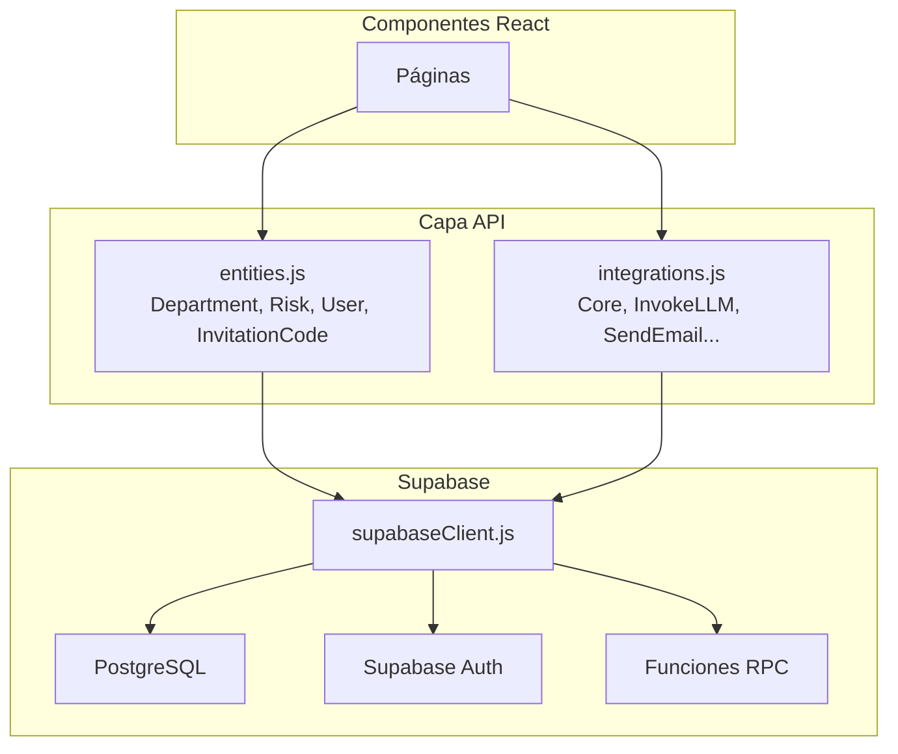

# 🔌 API y Entidades

## Arquitectura de la Capa de Datos

La capa de acceso a datos se organiza en tres archivos:

| Archivo                     | Propósito                                                |
| --------------------------- | -------------------------------------------------------- |
| `src/api/supabaseClient.js` | Inicialización del cliente Supabase                      |
| `src/api/entities.js`       | Modelos de datos: Department, Risk, User, InvitationCode |
| `src/api/integrations.js`   | Integraciones externas (LLM, Email, etc.)                |
| `src/api/ia.js`             | Cliente del asistente de IA (Edge Function `ia`): `callIa`, `IaError`, `iaStatus`, `iaSavedResult`, `IaUsage` — ver [IA.md](./IA.md) |



---

## Cliente Supabase

### `src/api/supabaseClient.js`

```javascript
import { createClient } from "@supabase/supabase-js";

const supabaseUrl = import.meta.env.VITE_SUPABASE_URL;
const supabaseAnonKey = import.meta.env.VITE_SUPABASE_ANON_KEY;

export const supabase = createClient(supabaseUrl, supabaseAnonKey);
```

---

## Entidades

### `Department`

Gestión de departamentos organizacionales.

| Método   | Firma                     | Descripción                                                    |
| -------- | ------------------------- | -------------------------------------------------------------- |
| `list`   | `list(order?)`            | Lista departamentos, ordenados por `order` o `created_at` desc |
| `filter` | `filter(filters, order?)` | Filtra departamentos por objeto de condiciones                 |
| `get`    | `get(id)`                 | Obtiene un departamento por ID                                 |
| `create` | `create(data)`            | Crea un nuevo departamento                                     |
| `update` | `update(id, data)`        | Actualiza un departamento existente                            |
| `delete` | `delete(id)`              | Elimina un departamento por ID                                 |

**Ejemplo de uso:**

```javascript
import { Department } from "@/api/entities";

// Listar todos
const departments = await Department.list("-created_date");

// Filtrar
const filtered = await Department.filter({ id: "uuid-123" });

// Crear
await Department.create({ name: "Finanzas", description: "..." });

// Actualizar
await Department.update("uuid-123", { name: "Finanzas Actualizadas" });

// Eliminar
await Department.delete("uuid-123");
```

### `Risk`

Gestión de riesgos por departamento.

| Método   | Firma                     | Descripción                    |
| -------- | ------------------------- | ------------------------------ |
| `list`   | `list(order?)`            | Lista todos los riesgos        |
| `filter` | `filter(filters, order?)` | Filtra riesgos por condiciones |
| `get`    | `get(id)`                 | Obtiene un riesgo por ID       |
| `create` | `create(data)`            | Crea un nuevo riesgo           |
| `update` | `update(id, data)`        | Actualiza un riesgo existente  |
| `delete` | `delete(id)`              | Elimina un riesgo por ID       |

**Campos del objeto Risk:**

```javascript
{
    department_id: 'uuid',
    threat_type: 'Interna' | 'Externa',
    description: 'Descripción del riesgo',
    inherent_probability: 'Remoto (0-20%)' | ... ,
    inherent_impact: 'Insignificante' | ... ,
    inherent_level: 'Tolerable' | 'Bajo' | 'Medio' | 'Alto' | 'Intolerable',
    risk_strategy: 'Aceptar' | 'Reducir' | 'Transferir',
    mitigant_1: 'Descripción mitigante',
    mitigant_impact_1: 'Mitiga la probabilidad' | ... ,
    mitigant_2: '...',
    mitigant_impact_2: '...',
    mitigant_3: '...',
    mitigant_impact_3: '...',
    residual_probability: '...',
    residual_impact: '...',
    residual_level: '...',
    created_by_id: 'uuid'
}
```

### Riesgos críticos en la planeación (Fase 2)

La integración riesgos → plan no agrega entidades: usa estos métodos existentes de `entities.js` y la carga unificada de `src/api/strategyInputs.js`.

| Método                       | Firma                                            | Descripción                                                                                                                                                                                                                                                                                               |
| ---------------------------- | ------------------------------------------------ | --------------------------------------------------------------------------------------------------------------------------------------------------------------------------------------------------------------------------------------------------------------------------------------------------------- |
| `Risk.listCritical`          | `listCritical({ perspective? })`                 | Riesgos del usuario con `inherent_score >= 13`, ordenados por gravedad. **Ninguna página lo llama directamente**: solo `loadStrategyInputs`, y solo si `includeRisks` es `true` (usuario con el módulo `risk`). Ante error de permisos o columnas faltantes devuelve `[]` y avisa en consola. |
| `loadStrategyInputs`         | `loadStrategyInputs({ includeRisks, extraSections })` | Devuelve `{ plan, sections, ratings, competitors, initiatives, risks, decisions }`; `sections` trae `PLAN_SOURCE_SECTIONS` (`STRATEGY_SOURCE_SECTIONS` es un alias; incluye `financial-situations` y `external-diagnosis` desde nov-2026) más `market`, `summary-ratings`, las de competidores y `extraSections`, cada una garantizada como objeto; `decisions = { controls, objectives }` son las secciones `risk-controls` y `risk-objectives` de `plan_answers`. Las páginas la consumen a través del hook `useStrategyInputs`.                                   |
| `Initiative.list`            | `list(planId)`                                   | Filas completas, con `source_key` y `strategy_label` (`NULL` en las manuales). El estado de la pantalla de iniciativas nace **siempre** de aquí.                                                                                                                                                       |
| `Initiative.createFromSource` | `createFromSource(planId, rows)`                | **Única vía** por la que una iniciativa nace con `source_key`. Hace `upsert` con `onConflict: "plan_id,source_key"` e `ignoreDuplicates: true`: repetir el clic no duplica ni pisa ediciones. Exige `source_key` y `strategy_id` en cada fila.                                                        |
| `Initiative.upsertMany`      | `upsertMany(planId, rows)`                       | Autosave. Manda `source_key`/`strategy_label` solo si la fila trae la propiedad (supabase-js arma las columnas con la unión de claves de todas las filas: una fila sin la propiedad se guarda con `NULL`). Por eso las filas del estado deben venir de `list()`.                                   |
| `Initiative.remove`          | `remove(id)`                                     | Borrar una iniciativa de riesgo libera su `source_key`: el control vuelve a poder convertirse (nueva fila, nuevo id).                                                                                                                                                                                 |
| `PlanAnswer.set` / `remove` / `getSection` | `set(planId, section, key, value)` · `remove(planId, section, key)` · `getSection(planId, section)` | Confirmación "Lo tengo controlado" de un riesgo aceptado (sección `risk-objectives`).                                                                                                                                                                                              |

#### Contrato de las iniciativas de riesgo (`strategic_initiatives`)

| Campo             | Valor                                                                                            | Nota                                                                                                                                                                                              |
| ----------------- | ------------------------------------------------------------------------------------------------ | ------------------------------------------------------------------------------------------------------------------------------------------------------------------------------------------------- |
| `strategy_id`     | `'risk:<risk.id>'`                                                                               | Igual que el id del objetivo de riesgo; `riskInitiativesOf` agrupa por él.                                                                                                                       |
| `source_key`      | `'risk:<risk.id>:m<n>'` (control n = 1..3) · `'risk:<risk.id>:tpl:<clave>'` (plantilla)         | Solo nace en `createFromSource`. Índice único `(plan_id, source_key)`. Las iniciativas manuales llevan `NULL`.                                                                                     |
| `strategy_label`  | Descripción del riesgo                                                                           | Sobrevive si el riesgo deja de ser crítico o se borra: título del grupo en "Otras iniciativas", en el Excel y en el Score Card. Las manuales creadas bajo un objetivo de riesgo también lo llevan. |
| `title`           | Texto del control o de la plantilla                                                              | Editable.                                                                                                                                                                                          |
| `expected_result` | Plantilla → su texto; control → "Bajar el riesgo a nivel Medio o menor" (o el de Aceptar)        | Editable.                                                                                                                                                                                          |
| `area`            | Nombre de la perspectiva (`'Finanzas'`, `'Clientes'`, …) o `NULL`                                | Editable.                                                                                                                                                                                          |
| `owner`           | `NULL`                                                                                           | La matriz no guarda el nombre del responsable (solo Sí/No); el usuario lo escribe y mientras tanto sale el aviso `no-owner`.                                                                       |
| `start_date`      | Hoy (`localISODate()`, hora local)                                                               |                                                                                                                                                                                                    |
| `end_date`        | Hoy + 30 (Intolerable) · hoy + 60 (Alto)                                                         | Sugerencia; si el usuario la aleja más de 60 / 120 días sale el aviso `far`.                                                                                                                      |
| `budget`, `kpi`, `steps` | `NULL` (`kpi`: el de la plantilla si viene de plantilla)                                  |                                                                                                                                                                                                    |
| `position`        | `initiatives.length` al crear                                                                    | `upsertMany` lo reescribe con el índice en cada autosave.                                                                                                                                         |

#### `plan_answers` sección `risk-objectives` (`RISK_OBJECTIVES_SECTION`)

| `question_key`           | `answer`                           | Significado                                                                                                                                   | Escribe                                                                 | Borra                                                       |
| ------------------------ | ---------------------------------- | --------------------------------------------------------------------------------------------------------------------------------------------- | ----------------------------------------------------------------------- | ----------------------------------------------------------- |
| `<risk.id>` (uuid tal cual) | `'acknowledged'` (`RISK_ACKNOWLEDGED`) | El usuario confirmó "Lo tengo controlado" para un riesgo crítico **Aceptar**. Sale de las alertas, no del plan.                             | `PlanAnswer.set(planId, RISK_OBJECTIVES_SECTION, riskId, RISK_ACKNOWLEDGED)` | `PlanAnswer.remove(planId, RISK_OBJECTIVES_SECTION, riskId)` |

Cualquier otro valor se trata como no confirmado. Si el riesgo cambia a Reducir/Transferir la fila queda sin efecto (no se borra; `accepted` manda). Si deja de ser crítico, queda huérfana sin efecto.

#### `plan_answers` sección `risk-controls` (`RISK_CONTROLS_SECTION`)

**Reservada: no se usa en la Fase 2.** La fuente de verdad de "este control ya es iniciativa" es `strategic_initiatives.source_key`. No escribir nada en esa sección.

#### Secciones de `plan_answers` del módulo estratégico

`plan_answers (plan_id, section, question_key, answer TEXT, updated_at)` con índice único `(plan_id, section, question_key)`. Métodos de `StrategicPlan`: `getAnswers(planId, section)`, `getAnswersForSections(planId, [sections])` → `{ [section]: { key: answer } }`, `saveAnswers(planId, section, answers)` y `saveSections(planId, { [section]: answers })`, ambos `upsert` por esa llave: **guardar un subconjunto de claves no borra las demás** (así `MarketOpportunities` guarda solo `bo_*` sin tocar `rs_propia`); desmarcar se guarda como `""`. Las constantes viven en `src/config/strategicCatalog.js`; `PLAN_SOURCE_SECTIONS` reúne las seis de catálogo que leen `collectStrategies` y `buildFoda` (la app, el MCP y la función IA la usan tal cual).

| Sección (`section`) | Constante | `question_key` | `answer` | Pantalla |
| --- | --- | --- | --- | --- |
| `customer` | `CUSTOMER_SECTION` | claves de `CUSTOMER_QUESTIONS` | texto libre | Análisis del cliente |
| `market` | `MARKET_SECTION` | `bo_eliminar`, `bo_reducir`, `bo_crear`, `bo_incrementar`, `rs_propia` | texto libre (una oportunidad por línea en `bo_crear` / `bo_incrementar`); `rs_propia` "Sí" / "No" | Oportunidades del mercado (`bo_*`) y Análisis del mercado (`rs_propia`) |
| `market-comp:<competitorId>` | `compSection(id)` | claves de `COMP_GROUPS` | opciones de cada pregunta (`Mayor/Menor/Igual`, `Sí/No`, …) o texto | Análisis del mercado |
| `market-conclusions` | `MKT_CONCL_SECTION` | claves de `MKT_CATALOG` | `"F"` (voy a mantener) / `"D"` (voy a cambiar) | Conclusiones del mercado |
| `opportunities` | `OPP_SECTION` | claves de `OPP_GROUPS` | `"Sí"` / `"No"` | Análisis de oportunidades |
| `opportunity-conclusions` | `OPP_CONCL_SECTION` | claves de `OPP_GROUPS` | `"F"` / `"D"` **solo los ajustes manuales** (lo automático se recalcula con `effectiveConclusions`) | Conclusión de oportunidades |
| `financial-situations` (**nueva, nov-2026**) | `FIN_SIT_SECTION` | claves de `ALL_FIN_SITUATIONS` (`sit_*`) | `"Sí"` marcada / `""` desmarcada | Estrategias financieras, paso 1 |
| `financial-strategies` | `FIN_SECTION` | claves de `FIN_GROUPS` | `"D"` marcada / `""` | Estrategias financieras, paso 2 |
| `external-diagnosis` (**nueva, nov-2026**) | `EXT_SECTION` | claves de `EXT_GROUPS` (`ext_*`) | `"Sí"` / `"No"` | Diagnóstico externo |
| `summary-ratings` | `RATING_SECTION` | `<strategyId>:costo` / `:riesgo` / `:complejidad` / `:beneficio` (p. ej. `mkt:precio_valor:costo`, `ext:ext_sustitutos:riesgo`) | `Alto/Medio/Bajo`, `Alta/Media/Baja`, `Ingresos/Ahorros` | Resumen y priorización |
| `risk-objectives` | `RISK_OBJECTIVES_SECTION` | `<risk.id>` | `'acknowledged'` | Iniciativas (ver arriba) |
| `risk-controls` | `RISK_CONTROLS_SECTION` | — | — | Reservada (ver arriba) |


#### Patrón "anexar, no reemplazar" tras `createFromSource`

`useAutosave.flush()` retorna de inmediato si hay un guardado en vuelo (no lo espera), así que reemplazar el estado con el resultado de `list()` pisaría lo que el usuario está tecleando. Al convertir un control o plantilla:

```javascript
await flush();                                              // mejor esfuerzo
await Initiative.createFromSource(planId, [row]);           // idempotente por (plan_id, source_key)
const created = (await Initiative.list(planId)).find((r) => r.source_key === key);
setInitiatives((prev) =>
  prev.some((p) => p.id === created.id) ? prev : [...prev, toFormRow(created)]   // anexar, nunca reemplazar
);
```

Nunca `setInitiatives(rows)` ni `rebase` del autosave. El autosave detecta la fila nueva y hace su `upsertMany` normal, que conserva `source_key`/`strategy_label` porque la fila viene de `list()`.

### `User`

Interacción con el usuario autenticado.

| Método       | Firma                | Descripción                                                                                 |
| ------------ | -------------------- | ------------------------------------------------------------------------------------------- |
| `me`         | `me()`               | Retorna el usuario autenticado actual                                                       |
| `list`       | `list()`             | Lista todos los usuarios (solo admin). Ver [09 - Suspensión](./09-SUSPENSION-DE-CUENTAS.md) |
| `suspend`    | `suspend(userId)`    | Suspende una cuenta (solo admin). Ver [09 - Suspensión](./09-SUSPENSION-DE-CUENTAS.md)      |
| `reactivate` | `reactivate(userId)` | Reactiva una cuenta (solo admin). Ver [09 - Suspensión](./09-SUSPENSION-DE-CUENTAS.md)      |

**Retorno de `User.me()`:**

```javascript
{
    id: 'uuid',
    email: 'user@example.com',
    user_metadata: {
        full_name: 'Nombre',
        role: 'admin' | 'user'
    },
    raw_user_meta_data: {
        full_name: 'Nombre',
        role: 'admin' | 'user'
    }
}
```

### `InvitationCode`

Gestión de códigos de invitación (requiere rol admin para la mayoría de operaciones).

| Método     | Firma                    | Descripción                                       |
| ---------- | ------------------------ | ------------------------------------------------- |
| `list`     | `list(order?)`           | Lista todos los códigos                           |
| `get`      | `get(id)`                | Obtiene un código por ID                          |
| `create`   | `create(data)`           | Crea un nuevo código de invitación                |
| `delete`   | `delete(id)`             | Elimina un código                                 |
| `stats`    | `stats()`                | Retorna estadísticas (total, usados, disponibles) |
| `validate` | `validate(code, email)`  | Valida un código via RPC                          |
| `markUsed` | `markUsed(code, userId)` | Marca un código como usado via RPC                |

**Estadísticas (`InvitationCode.stats()`):**

```javascript
{
    total: 15,      // Total de códigos generados
    used: 8,        // Códigos ya utilizados
    available: 7    // Códigos disponibles
}
```

### `FinAnalysis`, `FinYear`, `FinLine`, `FinValue`

Entidades del módulo **Análisis Financiero** (`fin-analysis`, modelo MP-AFH1). Cada usuario tiene un solo análisis (`fin_analyses`, con `owner_id` y RLS "solo el dueño"); de él cuelgan los periodos (`fin_years`), los segmentos de negocio (`fin_lines`) y todas las cifras capturadas (`fin_values`, en **miles**). Las pantallas del módulo y el servidor MCP leen con estos métodos y calculan con los módulos puros de `src/config/finCalc.js`; nada calculado se guarda.

| Método | Firma | Descripción |
| --- | --- | --- |
| `FinAnalysis.getOrCreate` | `getOrCreate()` | Devuelve el análisis del usuario actual (`owner_id = auth.uid()`, el más antiguo); si no existe lo crea. Sin sesión fuerza el logout. **Punto de entrada de todas las pantallas del módulo.** |
| `FinAnalysis.update` | `update(analysisId, fields)` | Actualiza los datos generales (`company_name`, `country`, `main_activity`, `secondary_activities`, `currency`) y `updated_at`. |
| `FinYear.list` | `list(analysisId)` | Periodos ordenados por `year` asc: `{ id, year, months }` (`months` 1–12; `< 12` = periodo parcial). El "periodo anterior" de cada uno es el que lo precede en este orden. |
| `FinYear.add` | `add(analysisId, year, months = 12)` | Crea un periodo (único por `(analysis_id, year)`). |
| `FinYear.update` | `update(id, fields)` | Cambia `year` o `months`. |
| `FinYear.remove` | `remove(id)` | Borra el periodo; sus cifras caen en cascada (FK en `fin_values`). |
| `FinLine.list` | `list(analysisId)` | Segmentos de negocio ordenados por `position`, `created_at`: `{ id, name, position }`. |
| `FinLine.create` | `create(analysisId, name, position = 0)` | Nuevo segmento. |
| `FinLine.rename` | `rename(id, name)` | Cambia el nombre. |
| `FinLine.remove` | `remove(analysisId, id)` | Borra el segmento y sus cifras: una sola `delete` sobre `fin_values` con `section IN ('sales', 'segcost')` y `concept_key = id`, y luego la fila de `fin_lines`. |
| `FinValue.getSections` | `getSections(analysisId, sections)` | Cifras de varias secciones en una sola consulta, con la forma `{ [section]: { [conceptKey]: { [yearId]: amount } } }`. Con `sections` vacío devuelve `{}`. |
| `FinValue.saveRows` | `saveRows(analysisId, rows)` | `upsert` de `[{ year_id, section, concept_key, amount }]` con `onConflict: "analysis_id,year_id,section,concept_key"`; `amount` vacío → `null`. Lo llama `useAutosave` en las pantallas de captura. |

**Secciones (`fin_values.section`)** — las constantes viven en `src/config/finConfig.js`. En `income` y `cashflow` las cifras se capturan en positivo salvo las marcadas `signed` (utilidad +, pérdida o gasto −); en `balance` cada cuenta lleva su signo contable (`reservas` y `resultados_acumulados`, marcadas `signed`, van en negativo con déficit o pérdidas acumuladas):

| Sección | Constante | `concept_key` | Pantalla |
| --- | --- | --- | --- |
| `income` | `INCOME_SECTION` | `INCOME_INPUT_KEYS` (11): `ventas`, `costo`, `gasto_venta`, `gasto_admin`, `gasto_general`, `productos_financieros`, `gastos_financieros`, `utilidad_cambiaria` (signo), `otros_productos` (signo), `isr`, `ptu`; memo `INCOME_MEMO` (3): `depreciacion`, `reserva_cxc`, `reserva_inventarios` | Estado de Resultados |
| `balance` | `BALANCE_SECTION` | `ALL_BALANCE_KEYS` (27): `efectivo`, `clientes`, `otras_cxc`, `cxc_relacionadas`, `inventarios`, `pagos_anticipados`, `impuestos_recuperar`, `otros_circulantes`, `activos_fijos`, `otros_activos`, `activos_diferidos`, `anticipos`, `proveedores`, `cias_relacionadas`, `gastos_acumulados`, `impuestos_pagar`, `bancario_cp`, `porcion_circulante_lp`, `acreedores`, `otras_cxp`, `bancario_lp`, `pasivos_diferidos`, `capital_social`, `aportaciones_futuras`, `reservas` (signo), `revaluacion`, `resultados_acumulados` (signo). **`resultado_periodo` no se guarda**: es la utilidad neta del Estado de Resultados | Balance General |
| `cashflow` | `CASHFLOW_SECTION` | `ALL_CASHFLOW_KEYS` (5): `venta_activo_fijo` (positivo), `cambiaria_deuda_cp`, `cambiaria_deuda_lp`, `cambiaria_clientes` (signo), `ajuste_revaluacion` (positivo); solo en periodos con periodo anterior | Estado de cambios |
| `sales` | `SALES_SECTION` | `id` del segmento (`fin_lines.id`) | Segmentos |
| `segcost` | `SEGCOST_SECTION` | `id` del segmento (`fin_lines.id`) | Segmentos |
| `expenses` | `EXPENSES_SECTION` | `ALL_EXPENSE_KEYS` (22): los 20 de `EXPENSE_CONCEPTS` (`sueldos` … `menores`) + `EXPENSE_VIRTUAL` (`amortizaciones`, `otras_virtuales`) | Desglose del gasto |
| `seasonality` | `SEASONALITY_SECTION` | `m01` … `m12` (`SEASON_MONTHS`) | Estacionalidad |

Secciones que desaparecieron con el modelo MP-AFH1 (las borra la migración `supabase-fin-model-afh1.sql`): `cost:<lineId>`, `cashflow-annex`, `cashflow-direct`; claves que desaparecieron: `income.otros_operacion`, `balance.caja`, `balance.inversiones`, `balance.impuesto_diferido_activo`, `balance.provisiones`, `balance.impuesto_diferido_pasivo`, `balance.resultado_periodo` (ver [02 - Reglas de Negocio §7, F6](./02-REGLAS-DE-NEGOCIO.md)).

**Ejemplo de uso (pantalla calculada, sin captura):**

```javascript
import { FinAnalysis, FinYear, FinLine, FinValue } from "@/api/entities";
import { INCOME_SECTION, BALANCE_SECTION, CASHFLOW_SECTION } from "@/config/finConfig";
import { computeRatios, summarizeRatios } from "@/config/finCalc";

const a = await FinAnalysis.getOrCreate();
const [years, lines] = await Promise.all([FinYear.list(a.id), FinLine.list(a.id)]);
const sections = await FinValue.getSections(a.id, [INCOME_SECTION, BALANCE_SECTION, CASHFLOW_SECTION]);
const ratios = computeRatios({ sections, years }); // { [yearId]: { months, values, status, na, aux } }
const last = years[years.length - 1];
const resumen = summarizeRatios(ratios[last.id]);  // { verde, ambar, rojo, na, atencion }
```

Las razones, el EBITDA y el Estado de cambios no se guardan: se recalculan en cada carga a partir de estas secciones (ver [02 - Reglas de Negocio §7](./02-REGLAS-DE-NEGOCIO.md)). `lines` solo hace falta para `computeSegments({ sections, years, lines })`.

### Asistente de IA: `callIa`, `iaStatus`, `iaSavedResult`, `IaUsage` (`src/api/ia.js`)

El asistente de IA ([IA.md](./IA.md)) no pasa por `entities.js`: `src/api/ia.js` llama a la Edge Function `ia` con `supabase.functions.invoke` (la sesión del usuario viaja como bearer y la función aplica su RLS) y lee dos tablas propias (`ia_usage`, `ia_resultados`; [03 - Base de Datos](./03-BASE-DE-DATOS.md)). La app **nunca** habla con la API de Claude.

| Export | Firma | Descripción |
| --- | --- | --- |
| `callIa` | `callIa(action, params = {}, { signal }?) → { result, usage, cached, generated_at }` | Invoca una acción (`interpretar_informe`, `extraer_estados`, `sugerir_riesgo`, `sugerir_iniciativa`, `resumen_ejecutivo`, `estado`) con `body: { action, ...params }`. Sin sesión local lanza `IaError('sin_sesion')` sin llamar. Si la función responde `ok: false` (supabase-js lo envuelve en `FunctionsHttpError` con la respuesta en `context`), lee `error.code` del cuerpo y lanza `IaError`. `usage` es `null` y `cached` es `true` cuando se devolvió un resultado guardado. `signal` permite cancelar (lo usa el Resumen ejecutivo). |
| `IaError` | `class IaError extends Error { code, status }` | `message` = `IA_ERROR_MESSAGES[code]` (texto en español listo para mostrar) o, si el código no está en la tabla, el mensaje de la función; `code` por omisión `desconocido`. Sin `code` en la respuesta se deduce por HTTP: 401 → `sin_sesion`, 429 → `saturado`, 413 → `archivo_grande`, otro → `desconocido`. |
| `IA_ERROR_MESSAGES` | `{ [code]: mensaje }` | `no_configurado`, `sin_sesion`, `sin_acceso`, `sin_datos`, `limite_diario`, `limite_global`, `peticion_invalida`, `archivo_grande`, `rechazado`, `incompleto`, `proveedor`, `saturado`, `desconocido` (tabla completa con HTTP y causa en [IA.md](./IA.md)). El panel de administración también los usa para explicar `error_code`. |
| `iaStatus` | `iaStatus() → { ok, version, configurado, modelo, limites: { diario_usd, llamadas_dia, mensual_usd }, uso: { usuario_24h_usd, usuario_24h_llamadas, global_30d_usd } \| null }` | Acción `estado` (no exige llave ni módulos y no cuesta). Si la función falla devuelve `{ ok: false, error: <code>, configurado: false }` en vez de lanzar. |
| `iaSavedResult` | `iaSavedResult(kind) → { result, input_hash, model, cost_usd, created_at } \| null` | Último resultado guardado del usuario en `ia_resultados` (RLS "lo propio") para `kind` `'informe'` o `'resumen_ejecutivo'`; lo leen el Informe y el Resumen al abrir, sin llamar a la IA. |
| `IaUsage.recent` | `recent(limit = 50) → fila[]` | Filas de `ia_usage` ordenadas por `created_at` desc (`id, user_id, action, model, input_tokens, output_tokens, cache_read_tokens, cache_write_tokens, cost_usd, duration_ms, ok, error_code, created_at`). RLS: el usuario ve lo suyo; el administrador, todo. |
| `IaUsage.byUser` | `byUser() → fila[]` | RPC `ia_usage_by_user`: `{ user_id, email, full_name, calls, calls_30d, cost_usd, cost_30d_usd, last_call }` por usuario, ordenadas por gasto; vacío para quien no es administrador. |
| `fmtUsd` | `fmtUsd(v) → "$0.09 USD"` | Dos decimales; cuatro cuando el monto es menor a un centavo (`"$0.0043 USD"`). |
| `fileToBase64` | `fileToBase64(file) → Promise<string>` | Lee un `File` del navegador con `FileReader` y devuelve el base64 sin el prefijo `data:`. Lo usa el diálogo «Importar desde PDF». |

Los errores de `iaSavedResult` e `IaUsage` pasan por `handleQueryError`, igual que las entidades (sin sesión fuerza el logout).

**Ejemplo de uso:**

```javascript
import { callIa, iaSavedResult, IaError, fmtUsd } from "@/api/ia";

// Al abrir la pantalla: lo guardado, sin gastar
const saved = await iaSavedResult("informe"); // null si todavía no hay

// Al pulsar el botón
try {
  const { result, usage, cached } = await callIa("interpretar_informe", saved ? { force: true } : {});
  if (cached) console.log("Mismos datos: se devolvió el guardado"); // usage === null
  else console.log(`Costo aprox. ${fmtUsd(usage.cost_usd)}`);
} catch (err) {
  if (err instanceof IaError && err.code === "no_configurado") {
    /* aviso ámbar: falta la llave en el servidor */
  } else {
    setError(err.message); // ya viene en español
  }
}
```

Las formas exactas de `result` por acción, los topes y los códigos están en [IA.md](./IA.md).

---

## Operaciones Comunes

### Patrón de ordenamiento

El parámetro `order` usa el formato:

- `"created_date"` → ascendente por fecha de creación
- `"-created_date"` → descendente (más recientes primero)

```javascript
// El prefijo "-" indica orden descendente
const risks = await Risk.list("-created_date");
```

### Patrón de filtros

```javascript
// Filtra por un campo
const deptRisks = await Risk.filter({ department_id: "uuid-123" });

// Múltiples filtros (AND)
const filtered = await Risk.filter({
  department_id: "uuid-123",
  threat_type: "Interna",
});
```

### Manejo de errores

Los métodos de las entidades lanzan excepciones en caso de error. Los componentes deben usar `try/catch`:

```javascript
try {
  await Risk.create(riskData);
  navigate("/allrisks");
} catch (error) {
  console.error("Error:", error);
  setError(t("errorCreatingRisk"));
}
```

---

## Integraciones (`src/api/integrations.js`)

Se exportan las siguientes integraciones de Supabase, que están disponibles pero **no se utilizan activamente** en el código actual:

| Integración                   | Propósito                          |
| ----------------------------- | ---------------------------------- |
| `Core`                        | Acceso directo al cliente Supabase |
| `InvokeLLM`                   | Invocación de modelos de lenguaje  |
| `SendEmail`                   | Envío de correos electrónicos      |
| `UploadFile`                  | Subida de archivos al storage      |
| `GenerateImage`               | Generación de imágenes             |
| `ExtractDataFromUploadedFile` | Extracción de datos de archivos    |
| `CreateFileSignedUrl`         | Creación de URLs firmadas          |
| `UploadPrivateFile`           | Subida de archivos privados        |

> **Nota:** Estas integraciones están disponibles como wrappers para futuras funcionalidades pero no están implementadas en la versión actual de la aplicación. El asistente de IA **no** usa `InvokeLLM`: llama a Claude desde la Edge Function `ia` a través de `src/api/ia.js` (ver arriba y [IA.md](./IA.md)).

---

**Navegación:**
← [06 - Internacionalización](./06-INTERNACIONALIZACION.md) | [08 - Despliegue](./08-DESPLIEGUE.md) →
