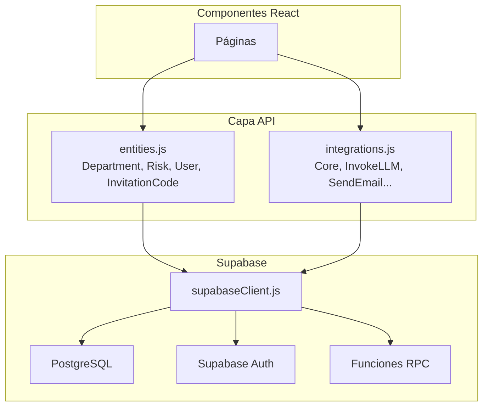

# 🔌 API y Entidades

## Arquitectura de la Capa de Datos

La capa de acceso a datos se organiza en tres archivos:

| Archivo                     | Propósito                                                |
| --------------------------- | -------------------------------------------------------- |
| `src/api/supabaseClient.js` | Inicialización del cliente Supabase                      |
| `src/api/entities.js`       | Modelos de datos: Department, Risk, User, InvitationCode |
| `src/api/integrations.js`   | Integraciones externas (LLM, Email, etc.)                |



---

## Cliente Supabase

### `src/api/supabaseClient.js`

```javascript
import { createClient } from "@supabase/supabase-js";

const supabaseUrl = import.meta.env.VITE_SUPABASE_URL;
const supabaseAnonKey = import.meta.env.VITE_SUPABASE_ANON_KEY;

export const supabase = createClient(supabaseUrl, supabaseAnonKey);
```

---

## Entidades

### `Department`

Gestión de departamentos organizacionales.

| Método   | Firma                     | Descripción                                                    |
| -------- | ------------------------- | -------------------------------------------------------------- |
| `list`   | `list(order?)`            | Lista departamentos, ordenados por `order` o `created_at` desc |
| `filter` | `filter(filters, order?)` | Filtra departamentos por objeto de condiciones                 |
| `get`    | `get(id)`                 | Obtiene un departamento por ID                                 |
| `create` | `create(data)`            | Crea un nuevo departamento                                     |
| `update` | `update(id, data)`        | Actualiza un departamento existente                            |
| `delete` | `delete(id)`              | Elimina un departamento por ID                                 |

**Ejemplo de uso:**

```javascript
import { Department } from "@/api/entities";

// Listar todos
const departments = await Department.list("-created_date");

// Filtrar
const filtered = await Department.filter({ id: "uuid-123" });

// Crear
await Department.create({ name: "Finanzas", description: "..." });

// Actualizar
await Department.update("uuid-123", { name: "Finanzas Actualizadas" });

// Eliminar
await Department.delete("uuid-123");
```

### `Risk`

Gestión de riesgos por departamento.

| Método   | Firma                     | Descripción                    |
| -------- | ------------------------- | ------------------------------ |
| `list`   | `list(order?)`            | Lista todos los riesgos        |
| `filter` | `filter(filters, order?)` | Filtra riesgos por condiciones |
| `get`    | `get(id)`                 | Obtiene un riesgo por ID       |
| `create` | `create(data)`            | Crea un nuevo riesgo           |
| `update` | `update(id, data)`        | Actualiza un riesgo existente  |
| `delete` | `delete(id)`              | Elimina un riesgo por ID       |

**Campos del objeto Risk:**

```javascript
{
    department_id: 'uuid',
    threat_type: 'Interna' | 'Externa',
    description: 'Descripción del riesgo',
    inherent_probability: 'Remoto (0-20%)' | ... ,
    inherent_impact: 'Insignificante' | ... ,
    inherent_level: 'Tolerable' | 'Bajo' | 'Medio' | 'Alto' | 'Intolerable',
    risk_strategy: 'Aceptar' | 'Reducir' | 'Transferir',
    mitigant_1: 'Descripción mitigante',
    mitigant_impact_1: 'Mitiga la probabilidad' | ... ,
    mitigant_2: '...',
    mitigant_impact_2: '...',
    mitigant_3: '...',
    mitigant_impact_3: '...',
    residual_probability: '...',
    residual_impact: '...',
    residual_level: '...',
    created_by_id: 'uuid'
}
```

### Riesgos críticos en la planeación (Fase 2)

La integración riesgos → plan no agrega entidades: usa estos métodos existentes de `entities.js` y la carga unificada de `src/api/strategyInputs.js`.

| Método                       | Firma                                            | Descripción                                                                                                                                                                                                                                                                                               |
| ---------------------------- | ------------------------------------------------ | --------------------------------------------------------------------------------------------------------------------------------------------------------------------------------------------------------------------------------------------------------------------------------------------------------- |
| `Risk.listCritical`          | `listCritical({ perspective? })`                 | Riesgos del usuario con `inherent_score >= 13`, ordenados por gravedad. **Ninguna página lo llama directamente**: solo `loadStrategyInputs`, y solo si `includeRisks` es `true` (usuario con el módulo `risk`). Ante error de permisos o columnas faltantes devuelve `[]` y avisa en consola. |
| `loadStrategyInputs`         | `loadStrategyInputs({ includeRisks, extraSections })` | Devuelve `{ plan, sections, ratings, competitors, initiatives, risks, decisions }`; `decisions = { controls, objectives }` son las secciones `risk-controls` y `risk-objectives` de `plan_answers`. Las páginas la consumen a través del hook `useStrategyInputs`.                                   |
| `Initiative.list`            | `list(planId)`                                   | Filas completas, con `source_key` y `strategy_label` (`NULL` en las manuales). El estado de la pantalla de iniciativas nace **siempre** de aquí.                                                                                                                                                       |
| `Initiative.createFromSource` | `createFromSource(planId, rows)`                | **Única vía** por la que una iniciativa nace con `source_key`. Hace `upsert` con `onConflict: "plan_id,source_key"` e `ignoreDuplicates: true`: repetir el clic no duplica ni pisa ediciones. Exige `source_key` y `strategy_id` en cada fila.                                                        |
| `Initiative.upsertMany`      | `upsertMany(planId, rows)`                       | Autosave. Manda `source_key`/`strategy_label` solo si la fila trae la propiedad (supabase-js arma las columnas con la unión de claves de todas las filas: una fila sin la propiedad se guarda con `NULL`). Por eso las filas del estado deben venir de `list()`.                                   |
| `Initiative.remove`          | `remove(id)`                                     | Borrar una iniciativa de riesgo libera su `source_key`: el control vuelve a poder convertirse (nueva fila, nuevo id).                                                                                                                                                                                 |
| `PlanAnswer.set` / `remove` / `getSection` | `set(planId, section, key, value)` · `remove(planId, section, key)` · `getSection(planId, section)` | Confirmación "Lo tengo controlado" de un riesgo aceptado (sección `risk-objectives`).                                                                                                                                                                                              |

#### Contrato de las iniciativas de riesgo (`strategic_initiatives`)

| Campo             | Valor                                                                                            | Nota                                                                                                                                                                                              |
| ----------------- | ------------------------------------------------------------------------------------------------ | ------------------------------------------------------------------------------------------------------------------------------------------------------------------------------------------------- |
| `strategy_id`     | `'risk:<risk.id>'`                                                                               | Igual que el id del objetivo de riesgo; `riskInitiativesOf` agrupa por él.                                                                                                                       |
| `source_key`      | `'risk:<risk.id>:m<n>'` (control n = 1..3) · `'risk:<risk.id>:tpl:<clave>'` (plantilla)         | Solo nace en `createFromSource`. Índice único `(plan_id, source_key)`. Las iniciativas manuales llevan `NULL`.                                                                                     |
| `strategy_label`  | Descripción del riesgo                                                                           | Sobrevive si el riesgo deja de ser crítico o se borra: título del grupo en "Otras iniciativas", en el Excel y en el Score Card. Las manuales creadas bajo un objetivo de riesgo también lo llevan. |
| `title`           | Texto del control o de la plantilla                                                              | Editable.                                                                                                                                                                                          |
| `expected_result` | Plantilla → su texto; control → "Bajar el riesgo a nivel Medio o menor" (o el de Aceptar)        | Editable.                                                                                                                                                                                          |
| `area`            | Nombre de la perspectiva (`'Finanzas'`, `'Clientes'`, …) o `NULL`                                | Editable.                                                                                                                                                                                          |
| `owner`           | `NULL`                                                                                           | La matriz no guarda el nombre del responsable (solo Sí/No); el usuario lo escribe y mientras tanto sale el aviso `no-owner`.                                                                       |
| `start_date`      | Hoy (`localISODate()`, hora local)                                                               |                                                                                                                                                                                                    |
| `end_date`        | Hoy + 30 (Intolerable) · hoy + 60 (Alto)                                                         | Sugerencia; si el usuario la aleja más de 60 / 120 días sale el aviso `far`.                                                                                                                      |
| `budget`, `kpi`, `steps` | `NULL` (`kpi`: el de la plantilla si viene de plantilla)                                  |                                                                                                                                                                                                    |
| `position`        | `initiatives.length` al crear                                                                    | `upsertMany` lo reescribe con el índice en cada autosave.                                                                                                                                         |

#### `plan_answers` sección `risk-objectives` (`RISK_OBJECTIVES_SECTION`)

| `question_key`           | `answer`                           | Significado                                                                                                                                   | Escribe                                                                 | Borra                                                       |
| ------------------------ | ---------------------------------- | --------------------------------------------------------------------------------------------------------------------------------------------- | ----------------------------------------------------------------------- | ----------------------------------------------------------- |
| `<risk.id>` (uuid tal cual) | `'acknowledged'` (`RISK_ACKNOWLEDGED`) | El usuario confirmó "Lo tengo controlado" para un riesgo crítico **Aceptar**. Sale de las alertas, no del plan.                             | `PlanAnswer.set(planId, RISK_OBJECTIVES_SECTION, riskId, RISK_ACKNOWLEDGED)` | `PlanAnswer.remove(planId, RISK_OBJECTIVES_SECTION, riskId)` |

Cualquier otro valor se trata como no confirmado. Si el riesgo cambia a Reducir/Transferir la fila queda sin efecto (no se borra; `accepted` manda). Si deja de ser crítico, queda huérfana sin efecto.

#### `plan_answers` sección `risk-controls` (`RISK_CONTROLS_SECTION`)

**Reservada: no se usa en la Fase 2.** La fuente de verdad de "este control ya es iniciativa" es `strategic_initiatives.source_key`. No escribir nada en esa sección.

#### Patrón "anexar, no reemplazar" tras `createFromSource`

`useAutosave.flush()` retorna de inmediato si hay un guardado en vuelo (no lo espera), así que reemplazar el estado con el resultado de `list()` pisaría lo que el usuario está tecleando. Al convertir un control o plantilla:

```javascript
await flush();                                              // mejor esfuerzo
await Initiative.createFromSource(planId, [row]);           // idempotente por (plan_id, source_key)
const created = (await Initiative.list(planId)).find((r) => r.source_key === key);
setInitiatives((prev) =>
  prev.some((p) => p.id === created.id) ? prev : [...prev, toFormRow(created)]   // anexar, nunca reemplazar
);
```

Nunca `setInitiatives(rows)` ni `rebase` del autosave. El autosave detecta la fila nueva y hace su `upsertMany` normal, que conserva `source_key`/`strategy_label` porque la fila viene de `list()`.

### `User`

Interacción con el usuario autenticado.

| Método       | Firma                | Descripción                                                                                 |
| ------------ | -------------------- | ------------------------------------------------------------------------------------------- |
| `me`         | `me()`               | Retorna el usuario autenticado actual                                                       |
| `list`       | `list()`             | Lista todos los usuarios (solo admin). Ver [09 - Suspensión](./09-SUSPENSION-DE-CUENTAS.md) |
| `suspend`    | `suspend(userId)`    | Suspende una cuenta (solo admin). Ver [09 - Suspensión](./09-SUSPENSION-DE-CUENTAS.md)      |
| `reactivate` | `reactivate(userId)` | Reactiva una cuenta (solo admin). Ver [09 - Suspensión](./09-SUSPENSION-DE-CUENTAS.md)      |

**Retorno de `User.me()`:**

```javascript
{
    id: 'uuid',
    email: 'user@example.com',
    user_metadata: {
        full_name: 'Nombre',
        role: 'admin' | 'user'
    },
    raw_user_meta_data: {
        full_name: 'Nombre',
        role: 'admin' | 'user'
    }
}
```

### `InvitationCode`

Gestión de códigos de invitación (requiere rol admin para la mayoría de operaciones).

| Método     | Firma                    | Descripción                                       |
| ---------- | ------------------------ | ------------------------------------------------- |
| `list`     | `list(order?)`           | Lista todos los códigos                           |
| `get`      | `get(id)`                | Obtiene un código por ID                          |
| `create`   | `create(data)`           | Crea un nuevo código de invitación                |
| `delete`   | `delete(id)`             | Elimina un código                                 |
| `stats`    | `stats()`                | Retorna estadísticas (total, usados, disponibles) |
| `validate` | `validate(code, email)`  | Valida un código via RPC                          |
| `markUsed` | `markUsed(code, userId)` | Marca un código como usado via RPC                |

**Estadísticas (`InvitationCode.stats()`):**

```javascript
{
    total: 15,      // Total de códigos generados
    used: 8,        // Códigos ya utilizados
    available: 7    // Códigos disponibles
}
```

---

## Operaciones Comunes

### Patrón de ordenamiento

El parámetro `order` usa el formato:

- `"created_date"` → ascendente por fecha de creación
- `"-created_date"` → descendente (más recientes primero)

```javascript
// El prefijo "-" indica orden descendente
const risks = await Risk.list("-created_date");
```

### Patrón de filtros

```javascript
// Filtra por un campo
const deptRisks = await Risk.filter({ department_id: "uuid-123" });

// Múltiples filtros (AND)
const filtered = await Risk.filter({
  department_id: "uuid-123",
  threat_type: "Interna",
});
```

### Manejo de errores

Los métodos de las entidades lanzan excepciones en caso de error. Los componentes deben usar `try/catch`:

```javascript
try {
  await Risk.create(riskData);
  navigate("/allrisks");
} catch (error) {
  console.error("Error:", error);
  setError(t("errorCreatingRisk"));
}
```

---

## Integraciones (`src/api/integrations.js`)

Se exportan las siguientes integraciones de Supabase, que están disponibles pero **no se utilizan activamente** en el código actual:

| Integración                   | Propósito                          |
| ----------------------------- | ---------------------------------- |
| `Core`                        | Acceso directo al cliente Supabase |
| `InvokeLLM`                   | Invocación de modelos de lenguaje  |
| `SendEmail`                   | Envío de correos electrónicos      |
| `UploadFile`                  | Subida de archivos al storage      |
| `GenerateImage`               | Generación de imágenes             |
| `ExtractDataFromUploadedFile` | Extracción de datos de archivos    |
| `CreateFileSignedUrl`         | Creación de URLs firmadas          |
| `UploadPrivateFile`           | Subida de archivos privados        |

> **Nota:** Estas integraciones están disponibles como wrappers para futuras funcionalidades pero no están implementadas en la versión actual de la aplicación.

---

**Navegación:**
← [06 - Internacionalización](./06-INTERNACIONALIZACION.md) | [08 - Despliegue](./08-DESPLIEGUE.md) →
